# Rule 1 - 類別變更狀態必須依程式碼現況判定

- 類別圖中的每個類別必須恰好判定一種變更狀態：新增、修改、刪除或既有。
- 「程式碼現況」中不存在、本次要建立的類別，必須判定為新增。
- 「程式碼現況」中存在、本次新增、修改或移除其成員或行為的類別，必須判定為修改。
- 「程式碼現況」中存在、本次要刪除的類別，必須判定為刪除。
- 「程式碼現況」中存在、本次不修改、只為呈現協作關係而放入圖中的類別，必須判定為既有。
- 不得把「程式碼現況」中已存在的類別判定為新增，也不得把不存在的類別判定為修改、刪除或既有。

## Good Example

- 需求：課程報名系統要支援折扣碼，報名時套用折扣；價格改由折扣碼計算後，手動價格表 `ManualPriceTable` 不再使用。每個類別的判定都對得上「程式碼現況」與本次變動。

| 類別 | 程式碼現況 | 本次變動 | 判定 |
| ---- | ---------- | -------- | ---- |
| `CouponValidator` | 不存在 | 建立，驗證折扣碼 | 新增 |
| `EnrollmentService` | 存在 | `enroll` 改為套用折扣 | 修改 |
| `ManualPriceTable` | 存在 | 刪除 | 刪除 |
| `PaymentClient` | 存在 | 不修改，`EnrollmentService` 照舊呼叫 | 既有 |

## Bad Example

- 同一需求中，`PaymentClient` 已存在卻判定為新增；`EnrollmentService` 的 `enroll` 行為改變，卻判定為既有。

| 類別 | 程式碼現況 | 本次變動 | 判定 |
| ---- | ---------- | -------- | ---- |
| `CouponValidator` | 不存在 | 建立，驗證折扣碼 | 新增 |
| `EnrollmentService` | 存在 | `enroll` 改為套用折扣 | 既有 |
| `ManualPriceTable` | 存在 | 刪除 | 刪除 |
| `PaymentClient` | 存在 | 不修改 | 新增 |

# Rule 2 - 成員與關係的變更標記必須對應本次變動

- 修改類別中本次新增的成員，必須在成員結尾標 `«new»`。
- 修改類別中本次修改簽章或行為的成員，必須在成員結尾標 `«changed»`。
- 修改類別中本次移除的成員，必須在成員結尾標 `«removed»`。
- 修改類別中未變動的成員，以及新增類別與刪除類別的成員，不得加變更標記。
- 本次新增的關係必須在關係標籤結尾標 `«new»`；本次移除的關係必須在關係標籤結尾標 `«removed»`。
- 關係的新增或移除，必須依「程式碼現況」中兩類別之間是否已有依賴判定；已有依賴、本次只多了用途的關係不得標 `«new»`。
- 兩端都是新增類別的關係，以及未變動的關係，不得加變更標記。

## Good Example

### Example 1

- 同一個折扣碼需求：`enroll` 行為改變標 `«changed»`，新方法標 `«new»`；`EnrollmentService` 到 `ManualPriceTable` 的關係要移除，標 `«removed»`；到 `CouponValidator` 的關係是本次新增，標 `«new»`；兩端都是新類別的實作關係與未變動的付款關係都沒有標記。

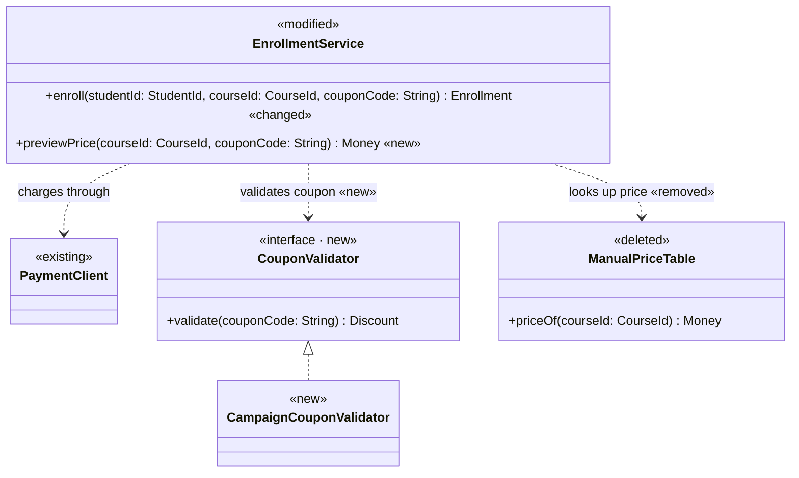

### Example 2

- 需求：課程報名系統要支援退款。「程式碼現況」中 `EnrollmentService` 已經透過 `PaymentClient` 收款，本次只多了退款用途，因此關係標籤改寫為 `charges and refunds through`，不標 `«new»`；新增的 `refund` 成員標在修改類別上。

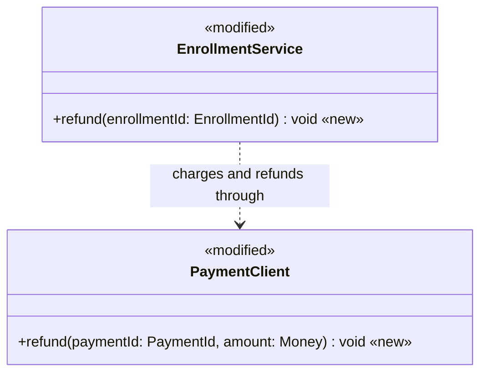

## Bad Example

### Example 1

- 同一情境中，新類別 `CouponValidator` 的成員被標 `«new»`；要移除的 `ManualPriceTable` 關係沒有標 `«removed»`，看不出這條依賴會消失；未變動的付款關係卻被標 `«new»`。

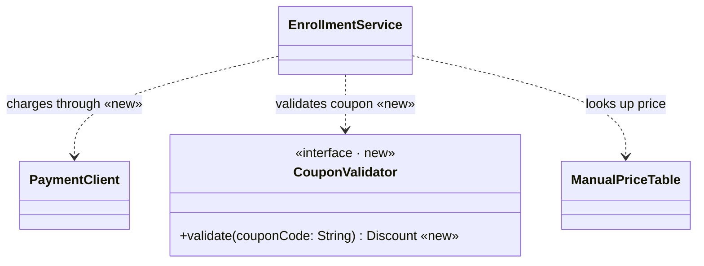

### Example 2

- 同一個退款需求中，`EnrollmentService` 與 `PaymentClient` 之間原本就有收款依賴，關係卻被標 `«new»`，讀者會誤以為這條依賴是本次才建立。

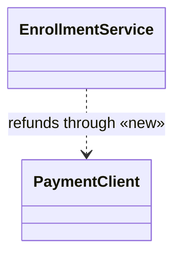

# Rule 3 - 類別圖只納入本次變更範圍

- 類別圖必須納入所有判定為新增、修改或刪除的類別。
- 既有類別只有在與新增、修改或刪除的類別有直接關係時，才可以納入類別圖。
- 與新增、修改或刪除的類別沒有直接關係的既有類別，不得納入類別圖。
- 每個類別必須只列出本次新增、修改或移除的成員，以及說明協作所需的公開成員。
- 不得列出私有欄位、getter／setter 等存取器，以及測試類別。
- 類別圖不得列出建構子；建構子參數的增減，必須以關係的 `«new»`、`«removed»` 表達。

## Good Example

- 同一個折扣碼需求：圖中只有變更的類別與直接被 `EnrollmentService` 使用的 `PaymentClient`；與報名無關的 `AttendanceExporter` 不在圖中；`EnrollmentService` 只列出本次變動的兩個方法。

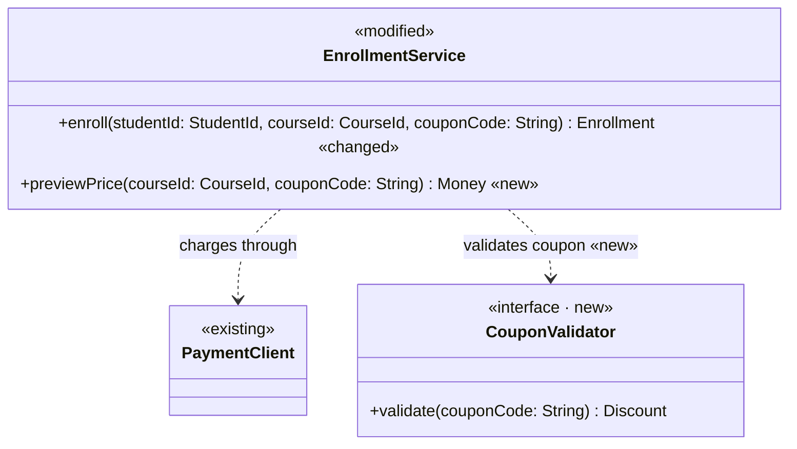

## Bad Example

- 同一情境中，圖裡多了與本次變更無關的 `AttendanceExporter`，`EnrollmentService` 列出私有欄位、getter 與建構子（建構子新增的 `CouponValidator` 參數已由關係的 `«new»` 表達），還畫出測試類別，本次的設計重點被雜訊蓋過。

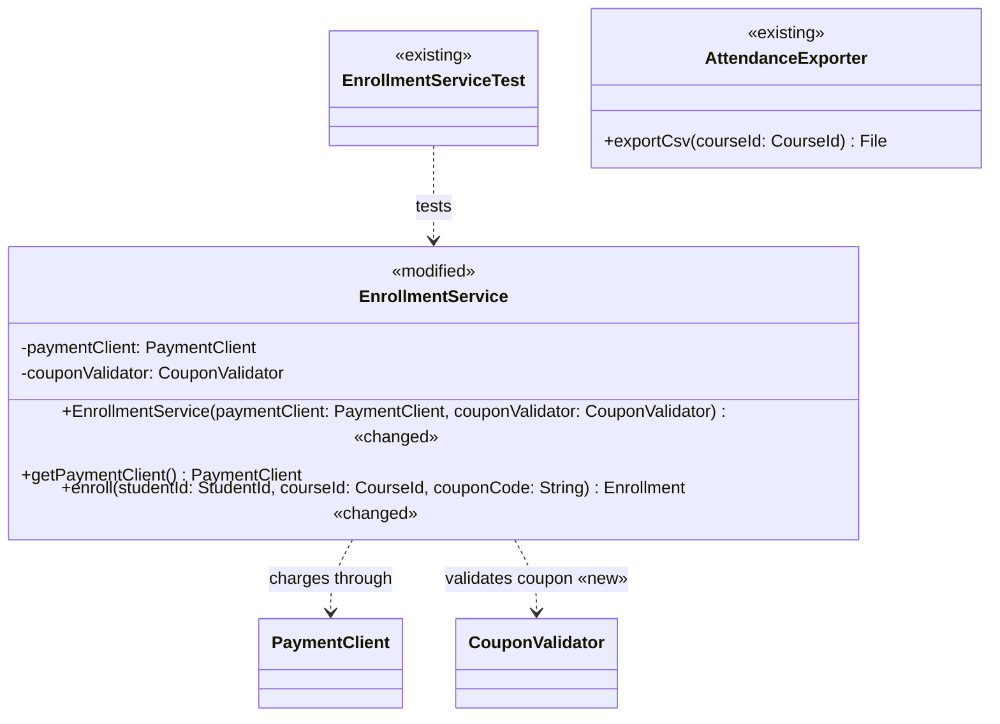

# Rule 4 - 設計說明與實作順序必須與類別圖對應

- 設計說明必須為類別圖中的每個類別各寫一項，並在類別名稱後註明變更狀態。
- 設計說明與實作順序不得提到類別圖中沒有的專案類別。
- 語言內建型別、標準函式庫的例外與測試檔，可以出現在設計說明與實作順序。
- 實作順序必須先建立被依賴的新類別，再修改依賴它們的類別。
- 刪除類別必須排在所有依賴它的類別改寫完成之後。

## Good Example

- 同一個折扣碼需求：設計說明涵蓋圖中五個類別並註明狀態，提到的標準例外 `IllegalArgumentException` 與測試檔 `EnrollmentServiceTest.java` 不是專案類別，可以出現；先建立 `CouponValidator`，再改 `EnrollmentService`，最後刪除已無依賴者的 `ManualPriceTable`。

```markdown
## 設計說明

- `CouponValidator`（新增）：驗證折扣碼並回傳折扣內容的契約。
- `CampaignCouponValidator`（新增）：依行銷活動設定實作 `CouponValidator`。
- `EnrollmentService`（修改）：`enroll` 改為先透過 `CouponValidator` 計算折扣，折扣碼無效時拋出 `IllegalArgumentException`；新增 `previewPrice` 供報名前試算。
- `ManualPriceTable`（刪除）：價格改由折扣計算取得，`EnrollmentService` 改寫後已沒有依賴者。
- `PaymentClient`（既有）：付款元件，本次不修改。

## 實作順序

1. 建立 `CouponValidator` 契約，再建立實作 `CampaignCouponValidator`。
2. 修改 `EnrollmentService`：`enroll` 改用 `CouponValidator`，並新增 `previewPrice`。
3. 刪除已沒有依賴者的 `ManualPriceTable`。
4. 在測試檔 `EnrollmentServiceTest.java` 補上有效與無效折扣碼的測試。
```

## Bad Example

- 同一情境中，設計說明漏掉 `CampaignCouponValidator` 與 `PaymentClient`，卻提到圖中沒有的專案類別 `DiscountCache`；實作順序先刪除 `ManualPriceTable`，此時 `EnrollmentService` 仍依賴它。

```markdown
## 設計說明

- `CouponValidator`（新增）：驗證折扣碼並回傳折扣內容的契約。
- `EnrollmentService`（修改）：`enroll` 改為套用折扣。
- `ManualPriceTable`（刪除）：不再使用。
- `DiscountCache`：快取折扣計算結果。

## 實作順序

1. 刪除 `ManualPriceTable`。
2. 建立 `CouponValidator`。
3. 修改 `EnrollmentService`。
```

# Rule 5 - 循序圖必須呈現本次變更的呼叫流程並與類別圖一致

- 類別圖中每個標 `«new»` 或 `«changed»` 的方法，必須至少出現在一個情境的訊息中。
- 每個情境必須從呼叫端 actor 發出的第一則訊息開始，呈現一條完整的呼叫流程。
- 參與者只能是類別圖中的類別，以及一個呼叫端 actor。
- 每則呼叫訊息（`->>`）的方法必須列在類別圖中接收端類別的成員上；既有類別被呼叫的方法，依 Rule 3 以協作所需的公開成員列出。
- 「程式碼現況」中不存在、本次新增的呼叫，必須在訊息結尾標 `«new»`；未變動的呼叫不得加標記。
- 兩端都是新增類別的呼叫不得標 `«new»`；呼叫端 actor 視為既有。
- 本次移除的呼叫不得畫在循序圖中，移除由類別圖的 `«removed»` 與 `<<deleted>>` 表達。

## Good Example

### Example 1

- 折扣碼需求的報名流程：`enroll` 本身既有，呼叫不標；對新增介面 `CouponValidator` 的呼叫標 `«new»`；既有的 `PaymentClient.charge` 不標，且已列在類別圖上；已刪除的 `ManualPriceTable` 沒有出現在流程中。

類別圖片段：

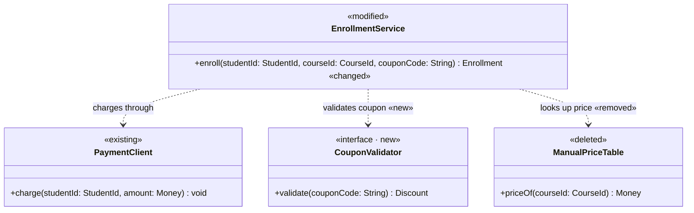

循序圖：

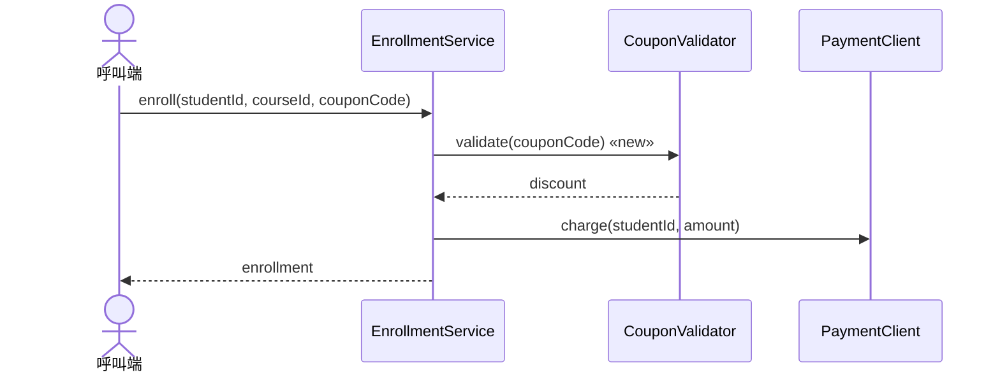

### Example 2

- 同一需求的 `previewPrice` 流程：呼叫端視為既有，呼叫新方法 `previewPrice` 標 `«new»`；既有的 `EnrollmentService` 呼叫新增類別 `CampaignCouponValidator` 標 `«new»`；`CampaignCouponValidator` 呼叫 `CampaignCatalog` 兩端都是新增類別，不標。

類別圖片段：

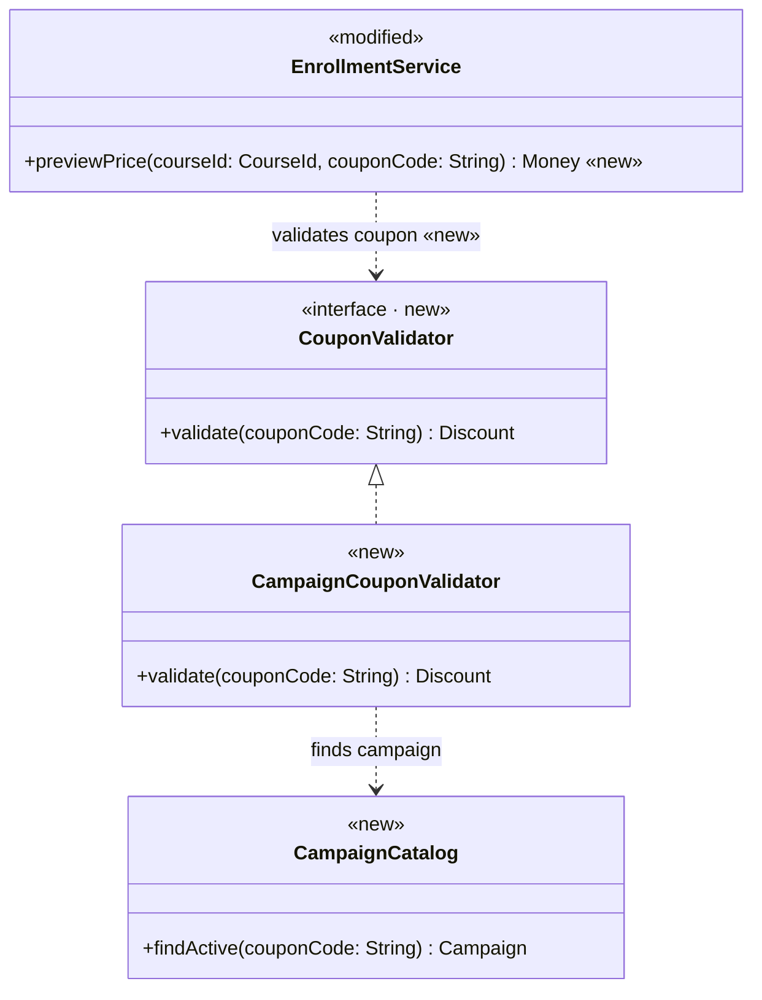

循序圖：

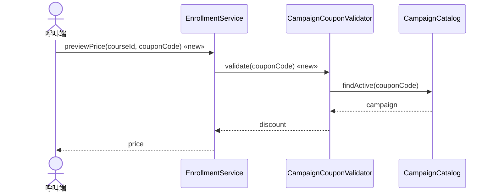

## Bad Example

### Example 1

- 同一個報名流程（類別圖片段同 Good Example 1），循序圖畫出已刪除的 `ManualPriceTable.priceOf`，讀者會以為新流程仍查手動價格表；既有的 `PaymentClient.charge` 呼叫被標 `«new»`。

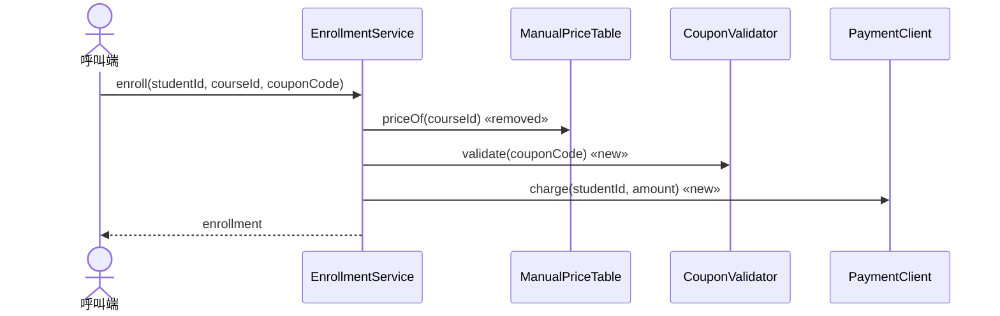

### Example 2

- 同一需求中，類別圖的 `EnrollmentService` 有 `enroll «changed»` 與 `previewPrice «new»`，`PaymentClient` 只列出 `charge`；循序圖卻呼叫 `PaymentClient` 沒有列出的 `authorize`，參與者出現類別圖中沒有的 `AuditLogger`，而 `previewPrice` 沒有出現在任何情境。

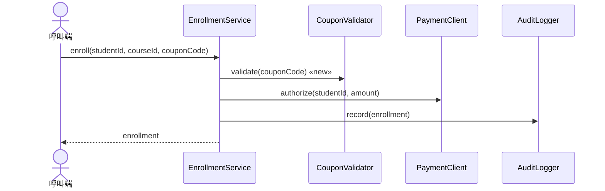
