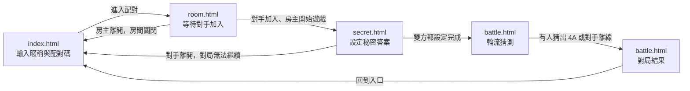

# UI 規劃：線上 PVP 1A2B 猜數字對戰平台

**Spec**: [spec.md](../spec.md) | **Plan**: [plan.md](../plan.md) | **Date**: 2026-10-29

- 負責介面：F1 進站與配對碼輸入介面、F2 房間等待與開始遊戲介面、F3 秘密答案設定介面、F4 輪流猜測與對局結果介面
- 雛形入口：[index.html](./index.html)

## 1. 畫面範疇

| 介面 | 畫面 | 需求依據 |
| ---- | ---- | -------- |
| F1 進站與配對碼輸入介面 | 進站與配對 | US1 情境 1、4；FR-001 只輸入暱稱即可進站、暱稱為空時拒絕並提示；FR-005 配對碼必須恰好四位 0–9 數字，不符時以繁體中文提示；FR-016 對局結束後回到入口重新輸入配對碼；FR-018 設定答案階段對手離開時回到入口；NFR-001 送出配對碼到看見房間低於 2 秒；SC-001 兩位新玩家 30 秒內進入同一房間；NFR-004 介面文字使用臺灣繁體中文 |
| F2 房間等待與開始遊戲介面 | 房間 | US1 情境 1、2、5；US2 情境 1–3；FR-006 顯示房內玩家暱稱並標示房主；FR-007 房主在開始前離開時關閉房間並釋出配對碼；FR-008 只有房主在房內滿兩人時可以開始遊戲；Edge Cases 等待中房主離開、配對碼被占用 |
| F3 秘密答案設定介面 | 設定秘密答案 | US2 情境 4–7；FR-009 雙方各自設定只有自己知道的秘密答案；FR-010 雙方都設定完成才進入猜測、房主先手；FR-017 答案必須是四位互不重複的數字；FR-018 設定階段有一方離開時通知另一方並回到入口、不判勝負；NFR-002 對局結束前不得看到對手答案；Edge Cases 秘密答案階段離開 |
| F4 輪流猜測與對局結果介面 | 對戰與結果 | US3 情境 1–6；FR-011 每次合法猜測回報幾 A 幾 B；FR-012 輪流制、房主先手、只有輪到的玩家可以提交；FR-013 雙方畫面顯示所有猜測紀錄與 A／B；FR-014 猜出 4A 立即結束、宣告勝者並揭曉雙方答案；FR-015 猜測階段一方離開或斷線時判另一方獲勝；FR-016 結束後可以回到入口；FR-017 猜測必須是四位互不重複的數字；NFR-002 結束前不得看到對手答案；NFR-003 對手畫面 1 秒內更新；Edge Cases 重複猜同一組數字 |

不在範疇：

- 註冊、登入、個人戰績與排行榜：FR-001 只要求輸入暱稱，且不得保存跨連線的戰績。
- 斷線重連與重新整理後回到原對局：spec 的 Assumptions 寫明第一版不支援斷線重連，畫面不提供「重新連線」。
- 觀戰與「再來一局」：spec 的 Assumptions 寫明不提供，對局結束後只提供「回到入口」（FR-016）。
- 出手倒數計時：spec 的 Assumptions 寫明不限制單次出手時間，畫面不顯示計時器。
- 房間已滿、遊戲尚未開始時對手離開的畫面：spec 沒有涵蓋，雛形不規劃，待 spec 補充後再設計。
- 配對比對、A／B 判定與輪次控制：由 B2 房間配對與離開 API、B3 對局進行 API 負責；雛形以假資料模擬結果。
- 對手加入、對手設定完成、對手猜測與對手離線的即時通知：由 B4 房間與對局即時推播負責；雛形以計時器模擬對手動作。
- 聊天與表情互動：spec 沒有涵蓋。

## 2. 視覺風格

- 氣質：輕鬆休閒的派對小遊戲，圓角卡片、明亮色塊與親切口語，像跟朋友約好一起玩的手機小遊戲，不走電競的緊張感。
- 配色：

  | 用途 | 色碼 |
  | ---- | ---- |
  | 背景 | `#F3F2FF` 淡薰衣草 |
  | 卡片 | `#FFFFFF` |
  | 主色（主要按鈕、目前階段、品牌字、房主標記） | `#5B5BD6` 藍紫 |
  | 強調（輪到你、A 數、勝利、配對碼底塊） | `#FFC83D` 暖黃 |
  | 文字 | `#24224A` |
  | 次要文字 | `#6D6A92` |
  | 錯誤 | `#D2454B` |
  | 等待中 | `#A0710B` |
  | 成功 | `#2B9468` |

- 字體：系統無襯線中文字體（PingFang TC、Noto Sans TC、微軟正黑體）；配對碼、秘密答案、猜測數字與 A／B 結果使用等寬字體（SF Mono、Menlo、Consolas）搭配等寬數字。
- 版面：內容最大寬度 720px，手機寬度 360px 仍可完整操作；卡片圓角 16px；主要按鈕為藍紫實心膠囊形，輪到自己時的提示條與勝利卡使用暖黃；玩家以暱稱首字的圓形頭像表示；四位數字以四個等寬方格呈現。

## 3. 畫面與流程

### 3.1 頁面清單

| 檔案 | 畫面 | 介面 | 進入方式 |
| ---- | ---- | ---- | -------- |
| `index.html` | 進站與配對 | F1 | 雛形入口；頁首「進站」；對局結束或中斷後的「回到入口」 |
| `room.html` | 房間 | F2 | 進站與配對送出後配對成功；頁首「房間」 |
| `secret.html` | 設定秘密答案 | F3 | 房主按「開始遊戲」；頁首「設定答案」 |
| `battle.html` | 對戰與結果 | F4 | 雙方都設定完成後自動進入；頁首「對戰」 |

### 3.2 流程

### 3.3 使用者操作

| 編號 | 畫面 | 操作 | 需求依據 |
| ---- | ---- | ---- | -------- |
| A1 | `index.html` | 輸入暱稱（1–12 字）與 4 位數字配對碼 | FR-001、FR-005 |
| A2 | `index.html` | 按「進入配對」，配對成功後進入房間 | FR-002、FR-003、FR-004、NFR-001、SC-001 |
| A3 | `room.html` | 查看房內玩家暱稱與房主標記，等待對手加入 | FR-006、US1 |
| A4 | `room.html` | 房主按「開始遊戲」 | FR-008 |
| A5 | `room.html` | 按「離開房間」並在確認視窗按「離開」 | FR-007 |
| A6 | `secret.html` | 輸入 4 位不重複數字作為秘密答案並送出 | FR-009、FR-017 |
| A7 | `secret.html` | 送出後等待對手完成設定，雙方完成後自動進入對戰 | FR-010 |
| A8 | `secret.html` | 按「離開房間」並在確認視窗按「離開」 | FR-018 |
| A9 | `battle.html` | 輪到自己時輸入 4 位不重複數字並按「送出猜測」 | FR-011、FR-012、FR-017 |
| A10 | `battle.html` | 查看雙方猜測紀錄與 A／B 結果，等待對手猜測 | FR-013、NFR-003 |
| A11 | `battle.html` | 對戰中按「離開對局」並在確認視窗按「離開」 | FR-015 |
| A12 | `battle.html` | 對局結束後查看勝負與雙方答案，按「回到入口」 | FR-014、FR-016 |

## 4. 狀態

每個雛形頁面右下角的「雛形狀態」面板可切換本節列出的該頁狀態。

| 畫面 | 狀態 | 呈現方式 | 需求依據 |
| ---- | ---- | -------- | -------- |
| `index.html` | 填寫暱稱與配對碼 | 暱稱欄與 4 位配對碼欄皆空白，下方說明「跟朋友輸入同一組配對碼，就會進到同一間房」 | FR-001、FR-005 |
| `index.html` | 配對中 | 暱稱「阿哲」、配對碼「5208」已填入，欄位停用，按鈕改為「配對中…」並顯示轉圈 | NFR-001 |
| `index.html` | 對局結束後回到入口 | 暱稱欄已帶入「阿哲」，配對碼空白，頁頂提示「上一局已結束，輸入配對碼開始新的一局」 | FR-016 |
| `index.html` | 對手離開後回到入口 | 暱稱欄已帶入「阿哲」，頁頂黃色提示「小米 離開了房間，這局無法繼續，不判定勝負」 | FR-018；Edge Cases 秘密答案階段離開 |
| `room.html` | 等待對手加入 | 頁頂顯示配對碼 5208；玩家區只有「阿哲（房主）」與一個虛線空位「等待對手加入…」；空位旁顯示轉圈 | US1 情境 1；FR-003、FR-006；Edge Cases 配對碼被占用 |
| `room.html` | 對手已加入 | 玩家區顯示「阿哲（房主）」與「小米」，提示「小米 加入了房間」，「開始遊戲」按鈕可按 | US1 情境 2；FR-002、FR-006、FR-008 |
| `room.html` | 以對手身分檢視 | 頁首暱稱為「小米」；玩家區顯示「阿哲（房主）」與「小米（你）」，沒有「開始遊戲」按鈕，改顯示「等房主 阿哲 開始遊戲」 | US2 情境 2；FR-008 |
| `room.html` | 開始遊戲中 | 「開始遊戲」按鈕改為「開始中…」並停用 | US2 情境 3；FR-008 |
| `room.html` | 確認離開房間 | 確認視窗「確定要離開嗎？你是房主，離開後房間會關閉，配對碼 5208 會開放給其他人使用」與「留在房間」「離開」 | FR-007；Edge Cases 等待中房主離開 |
| `secret.html` | 設定秘密答案 | 4 格答案輸入欄空白，說明「設定 4 個不重複的數字，可以 0 開頭，只有你看得到」；對手狀態「小米 設定中…」 | FR-009、FR-017 |
| `secret.html` | 送出答案中 | 答案「7310」已填入並停用，按鈕改為「送出中…」 | FR-009 |
| `secret.html` | 對手先完成設定 | 答案欄空白，對手狀態改為綠色「小米 已設定好答案」，提示「小米 已經準備好了，換你設定」 | FR-010 |
| `secret.html` | 等待對手設定答案 | 輸入區換成「你的答案 7310」與鎖頭圖示；對手狀態「小米 設定中…」並轉圈，提示「等待對手設定答案」 | US2 情境 5；FR-010 |
| `secret.html` | 雙方設定完成 | 雙方狀態都是「已設定」，黃色提示條「雙方都準備好了！阿哲 先猜」，之後自動進入對戰 | US2 情境 6；FR-010 |
| `secret.html` | 確認離開房間 | 確認視窗「確定要離開嗎？離開後這局會取消，不判定勝負」與「留下來」「離開」 | FR-018 |
| `battle.html` | 尚無猜測紀錄 | 回合 1，黃色提示條「輪到你猜！」，紀錄區顯示「還沒有人猜，阿哲 先手」 | US2 情境 6；FR-012 |
| `battle.html` | 輪到你猜 | 回合 5，黃色提示條「輪到你猜！」，猜測欄可輸入；紀錄區 4 筆（阿哲 1234 0A1B、小米 5678 0A1B、阿哲 4059 2A1B、小米 7013 2A2B）；上方顯示「你的答案 7310」與「小米 的答案 ● ● ● ●」 | FR-012、FR-013；NFR-002 |
| `battle.html` | 送出猜測中 | 猜測欄「4096」停用，按鈕改為「送出中…」 | FR-011 |
| `battle.html` | 輪到對手猜 | 提示條改為淡紫「小米 正在猜…」並轉圈，猜測欄與按鈕停用，按鈕文字「等待 小米 猜測」 | US3 情境 2；FR-012、NFR-003 |
| `battle.html` | 你獲勝 | 黃色結果卡「你贏了！第 5 手猜中 小米 的答案」，揭曉「阿哲 7310」「小米 4096」，紀錄最後一筆「阿哲 4096 4A0B」標示勝利，按鈕「回到入口」 | US3 情境 5；FR-014、FR-016 |
| `battle.html` | 對手獲勝 | 淡紫結果卡「小米 獲勝」與「小米 在第 6 手猜中你的答案」，揭曉雙方答案，紀錄最後一筆「小米 7310 4A0B」，按鈕「回到入口」 | US3 情境 5；FR-014、FR-016 |
| `battle.html` | 確認離開對局 | 確認視窗「確定要離開嗎？對戰中離開，這局會直接判 小米 獲勝」與「繼續對戰」「離開」 | FR-015 |

## 5. 驗證與錯誤回饋

錯誤狀態同樣可從「雛形狀態」面板切換；同一畫面的多個欄位驗證錯誤合併為一個狀態「欄位驗證錯誤」。

| 畫面 | 情境 | 觸發條件 | 畫面回饋 | 需求依據 |
| ---- | ---- | -------- | -------- | -------- |
| `index.html` | 暱稱空白 | 暱稱空白或只輸入空格「   」時按「進入配對」 | 暱稱欄紅框，欄位下方顯示「請輸入暱稱，最多 12 個字」，不送出 | FR-001 |
| `index.html` | 配對碼含非數字 | 配對碼輸入「12a」 | 配對碼欄紅框，欄位下方顯示「配對碼要是 4 位數字（0–9），例如 5208」，不建立也不加入房間 | US1 情境 4；FR-005 |
| `index.html` | 配對碼少於四位 | 配對碼輸入「123」 | 配對碼欄紅框，欄位下方顯示「配對碼要是 4 位數字（0–9），例如 5208」，不建立也不加入房間 | US1 情境 4；FR-005 |
| `room.html` | 配對碼已被占用 | 輸入 5208 時，原本配對碼 5208 的房間已有兩人或已開始對局 | 不顯示錯誤，照常進到新房間：頁頂配對碼 5208、狀態「等待對手加入」，自己標示為房主 | FR-004；Edge Cases 配對碼被占用 |
| `room.html` | 對手尚未加入就開始 | 房內只有阿哲時按「開始遊戲」 | 按鈕下方黃色提示「還沒有對手加入，等對手進房後才能開始遊戲」，畫面維持等待對手加入 | US2 情境 1；FR-008 |
| `room.html` | 非房主沒有開始功能 | 以小米（對手）身分檢視房間 | 不顯示「開始遊戲」按鈕，改顯示「等房主 阿哲 開始遊戲」 | US2 情境 2；FR-008 |
| `room.html` | 房主在等待中離開 | 阿哲在「等待對手加入」時按「離開房間」再按「離開」 | 回到入口，配對碼欄清空；房間關閉，之後輸入 5208 的人會開新房間 | US1 情境 5；FR-007；Edge Cases 等待中房主離開 |
| `secret.html` | 答案有重複數字 | 答案輸入「1123」 | 答案欄紅框，下方顯示「答案要是 4 個不重複的數字，1 重複了」，不送出 | US2 情境 4；FR-017 |
| `secret.html` | 答案少於四位或含非數字 | 答案輸入「73」或「7a10」 | 答案欄紅框，下方顯示「答案要是 4 位數字（0–9）」，不送出 | FR-017 |
| `secret.html` | 對手在設定階段離開 | 阿哲已送出答案、小米離開房間 | 彈出視窗「小米 離開了房間，這局無法繼續，不判定勝負」與「回到入口」；按下後回到入口並顯示同一句提示 | US2 情境 7；FR-018；Edge Cases 秘密答案階段離開 |
| `battle.html` | 猜測有重複數字 | 猜測輸入「4409」 | 猜測欄紅框，下方顯示「猜測要是 4 個不重複的數字，4 重複了」，仍是「輪到你猜！」 | US3 情境 4；FR-017 |
| `battle.html` | 猜測少於四位或含非數字 | 猜測輸入「40」或「40a6」 | 猜測欄紅框，下方顯示「猜測要是 4 位數字（0–9）」，仍是「輪到你猜！」 | FR-017 |
| `battle.html` | 還沒輪到你 | 輪到小米時送出猜測「4096」（例如網路延遲時按下） | 猜測欄上方紅色提示「還沒輪到你，這次猜測沒有送出，請等 小米 猜完」，紀錄不新增 | US3 情境 3；FR-012 |
| `battle.html` | 重複猜同一組數字 | 第 5 手再次猜「1234」（第 1 手已猜過） | 照常記入紀錄「阿哲 1234 0A1B」，紀錄旁加註灰色小字「猜過了」，輪次交給小米 | Edge Cases 重複猜同一組數字 |
| `battle.html` | 對手離線 | 對戰中小米關閉分頁或斷線 | 黃色結果卡「你贏了！小米 已離開對局」，揭曉雙方答案，按鈕「回到入口」 | US3 情境 6；FR-015 |
