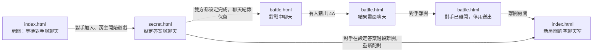

# UI 規劃：1A2B 房間與對局聊天 (Room and Game Chat)

**Spec**: [spec.md](../spec.md) | **Plan**: [plan.md](../plan.md) | **Date**: 2026-11-04

- 負責介面：F1 聊天訊息送出與顯示介面、F2 聊天區展開收合與未讀數量介面、F3 對手靜音設定介面
- 雛形入口：[index.html](./index.html)

## 1. 畫面範疇

| 介面 | 畫面 | 需求依據 |
| ---- | ---- | -------- |
| F1 聊天訊息送出與顯示介面 | 聊天區的訊息清單與輸入框（房間、設定答案、對戰與結果三個畫面共用同一個聊天區） | US1 情境 1–13、16–18；FR-001 送出文字訊息（含 emoji）並顯示發送者暱稱；FR-002 四個階段共用一個聊天室、結果畫面仍可聊天；FR-003 加入者看到房主先前的訊息；FR-004 空白與超過 100 個字時提示並不送出；FR-005 10 秒內已送 5 則時提示稍後再傳；FR-006 對戰中不論輪次都能聊天且不改變輪次；FR-007 對手離開時顯示「對手已離開」並停用送出；FR-008 不顯示先前房間的訊息；FR-013 雙方訊息順序相同；FR-015 沒有送達時標示「傳送失敗」並可手動重送；NFR-001 對手 1 秒內看到訊息；NFR-002 聊天區文字使用臺灣繁體中文；NFR-003 訊息以純文字呈現；SC-005 新玩家 10 秒內找到聊天區並送出第一則訊息；Edge Cases 剛好 100 個字、訊息沒有送達 |
| F2 聊天區展開收合與未讀數量介面 | 聊天區標頭的「收合」「展開」與未讀數量 | US1 情境 14–15；FR-014 收合期間對手的新訊息顯示未讀數量、展開後歸零 |
| F3 對手靜音設定介面 | 聊天區標頭的「靜音」「取消靜音」與靜音提示 | US2 情境 1–7；FR-009 靜音後不顯示對手新訊息、已顯示的保留；FR-010 被靜音者照常送出且沒有任何被靜音的提示；FR-011 取消靜音後不補顯示靜音期間的訊息；FR-012 靜音只在當次房間有效；FR-016 靜音期間不計入未讀數量；SC-004 靜音後對手新訊息出現次數為 0 |

不在範疇：

- 進站與配對、房主開始遊戲、設定秘密答案、輪流猜測與判定勝負的操作：沿用 `specs/001-online-pvp-1a2b/ui/` 的畫面；本雛形只畫出精簡的遊戲區，讓聊天區有實際的擺放位置。
- 入口畫面：設定答案階段對手離開時回到入口，由既有規格負責；雛形以「重新配對」連到新房間的空聊天室，呈現聊天紀錄不保留。
- 送出訊息、查詢本房聊天歷史與即時推播：由 B1 聊天訊息送出 API、B2 本房聊天歷史查詢 API、B3 聊天訊息即時推播負責；雛形以計時器模擬送達與對手回覆。
- 「你被靜音了」的提示：FR-010 規定不得向被靜音的玩家顯示任何提示，所以沒有這個畫面。
- 表情選單、快捷短語、圖片／語音／檔案訊息、不雅字詞過濾：spec 的 Out of Scope 由使用者決定第一版不做，輸入框只接受文字。
- 檢舉與封鎖玩家、大廳聊天、聊天紀錄保存與匯出：spec 的 Out of Scope 不提供。

## 2. 視覺風格

- 氣質：輕鬆休閒的派對小遊戲，圓角卡片、明亮色塊與親切口語，像跟朋友約好一起玩的手機小遊戲，不走電競的緊張感；聊天區像朋友間的通訊軟體對話框。
- 配色：

  | 用途 | 色碼 |
  | ---- | ---- |
  | 背景 | `#F3F2FF` 淡薰衣草 |
  | 卡片 | `#FFFFFF` |
  | 主色（主要按鈕、自己的訊息泡泡、目前頁面、品牌字、房主頭像） | `#5B5BD6` 藍紫 |
  | 強調（未讀數量、輪到誰的提示、勝利卡、配對碼底塊、加入者頭像） | `#FFC83D` 暖黃 |
  | 文字 | `#24224A` |
  | 次要文字（暱稱旁的時間、字數、系統提示） | `#6D6A92` |
  | 錯誤（傳送失敗、驗證錯誤） | `#D2454B` |
  | 等待中（傳送中、等待對手） | `#A0710B` |
  | 成功（對手已加入） | `#2B9468` |

- 字體：系統無襯線中文字體（PingFang TC、Noto Sans TC、微軟正黑體）；配對碼、秘密答案、猜測數字、字數與訊息時間使用等寬字體（SF Mono、Menlo、Consolas）搭配等寬數字。
- 版面：內容最大寬度 720px，手機寬度 360px 仍可完整操作；卡片圓角 16px；上方是精簡的遊戲區，下方是預設展開的聊天區卡片；聊天區標頭左邊是「聊天」與未讀數量，右邊是靜音與收合按鈕；自己的訊息靠右、藍紫泡泡白字，對手的訊息靠左、白底泡泡並附暱稱首字的圓形頭像；系統提示（對手已離開、靜音提示）以置中的淡色小字呈現；主要按鈕為藍紫實心膠囊形。

## 3. 畫面與流程

### 3.1 頁面清單

| 檔案 | 畫面 | 介面 | 進入方式 |
| ---- | ---- | ---- | -------- |
| `index.html` | 房間與聊天區 | F1、F2、F3 | 雛形入口；頁首「房間」；「重新配對」「離開房間」後進入新房間 |
| `secret.html` | 設定秘密答案與聊天區 | F1、F2、F3 | 房主按「開始遊戲」；頁首「設定答案」 |
| `battle.html` | 對戰、對局結果與聊天區 | F1、F2、F3 | 雙方都設定完成後自動進入；頁首「對戰」 |

### 3.2 流程

### 3.3 使用者操作

| 編號 | 畫面 | 操作 | 需求依據 |
| ---- | ---- | ---- | -------- |
| A1 | `index.html` | 在聊天輸入框輸入文字（可含 emoji），輸入框右下即時顯示「字數/100」 | FR-001、FR-004 |
| A2 | `index.html` | 按「傳送」或 Enter 送出訊息，訊息先標示「傳送中…」，送達後改為送出時間 | FR-001、FR-013、NFR-001 |
| A3 | `index.html` | 在標示「傳送失敗」的訊息按「重送」 | FR-015 |
| A4 | `index.html` | 按聊天區標頭的「收合」或「展開」，收合期間查看未讀數量 | FR-014 |
| A5 | `index.html` | 以加入者身分進房後，捲動聊天區查看房主先前送出的訊息 | FR-003 |
| A6 | `index.html` | 房主在對手加入後按「開始遊戲」，進入設定答案 | FR-002 |
| A7 | `secret.html` | 設定答案時繼續送出訊息，查看房間階段的訊息仍在 | FR-002 |
| A8 | `secret.html` | 按聊天區標頭的「靜音 小米」把對手設成靜音 | FR-009、FR-016 |
| A9 | `secret.html` | 按「取消靜音」恢復顯示對手之後的新訊息 | FR-011 |
| A10 | `battle.html` | 在對手的回合送出訊息，輪次提示維持不變 | FR-006 |
| A11 | `battle.html` | 對局結束後在結果畫面繼續聊天 | FR-002 |
| A12 | `battle.html` | 對手離開後按「離開房間」，進入新房間 | FR-007、FR-008、FR-012 |

## 4. 狀態

每個雛形頁面右下角的「雛形狀態」面板可切換本節列出的該頁狀態。

| 畫面 | 狀態 | 呈現方式 | 需求依據 |
| ---- | ---- | -------- | -------- |
| `index.html` | 載入聊天紀錄中 | 聊天區以 3 條灰色泡泡骨架顯示，輸入框停用並顯示「載入聊天紀錄中…」 | FR-003 |
| `index.html` | 空聊天室 | 阿哲獨自在配對碼 5208 的房間，聊天區中央顯示「還沒有訊息，先打聲招呼吧，對手進房後也看得到」，字數「0/100」；標頭的「靜音」停用 | FR-008、FR-012、SC-005 |
| `index.html` | 房主等待中已傳訊息 | 玩家區只有「阿哲（房主）」與虛線空位「等待對手加入…」；聊天區有阿哲 20:15 的「有人嗎」「等你喔，配對碼 5208」 | US1 情境 2；FR-001 |
| `index.html` | 加入者看到先前訊息 | 頁首暱稱為「小米」；玩家區顯示「阿哲（房主）」與「小米（你）」；聊天區靠左顯示阿哲先前的 2 則訊息，最下方提示「小米 加入了房間」 | US1 情境 2；FR-003 |
| `index.html` | 雙方在房間聊天 | 房間狀態「對手已加入」；聊天區依序顯示 5 則訊息，阿哲的靠右、小米的靠左並附暱稱；房主下方有「開始遊戲」 | US1 情境 1；FR-001、FR-013 |
| `index.html` | 訊息傳送中 | 阿哲剛送出的「準備好了嗎」泡泡轉淡，下方顯示「傳送中…」 | FR-001、NFR-001 |
| `index.html` | 傳送失敗 | 「準備好了嗎」泡泡加紅框，下方紅字「傳送失敗」與「重送」按鈕 | US1 情境 16；FR-015 |
| `index.html` | 收合且有未讀訊息 | 聊天區只剩標頭，「聊天」旁的暖黃圓點顯示「2」，按鈕為「展開」 | US1 情境 14–15；FR-014 |
| `secret.html` | 設定答案中聊天 | 遊戲區顯示阿哲的答案 7310 與「雙方都設定完成後就會開始對戰」；聊天區保留房間階段的 5 則訊息，接著是 20:17 的 2 則新訊息 | US1 情境 3；FR-002 |
| `secret.html` | 已靜音 小米 | 標頭按鈕改為「取消靜音」並標示「已靜音」；聊天區保留先前的訊息，最下方置中提示「已將 小米 靜音，之後的新訊息不會顯示」 | US2 情境 1–2；FR-009；SC-004 |
| `secret.html` | 靜音中收合聊天區 | 聊天區只剩標頭，標示「已靜音」，未讀數量不顯示（0） | US2 情境 7；FR-016 |
| `secret.html` | 已取消靜音 | 靜音提示下方接著置中提示「已取消靜音，會顯示 小米 之後的新訊息」，再接小米 20:18 的「好啦，我設定好了」；靜音期間的「你猜不到的啦」不顯示 | US2 情境 5；FR-011 |
| `secret.html` | 以被靜音的 小米 檢視 | 頁首暱稱為「小米」；小米自己的「你猜不到的啦」照常靠右顯示送出時間 20:18，畫面沒有任何靜音字樣，標頭按鈕為「靜音 阿哲」 | US2 情境 3–4；FR-010 |
| `battle.html` | 對手回合中聊天 | 遊戲區暖黃提示條「輪到 小米 猜測」，猜測輸入框停用；聊天區顯示設定答案階段以前的訊息與對戰中的 4 則訊息，輸入框可以使用 | US1 情境 4–5；FR-006 |
| `battle.html` | 對局結果畫面聊天 | 遊戲區勝利卡「阿哲 獲勝！第 4 手猜中 小米 的答案 4096」與「離開房間」；聊天區最後是小米的「好啦你贏了」與阿哲的「再來一場」 | US1 情境 6；FR-002；SC-002 |
| `battle.html` | 對手已離開 | 勝利卡上方提示「小米 離開了房間」；聊天區最後一行置中「對手已離開」，輸入框停用並顯示「對手已離開，無法再傳送訊息」，「傳送」與靜音按鈕停用 | US1 情境 11–12；FR-007 |

## 5. 驗證與錯誤回饋

錯誤狀態同樣可從「雛形狀態」面板切換；同一畫面的多個欄位驗證錯誤合併為一個狀態「欄位驗證錯誤」。

| 畫面 | 情境 | 觸發條件 | 畫面回饋 | 需求依據 |
| ---- | ---- | -------- | -------- | -------- |
| `index.html` | 訊息空白 | 只輸入 3 個空白「   」後按「傳送」 | 輸入框紅框，下方紅字「訊息不可空白」，訊息不送出 | US1 情境 7；FR-004 |
| `index.html` | 訊息超過 100 個字 | 輸入 101 個字後按「傳送」 | 字數「101/100」轉紅，輸入框下方紅字「訊息最多 100 個字，目前 101 個字」，訊息不送出，輸入的文字保留 | US1 情境 8；FR-004 |
| `index.html` | 剛好 100 個字 | 輸入 100 個字（含 🧋 emoji，每個 emoji 算 1 個字） | 字數「100/100」維持一般顏色，按「傳送」照常送出 | FR-004；Edge Cases 剛好 100 個字 |
| `index.html` | 送出太頻繁 | 阿哲 10 秒內已送出「我要按開始囉」「3」「2」「1」「開始！」5 則，再送第 6 則「真的要開始囉」 | 輸入框下方紅字「傳太快了，10 秒內最多傳 5 則，請稍後再傳」，「真的要開始囉」留在輸入框，不送出 | US1 情境 9；FR-005 |
| `index.html` | 訊息沒有送達 | 阿哲送出「準備好了嗎」時網路不穩，5 秒內沒有送達 | 泡泡加紅框，下方紅字「傳送失敗」與「重送」；小米的聊天區不出現這則訊息 | US1 情境 16–17；FR-015；Edge Cases 訊息沒有送達 |
| `index.html` | 重送成功 | 在「傳送失敗」的「準備好了嗎」按「重送」並送達 | 「傳送失敗」改為「傳送中…」，再改為送出時間 20:16；小米的聊天區只出現一次 | US1 情境 18；FR-015 |
| `index.html` | 房主等待時傳訊息後離開 | 阿哲在配對碼 5208 的房間送出「有人嗎」後離開，再以 5208 開新房間 | 新房間的聊天區顯示「還沒有訊息，先打聲招呼吧，對手進房後也看得到」，不顯示「有人嗎」 | US1 情境 13；FR-008；Edge Cases 房主等待時傳訊息後離開 |
| `index.html` | 靜音不帶到新房間 | 阿哲在上一間房把對手設成靜音後按「離開房間」，進入新房間後小米加入並送出「我來了！」 | 標頭沒有「已靜音」標示，按鈕為「靜音 小米」；「我來了！」照常顯示 | US2 情境 6；FR-012 |
| `secret.html` | 靜音期間對手傳訊息 | 已靜音 小米 時，小米送出「你猜不到的啦」 | 阿哲的聊天區不顯示這則訊息；聊天區收合時未讀數量維持 0 | US2 情境 1、7；FR-009、FR-016；SC-004 |
| `secret.html` | 取消靜音後不補顯示 | 阿哲按「取消靜音」後，小米送出「好啦，我設定好了」 | 只多顯示「好啦，我設定好了」，靜音期間的「你猜不到的啦」不出現 | US2 情境 5；FR-011 |
| `secret.html` | 被靜音的玩家洗頻 | 以被靜音的 小米 檢視，小米 10 秒內送出第 6 則訊息 | 小米的輸入框下方紅字「傳太快了，10 秒內最多傳 5 則，請稍後再傳」，與沒被靜音時相同，沒有任何靜音字樣 | FR-005、FR-010；Edge Cases 靜音期間對手洗頻 |
| `secret.html` | 設定答案階段對手離開 | 小米在設定答案時離開房間 | 彈出視窗「小米 離開了房間」「這局無法繼續，房間已關閉，聊天紀錄不會保留」與「重新配對」；按下後進入新房間，聊天區是空的 | FR-008；Edge Cases 設定答案階段對手離開 |
| `secret.html` | 在聊天中說出秘密答案 | 阿哲輸入「我的答案是 7310」後按「傳送」 | 照常送出並顯示，沒有任何提示 | FR-001；Edge Cases 在聊天中說出秘密答案 |
| `battle.html` | 訊息含標記語法 | 小米送出 `<b>先別催</b>` | 泡泡以原文顯示 `<b>先別催</b>`，文字沒有變粗 | NFR-003 |
| `battle.html` | 雙方幾乎同時送出 | 阿哲的「換你了」與小米的「我想好了」在 20:19 幾乎同時送出 | 雙方聊天區都是「換你了」在前、「我想好了」在後 | US1 情境 10；FR-013；Edge Cases 同時送出訊息 |
| `battle.html` | 對手回合中送出訊息 | 輪到小米猜測時，阿哲送出「慢慢想沒關係」 | 訊息照常顯示，提示條仍是「輪到 小米 猜測」，阿哲的猜測輸入框仍停用 | US1 情境 4–5；FR-006 |
| `battle.html` | 對手已離開後要送出訊息 | 對局結束後小米離開，阿哲想再傳訊息 | 聊天區最後一行「對手已離開」，輸入框停用並顯示「對手已離開，無法再傳送訊息」，按「傳送」沒有反應 | US1 情境 11–12；FR-007 |
