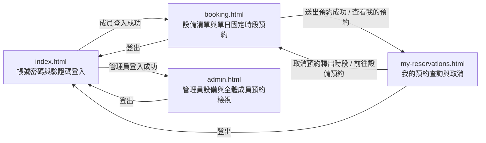

# UI 規劃：設備借用與預約系統 (Equipment Loan and Booking System)

**Spec**: [spec.md](../spec.md) | **Plan**: [plan.md](../plan.md) | **Date**: 2026-11-08

- 負責介面：F1 驗證碼與帳號密碼登入登出介面、F2 設備清單與單日固定時段預約介面、F3 成員個人預約查詢與取消介面、F4 管理員設備與全體成員預約檢視介面
- 雛形入口：[index.html](./index.html)

## 1. 畫面範疇

| 介面 | 畫面 | 需求依據 |
| ---- | ---- | -------- |
| F1 驗證碼與帳號密碼登入登出介面 | 帳號密碼與 7 位數驗證碼登入 | US1 成員以帳號密碼與 7 位數區分大小寫英數驗證碼登入及登出；FR-001 顯示以大小寫英文與阿拉伯數字組成的 7 位數驗證碼（有效期限 5 分鐘），支援手動重整，驗證時嚴格區分大小寫且送出或重整後立即失效，失敗時拒絕並顯示繁體中文錯誤提示；FR-002 支援預建成員與管理員測試帳號登入、維持工作階段與登出，未登入存取受保護頁面時拒絕並要求先登入；NFR-001 全介面與錯誤提示使用臺灣繁體中文；NFR-002 登入操作回應時間低於 2 秒；SC-001 100% 強制檢查 7 位數大小寫驗證碼並攔截無效請求；SC-004 登入回應時間低於 2 秒；Edge Cases 驗證碼英文大小寫不符、過期或重複使用舊驗證碼 |
| F2 設備清單與單日固定時段預約介面 | 設備清單與單日固定時段預約 | US1 成員查看預建單件設備並選擇當日起 7 天內的單日固定時段送出預約；FR-003 展示預建單件獨立設備清單（含設備編號、名稱、分類與可用狀態）及所選日期 3 個固定時段狀態（可預約、本人已預約、已被預約，對一般成員不揭露他人身分）；FR-004 允許預約當日起算 7 天內尚未開始的時段並立即占用，拒絕過去日期、超範圍日期或已開始／已結束時段；FR-005 多人同時搶約同一設備、日期與時段時僅一筆成功，衝突請求拒絕並顯示繁體中文時段衝突提示；FR-011 預建至少 4 台單件設備與 3 個單日固定時段；NFR-001 臺灣繁體中文介面與錯誤提示；NFR-002 查詢與建立預約回應時間低於 2 秒；SC-002 10 並發搶約僅 1 筆成功、重複占用率 0%；SC-004 查詢與建立預約回應時間低於 2 秒；Edge Cases 多人同時搶約同一台設備的同一日期與時段、嘗試預約已開始／已過期時段或取消已開始的預約 |
| F3 成員個人預約查詢與取消介面 | 我的預約查詢與取消 | US2 成員查看自己的預約紀錄並在時段開始前取消預約以釋出時段；FR-006 依預約日期由新到舊、固定時段順序及建立時間顯示本人所有預約紀錄（含設備名稱、預約日期、固定時段、目前狀態、建立時間與取消時間）；FR-007 在時段開始前取消本人有效預約，更新狀態為已取消、記錄取消時間、保留歷史紀錄並立即釋出時段；FR-008 拒絕取消非本人、已到達開始時間或已取消的預約並顯示繁體中文錯誤提示；NFR-001 臺灣繁體中文介面與錯誤提示；NFR-002 查詢與取消回應時間低於 2 秒；SC-003 取消後 1 秒內恢復可預約狀態並 100% 保留已取消歷史紀錄；SC-004 取消預約回應時間低於 2 秒；SC-005 一般成員嘗試取消他人預約 100% 攔截；Edge Cases 時段取消後再次預約、嘗試預約已開始／已過期時段或取消已開始的預約、成員嘗試越權取消他人預約或查看管理員清單 |
| F4 管理員設備與全體成員預約檢視介面 | 管理員設備與全體成員預約檢視 | US3 管理員登入後檢視所有預建設備與全體成員預約紀錄清單；FR-009 允許管理員查看所有預建設備清單與全體成員預約紀錄（含預約成員識別資訊、設備名稱、預約日期、固定時段、預約狀態、建立時間與取消時間，預設依預約日期由新到舊、固定時段順序及建立時間排序）；FR-010 限制管理員全體預約清單僅供管理員存取，一般成員嘗試存取時拒絕並顯示權限不足提示；FR-011 預建管理員帳號、成員帳號、單件設備與範例預約紀錄；NFR-001 臺灣繁體中文介面與錯誤提示；SC-005 一般成員越權存取管理員清單 100% 攔截；Edge Cases 成員嘗試越權取消他人預約或查看管理員清單 |

不在範疇：

- 公開註冊、忘記密碼與帳號管理：spec 明確排除，第一版使用預先建好的 2 組一般成員測試帳號（`lin.yating`、`chen.guanting`）與 1 組管理員測試帳號（`wu.chenghan`）。
- 跨日借用與自訂起訖時間：spec 明確排除，僅支援單一日期搭配預建的 3 個單日固定時段（上午 `09:00–12:00`、下午 `13:00–17:00`、晚間 `18:00–21:00`）。
- 設備人工審核、設備新增／編輯／維修停用管理、現場領取歸還登記與逾期通知：spec 明確排除，送出預約即立即生效占用。
- 後端驗證碼挑戰持久化、工作階段管理與 PostgreSQL 部分唯一索引並發鎖定：由 B1–B4 後端 API 與 D1–D2 資料庫介面負責，HTML 雛形於前端模擬單次驗證碼消耗、角色切換與並發衝突回饋。

## 2. 視覺風格

- 氣質：現代專業實驗室／企業管理風（清爽、專業、秩序感強的商務工具風格，支援 Light Mode 淺色模式與 Dark Mode 深色模式雙主題切換）。
- 配色：

  | 用途 | 色碼 |
  | ---- | ---- |
  | 背景（`--bg`，Light Mode 預設 ／ Dark Mode） | `#F8FAFC` 淺灰白 ／ `#0F172A` 深石板藍 |
  | 卡片與表單底色（`--surface`，Light ／ Dark） | `#FFFFFF` 純白 ／ `#1E293B` 深灰藍 |
  | 次要區塊底色（`--surface-muted`，Light ／ Dark） | `#F1F5F9` 淺霧灰 ／ `#162032` 深藍灰底 |
  | 主要文字（`--ink`，Light ／ Dark） | `#0F172A` 深藍灰 ／ `#F8FAFC` 淺灰白 |
  | 次要文字（`--muted`，Light ／ Dark） | `#475569` 藍灰 ／ `#94A3B8` 淺藍灰 |
  | 邊框與分隔線（`--line`，Light ／ Dark） | `#E2E8F0` 淺灰藍 ／ `#334155` 深灰藍邊框 |
  | 主色／本人已預約（`--primary`，Light ／ Dark） | `#2563EB` 靛藍 ／ `#3B82F6` 亮藍 |
  | 主色柔和底（`--primary-soft`，Light ／ Dark） | `#DBEAFE` 淺靛藍 ／ `#1E3A8A` 深靛藍底 |
  | 可預約／成功（`--success`，Light ／ Dark） | `#16A34A` 翠綠 ／ `#22C55E` 亮綠 |
  | 可預約／成功柔和底（`--success-soft`，Light ／ Dark） | `#DCFCE7` 淺翠綠 ／ `#14532D` 深綠底 |
  | 已被預約／中性狀態（`--occupied`，Light ／ Dark） | `#64748B` 中性灰 ／ `#94A3B8` 中灰 |
  | 已被預約柔和底（`--occupied-soft`，Light ／ Dark） | `#F1F5F9` 淺中性灰 ／ `#334155` 深中灰底 |
  | 處理中／提示（`--pending`，Light ／ Dark） | `#D97706` 琥珀橘 ／ `#F59E0B` 亮琥珀 |
  | 處理中柔和底（`--pending-soft`，Light ／ Dark） | `#FEF3C7` 淺琥珀 ／ `#78350F` 深琥珀底 |
  | 已取消／錯誤（`--danger`，Light ／ Dark） | `#DC2626` 珊瑚紅 ／ `#EF4444` 亮紅 |
  | 已取消／錯誤柔和底（`--danger-soft`，Light ／ Dark） | `#FEE2E2` 淺珊瑚紅 ／ `#7F1D1D` 深紅底 |

- 字體：介面內文使用系統無襯線字體（`"Noto Sans TC", "PingFang TC", "Microsoft JhengHei", system-ui, sans-serif`）；7 位數驗證碼、設備編號、預約編號與時段時間固定使用等寬字體（`"JetBrains Mono", ui-monospace, SFMono-Regular, Menlo, Consolas, monospace`）。
- 版面：內容最大寬度 1120px，手機寬度 360px 仍可完整操作；卡片圓角 12px；每個 HTML 雛形頁面頂部導覽列統一提供品牌標題、4 個頁面導覽連結、目前登入角色徽章、可即時切換 Light Mode／Dark Mode 的主題按鈕與登出連結。

## 3. 畫面與流程

### 3.1 頁面清單

| 檔案 | 畫面 | 介面 | 進入方式 |
| ---- | ---- | ---- | -------- |
| `index.html` | 帳號密碼與 7 位數驗證碼登入 | F1 | 雛形入口；頁首「登入」或「登出」；未登入嘗試存取受保護頁面時導向 |
| `booking.html` | 設備清單與單日固定時段預約 | F2 | 成員登入成功的「前往設備預約」；頁首「設備預約」；我的預約頁的「前往設備預約」 |
| `my-reservations.html` | 我的預約查詢與取消 | F3 | 頁首「我的預約」；設備預約成功提示的「查看我的預約」 |
| `admin.html` | 管理員設備與全體成員預約檢視 | F4 | 管理員登入成功的「前往全體預約管理」；頁首「全體預約管理」 |

### 3.2 流程

### 3.3 使用者操作

| 編號 | 畫面 | 操作 | 需求依據 |
| ---- | ---- | ---- | -------- |
| A1 | `index.html` | 點擊「重整驗證碼」更換新的 7 位數區分大小寫英數驗證碼 | US1、FR-001 |
| A2 | `index.html` | 輸入預建帳號、密碼與 7 位數區分大小寫英數驗證碼（或點選預建測試帳號快速帶入）並送出登入 | US1、US3、FR-001、FR-002、FR-011、SC-001、SC-004 |
| A3 | `index.html` | 點擊頂部導覽的「深色模式／淺色模式」切換按鈕即時切換 Light Mode 與 Dark Mode | NFR-001 |
| A4 | `booking.html` | 選擇當日起算 7 天內（`2026-11-08` 至 `2026-11-14`）的預約日期或依設備分類篩選，檢視 4 台預建單件設備的 3 個單日固定時段狀態 | US1、FR-003、FR-004、FR-011 |
| A5 | `booking.html` | 點選任一單件設備於所選日期狀態為「可預約」且尚未開始的固定時段（上午 `09:00–12:00`、下午 `13:00–17:00`、晚間 `18:00–21:00`） | US1、FR-003、FR-004 |
| A6 | `booking.html` | 點擊「確認送出預約」，使預約立即生效並將該時段更新為「本人已預約」 | US1、FR-004、FR-005、NFR-002、SC-002、SC-004 |
| A7 | `booking.html` | 點擊頁首「登出」結束工作階段並返回登入頁 | US1、FR-002 |
| A8 | `my-reservations.html` | 檢視依預約日期由新到舊、固定時段順序及建立時間排序的個人預約紀錄，或切換全部／有效預約／已取消篩選 | US2、FR-006 |
| A9 | `my-reservations.html` | 對尚未到達時段開始時間的本人有效預約點擊「取消預約」，並於確認對話框點擊「確認取消並釋出時段」 | US2、FR-007、FR-008、NFR-002、SC-003、SC-004 |
| A10 | `my-reservations.html` | 取消成功後點擊「前往設備預約重新預約」回到設備時段頁面 | US2、FR-007 |
| A11 | `admin.html` | 檢視全組織 4 台預建單件設備清單與全體成員預約紀錄（依預約日期由新到舊、固定時段順序及建立時間排序） | US3、FR-009、FR-011 |
| A12 | `admin.html` | 依預約狀態（全部／有效預約／已取消）或設備篩選全體成員預約紀錄 | US3、FR-009 |
| A13 | `admin.html` | 一般成員誤入管理員頁面遭攔截時，點擊「返回設備預約」或「切換管理員帳號登入」 | US3、FR-010、SC-005 |

## 4. 狀態

每個雛形頁面右下角的「雛形狀態」面板可切換本節列出的該頁狀態。

| 畫面 | 狀態 | 呈現方式 | 需求依據 |
| ---- | ---- | -------- | -------- |
| `index.html` | 載入驗證碼中 | 驗證碼顯示框顯示旋轉圖示與「正在產生 7 位數驗證碼…」，送出按鈕暫時停用 | FR-001、NFR-001 |
| `index.html` | 待登入 | 顯示帳號、密碼欄位與 7 位數區分大小寫英數驗證碼 `A7k9M2x`（有效期限 5 分鐘），下方提供預建成員（林雅婷、陳冠廷）與管理員（吳承翰）快速帶入按鈕 | US1、FR-001、FR-002、FR-011 |
| `index.html` | 已重整驗證碼 | 原驗證碼 `A7k9M2x` 立即作廢，驗證碼顯示框更新為 `B4p8Q1z`，並顯示提示「已更換為新的 7 位數驗證碼，有效期限 5 分鐘」 | US1、FR-001 |
| `index.html` | 登入驗證中 | 送出按鈕改為「登入驗證中…」並停用，帳號、密碼與驗證碼輸入欄停用 | FR-002、NFR-002、SC-004 |
| `index.html` | 成員登入成功 | 表單切換為成功卡片，顯示「登入成功，歡迎林雅婷（一般成員）」與「前往設備預約」按鈕 | US1、FR-002 |
| `index.html` | 管理員登入成功 | 表單切換為成功卡片，顯示「登入成功，歡迎吳承翰（管理員）」與「前往全體預約管理」按鈕 | US3、FR-002、FR-009 |
| `index.html` | 已登出 | 頁頂顯示「您已安全登出工作階段，請重新輸入帳號、密碼與新的 7 位數驗證碼登入」，驗證碼更新為 `m3R7v9K` | US1、FR-002 |
| `booking.html` | 載入中 | 日期選擇列與 4 張單件設備卡片以灰色骨架顯示，提示「正在載入預建設備與單日固定時段狀態…」 | FR-003、NFR-001、NFR-002 |
| `booking.html` | 檢視設備與時段 | 日期選在 `2026-11-09`，展示 `EQ-101`～`EQ-104` 共 4 台單件設備及上午 `09:00–12:00`、下午 `13:00–17:00`、晚間 `18:00–21:00` 狀態（`EQ-101` 上午為「本人已預約」、下午為「已被預約」且不揭露陳冠廷身分、晚間為「可預約」；`EQ-103` 上午因已取消而恢復為「可預約」） | US1、FR-003、FR-011；Edge Cases 時段取消後再次預約 |
| `booking.html` | 已選取可預約時段 | 已點選 `EQ-102 四通道數位示波器 Keysight DSOX3024T` 於 `2026-11-09` 的「下午 `13:00–17:00`（可預約）」，右側預約確認面板顯示所選設備、日期與固定時段，「確認送出預約」按鈕啟用 | US1、FR-004 |
| `booking.html` | 送出預約中 | 「確認送出預約」按鈕改為「送出預約中…」並停用，時段按鈕暫時鎖定 | FR-004、NFR-002、SC-004 |
| `booking.html` | 預約成功 | 頁頂顯示綠色成功橫幅「預約已成立！預約編號 RV-20261108-06（EQ-102 四通道數位示波器 Keysight DSOX3024T，2026-11-09 下午 13:00–17:00）已立即生效並占用時段」與「查看我的預約」按鈕，該時段狀態立即改為「本人已預約」 | US1、FR-004 |
| `booking.html` | 無符合篩選的設備 | 顯示空白狀態卡片「目前分類下沒有符合條件的設備」與「顯示全部設備」按鈕 | FR-003、NFR-001 |
| `my-reservations.html` | 載入中 | 個人預約清單以灰色骨架顯示，提示「正在載入您的預約紀錄…」 | FR-006、NFR-001、NFR-002 |
| `my-reservations.html` | 個人預約清單 | 依預約日期由新到舊、固定時段順序及建立時間列出林雅婷名下 4 筆紀錄（`RV-20261108-05`、`RV-20261108-03`、`RV-20261108-01` 為有效預約，`RV-20261107-06` 為已取消且顯示取消時間 `2026-11-07 19:30`） | US2、FR-006 |
| `my-reservations.html` | 確認取消預約 | 開啟確認取消對話框，顯示 `RV-20261108-03`（`EQ-101 高解析度光學顯微鏡 Olympus BX53`，`2026-11-09` 上午 `09:00–12:00`）明細與「確認取消並釋出時段」按鈕 | US2、FR-007 |
| `my-reservations.html` | 取消處理中 | 對話框或該列按鈕改為「取消處理中…」並停用 | FR-007、NFR-002、SC-004 |
| `my-reservations.html` | 取消成功並釋出時段 | 頁頂顯示綠色成功橫幅「已取消預約 RV-20261108-03（EQ-101 高解析度光學顯微鏡 Olympus BX53，2026-11-09 上午 09:00–12:00），該時段已立即恢復為可預約狀態」與「前往設備預約重新預約」連結；`RV-20261108-03` 狀態改為「已取消」、記錄取消時間 `2026-11-08 10:32` 並保留於清單中 | US2、FR-007、SC-003；Edge Cases 時段取消後再次預約 |
| `my-reservations.html` | 尚無預約紀錄 | 顯示空白狀態卡片「您目前還沒有任何設備預約紀錄」與「前往設備預約」按鈕 | FR-006、NFR-001 |
| `admin.html` | 載入中 | 設備總覽與全體成員預約表格以灰色骨架顯示，提示「正在載入全組織預建設備與全體成員預約紀錄…」 | FR-009、NFR-001 |
| `admin.html` | 全體設備與預約總覽 | 上方列出全部 4 台預建單件設備（`EQ-101`～`EQ-104`），下方依預約日期由新到舊、固定時段順序及建立時間列出全體成員（林雅婷、陳冠廷）共 6 筆有效與已取消預約紀錄 | US3、FR-009、FR-011 |
| `admin.html` | 篩選已取消預約紀錄 | 篩選狀態切為「已取消」，列出 `RV-20261108-02`（陳冠廷，取消時間 `2026-11-08 08:50`）與 `RV-20261107-06`（林雅婷，取消時間 `2026-11-07 19:30`）2 筆歷史紀錄 | US3、FR-009 |
| `admin.html` | 尚無預約紀錄 | 顯示空白狀態卡片「目前沒有符合篩選條件的成員預約紀錄」與「重設篩選條件」按鈕 | FR-009、NFR-001 |

## 5. 驗證與錯誤回饋

錯誤狀態同樣可從「雛形狀態」面板切換；同一畫面的多個欄位驗證錯誤合併為一個狀態「欄位驗證錯誤」。

| 畫面 | 情境 | 觸發條件 | 畫面回饋 | 需求依據 |
| ---- | ---- | -------- | -------- | -------- |
| `index.html` | 帳號空白 | 送出登入時帳號欄位為空字串 | 帳號輸入欄紅框，欄位下方顯示「請輸入登入帳號」 | FR-002、NFR-001 |
| `index.html` | 密碼空白 | 送出登入時密碼欄位為空字串 | 密碼輸入欄紅框，欄位下方顯示「請輸入登入密碼」 | FR-002、NFR-001 |
| `index.html` | 驗證碼未滿 7 位或含非英數字元 | 驗證碼輸入 `A7k9`（僅 4 碼，不足 7 位數） | 驗證碼輸入欄紅框，欄位下方顯示「請輸入完整的 7 位數英數驗證碼（區分英文大小寫）」 | FR-001、NFR-001、SC-001 |
| `index.html` | 驗證碼大小寫不符 | 畫面驗證碼為 `A7k9M2x`，但驗證碼欄位輸入小寫 `a7k9m2x` 並送出 | 頁頂紅色錯誤橫幅顯示「驗證碼輸入錯誤（英文須區分大小寫，例如 a 與 A 不同），原驗證碼已失效，請輸入新驗證碼 B4p8Q1z 後重試」，驗證碼顯示框自動更新為 `B4p8Q1z` 並清空驗證碼輸入欄 | US1、FR-001、SC-001；Edge Cases 驗證碼英文大小寫不符、過期或重複使用舊驗證碼 |
| `index.html` | 驗證碼已過期或重複使用 | 驗證碼挑戰超過 5 分鐘有效期限，或重送已驗證過的舊驗證碼 `A7k9M2x` | 頁頂紅色錯誤橫幅顯示「此 7 位數驗證碼已超過 5 分鐘有效期限或已失效，系統已換發新驗證碼 T6n2W8c，請重新輸入」，驗證碼顯示框更新為 `T6n2W8c` | FR-001、SC-001；Edge Cases 驗證碼英文大小寫不符、過期或重複使用舊驗證碼 |
| `index.html` | 帳號或密碼錯誤 | 帳號輸入 `lin.yating`、密碼輸入 `WrongPass123` 且驗證碼輸入 `A7k9M2x` 送出 | 頁頂紅色錯誤橫幅顯示「帳號或密碼不正確，且原驗證碼已單次消耗失效，請確認密碼並輸入新驗證碼 h5L4d9P」，驗證碼顯示框更新為 `h5L4d9P` | US1、FR-001、FR-002、NFR-001 |
| `index.html` | 未登入存取受保護頁面 | 未登入或已點擊登出後，嘗試開啟設備清單或預約頁面 | 頁頂紅色錯誤橫幅顯示「請先完成帳號密碼與 7 位數驗證碼登入，才能檢視設備清單或執行預約操作」 | US1、FR-002、NFR-001 |
| `booking.html` | 未選擇可預約時段 | 尚未點選任何「可預約」固定時段即點擊「確認送出預約」 | 右側預約確認面板下方顯示紅色提示「請先從上方設備卡片點選一個狀態為『可預約』的固定時段」 | FR-004、NFR-001 |
| `booking.html` | 同時搶約時段衝突 | 針對 `EQ-101` 於 `2026-11-09` 晚間 `18:00–21:00` 送出預約時，另一位成員已同時搶先完成預約 | 頁頂紅色錯誤橫幅顯示「預約失敗：EQ-101 高解析度光學顯微鏡 Olympus BX53 於 2026-11-09 晚間 18:00–21:00 剛剛已被其他成員預約，請改選其他可預約時段」，該時段標籤立即更新為「已被預約」並停用 | US1、FR-005、NFR-001、SC-002；Edge Cases 多人同時搶約同一台設備的同一日期與時段 |
| `booking.html` | 選擇已開始或已結束時段 | 日期選在當日 `2026-11-08`（目前時間 `10:30`），嘗試預約已開始的上午 `09:00–12:00` 時段 | 頁頂紅色錯誤橫幅顯示「無法預約：2026-11-08 上午 09:00–12:00 時段已開始或已結束，請選擇尚未開始的固定時段」 | US1、FR-004、NFR-001；Edge Cases 嘗試預約已開始／已過期時段或取消已開始的預約 |
| `booking.html` | 選擇超出開放範圍日期 | 日期選擇過去日期 `2026-11-07` 或超過當日起 7 天的 `2026-11-16` 並嘗試預約 | 日期選擇列下方與頁頂紅色錯誤橫幅顯示「僅開放預約當日起算 7 天內（2026-11-08 至 2026-11-14）尚未開始的固定時段，所選日期不在開放範圍內」，送出按鈕停用 | US1、FR-004、NFR-001；Edge Cases 嘗試預約已開始／已過期時段或取消已開始的預約 |
| `my-reservations.html` | 取消已開始或已過期預約 | 嘗試對當日 `2026-11-08` 上午 `09:00–12:00` 已開始的預約 `RV-20261108-01` 送出取消請求 | 頁頂紅色錯誤橫幅顯示「無法取消預約：預約編號 RV-20261108-01（2026-11-08 上午 09:00–12:00）已到達或超過時段開始時間，僅能在時段開始前取消」 | US2、FR-008、NFR-001；Edge Cases 嘗試預約已開始／已過期時段或取消已開始的預約 |
| `my-reservations.html` | 重複取消已取消預約 | 嘗試對狀態已為「已取消」的預約 `RV-20261107-06` 再次執行取消 | 頁頂紅色錯誤橫幅顯示「無法取消預約：預約編號 RV-20261107-06 已經處於『已取消』狀態（取消時間 2026-11-07 19:30），無須重複取消」 | US2、FR-008、NFR-001 |
| `my-reservations.html` | 越權取消他人預約 | 一般成員林雅婷嘗試取消屬於陳冠廷的預約 `RV-20261108-04` | 頁頂紅色錯誤橫幅顯示「權限不足：預約編號 RV-20261108-04 不屬於您本人名下，系統拒絕取消他人預約」 | US2、FR-008、NFR-001、SC-005；Edge Cases 成員嘗試越權取消他人預約或查看管理員清單 |
| `admin.html` | 一般成員越權存取遭拒 | 以一般成員帳號 `lin.yating`（林雅婷）登入並嘗試開啟 `admin.html` | 隱藏管理員設備與全體成員預約表格，顯示紅色權限攔截卡片「權限不足：『管理員全體成員預約清單』僅供管理員（admin）角色存取，您目前的身分為一般成員（林雅婷），系統已拒絕存取」與「返回設備預約」「切換管理員帳號登入」按鈕 | US3、FR-010、NFR-001、SC-005；Edge Cases 成員嘗試越權取消他人預約或查看管理員清單 |
