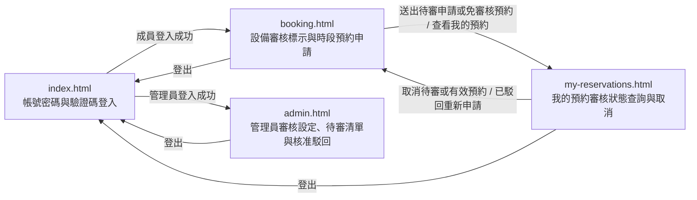

# UI 規劃：設備人工審核設定與預約申請審核 (Equipment Approval Settings and Reservation Review)

**Spec**: [spec.md](../spec.md) | **Plan**: [plan.md](../plan.md) | **Date**: 2026-11-09

- 負責介面：F1 驗證碼與帳號密碼登入登出介面、F2 設備審核標示與單日固定時段預約申請介面、F3 成員個人預約審核狀態查詢與取消介面、F4 管理員設備審核設定、待審清單與核准駁回介面
- 雛形入口：[index.html](./index.html)

## 1. 畫面範疇

| 介面 | 畫面 | 需求依據 |
| ---- | ---- | -------- |
| F1 驗證碼與帳號密碼登入登出介面 | 帳號密碼與 7 位數驗證碼登入 | FR-011 完整保留並向下相容第一版 7 位數區分大小寫英數驗證碼登入、工作階段維持與預建成員／管理員帳號；NFR-001 所有使用者介面文字與錯誤提示使用臺灣繁體中文；SC-003 第一版既有功能回歸測試通過率達 100% |
| F2 設備審核標示與單日固定時段預約申請介面 | 設備審核標示與單日固定時段預約申請 | US1 成員申請需人工審核的設備時段並分辨免審核與需人工審核設備；FR-001 清楚標示每台預建設備屬於免審核或需人工審核，並區分顯示各固定時段對當前登入成員的狀態（可預約、本人待審核、本人已預約、已被預約，對一般成員不揭露其他成員的待審申請或預約身分）；FR-002 對需人工審核設備送出申請後建立待審核申請且不占用該時段，允許其他成員在尚未被核准占用前對同一時段提出待審申請，對免審核設備送出預約則直接建立已核准／有效預約並立即占用時段；FR-003 禁止同一成員對同一台設備、同一日期與同一固定時段重複送出多筆待審核或已核准／有效申請，並允許在已駁回或已取消且時段未開始也未被占用時重新提出新申請並保留舊紀錄；FR-011 保留單日 3 個固定時段（上午 09:00–12:00、下午 13:00–17:00、晚間 18:00–21:00）與當日起算 7 天內預約範圍；NFR-001 全介面文字、審核狀態標籤與錯誤提示使用臺灣繁體中文；NFR-002 送出待審申請的操作回應時間低於 2 秒；SC-001 需人工審核設備送出後 100% 進入待審核且不鎖定時段、免審核設備送出後 100% 立即成為已核准／有效並鎖定時段；SC-004 送出待審申請的操作回應時間低於 2 秒；Edge Cases 同一成員對同一設備時段重複申請或駁回後重送 |
| F3 成員個人預約審核狀態查詢與取消介面 | 我的預約審核狀態查詢與取消 | US1 成員在我的預約清單追蹤審核狀態、檢視駁回原因並在時段開始前取消待審核或已核准／有效申請；FR-004 在我的預約清單完整顯示待審核、已核准／有效、已駁回與已取消四種狀態、審核時間及駁回原因（預設依預約日期由新到舊、固定時段順序及建立時間排序），並允許在預約時段開始前取消屬於自己的待審核或已核准／有效申請（取消已核准／有效申請時立即釋出時段，取消待審核申請時將其自待審佇列移除，兩者皆更新為已取消並保留歷史紀錄）；FR-011 保留取消釋出功能並將第一版既有有效預約無損遷移為已核准／有效狀態；NFR-001 全介面文字、審核狀態標籤與錯誤提示使用臺灣繁體中文；Edge Cases 同一成員對同一設備時段重複申請或駁回後重送 |
| F4 管理員設備審核設定、待審清單與核准駁回介面 | 管理員設備審核設定、待審清單與核准駁回 | US2 管理員於待審清單核准或駁回預約申請並重檢時段衝突；US3 管理員切換指定設備的人工審核設定並維持既有預約效力；FR-005 為管理員提供待審核申請清單（預設依預約日期由近到遠、固定時段順序及申請建立時間由早到晚排序），並在全體預約紀錄中支援依四種預約狀態篩選與檢視審核時間、審核人及駁回原因；FR-006 管理員核准待審核申請時驗證時段尚未開始且尚未被已核准／有效預約占用，通過時更新為已核准／有效、記錄審核時間與審核管理員並鎖定占用該時段，若已被占用或已開始則拒絕核准並顯示繁體中文錯誤提示；FR-007 管理員駁回未開始的待審核申請時允許選填駁回原因（上限 200 字），更新為已駁回、記錄審核時間、審核管理員與駁回原因並完整保留紀錄；FR-008 拒絕管理員對非待審核狀態或已到達／超過時段開始時間的申請執行核准或駁回，並限制待審清單與核准／駁回操作僅供管理員角色執行；FR-009 允許管理員查看所有預建設備的目前審核設定並在免審核與需人工審核之間切換且持久化保存，拒絕一般成員修改；FR-010 切換設備免審核／需人工審核設定時保持既有已核准／有效預約與既有待審核申請維持原狀態與效力，僅對切換後新送出的預約申請套用最新設定；FR-011 擴充初始展示資料以涵蓋需人工審核設備、免審核設備與四種狀態（含同設備同時段多筆待審）紀錄；NFR-001 全介面文字、待審清單、駁回原因輸入框與錯誤提示使用臺灣繁體中文；NFR-002 切換設備審核設定、查詢待審清單、執行核准或駁回的操作回應時間低於 2 秒；SC-002 同一設備時段多筆待審申請執行核准時最終成功成為已核准／有效的預約恰好 1 筆，其餘核准請求 100% 被攔截拒絕，重複占用率 0%；SC-003 切換設備設定時 100% 既有已核准／有效預約與既有待審核申請維持原狀態與效力；SC-004 操作回應時間低於 2 秒；SC-005 一般成員嘗試修改設備審核設定、查詢待審清單或執行核准／駁回時 100% 攔截拒絕；Edge Cases 多筆待審申請針對同一設備時段時的核准衝突、管理員正要核准時申請人已先行取消或時段已開始、設備在「免審核」與「需人工審核」之間來回切換、一般成員越權存取待審清單、審核申請或修改設備審核設定 |

不在範疇：

- 多層主管簽核與自訂審核工作流：spec 明確排除，僅支援單層管理員核准或駁回，不支援多級簽核或依條件指派特定審核人。
- 批次審核與核准時自動駁回其餘待審申請：spec 明確排除，管理員逐筆核准或駁回待審申請，核准其中一筆時不自動改寫其他同設備同時段待審申請的狀態。
- 實體設備現場領取、歸還登記、改期、送修停用與逾期外部通知：spec 明確排除，延續第一版功能邊界。
- 後端驗證碼挑戰、工作階段權限中介層與資料庫雙重部分唯一索引鎖定：由 B1–B5 後端介面與 D1–D2 資料庫介面負責，HTML 雛形於前端模擬角色切換、待審不占位與核准衝突攔截回饋。

## 2. 視覺風格

- 氣質：現代專業實驗室／企業管理風（清爽、專業、秩序感強的商務工具風格，支援 Light Mode 淺色模式與 Dark Mode 深色模式雙主題切換）。
- 配色：

  | 用途 | 色碼 |
  | ---- | ---- |
  | 背景（`--bg`，Light Mode 預設 ／ Dark Mode） | `#F8FAFC` 淺灰白 ／ `#0F172A` 深石板藍 |
  | 卡片與表單底色（`--surface`，Light ／ Dark） | `#FFFFFF` 純白 ／ `#1E293B` 深灰藍 |
  | 次要區塊底色（`--surface-muted`，Light ／ Dark） | `#F1F5F9` 淺霧灰 ／ `#162032` 深藍灰底 |
  | 主要文字（`--ink`，Light ／ Dark） | `#0F172A` 深藍灰 ／ `#F8FAFC` 淺灰白 |
  | 次要文字（`--muted`，Light ／ Dark） | `#475569` 藍灰 ／ `#94A3B8` 淺藍灰 |
  | 邊框與分隔線（`--line`，Light ／ Dark） | `#E2E8F0` 淺灰藍 ／ `#334155` 深灰藍邊框 |
  | 主色／本人已預約（`--primary`，Light ／ Dark） | `#2563EB` 靛藍 ／ `#3B82F6` 亮藍 |
  | 主色柔和底（`--primary-soft`，Light ／ Dark） | `#DBEAFE` 淺靛藍 ／ `#1E3A8A` 深靛藍底 |
  | 可預約／成功（`--success`，Light ／ Dark） | `#16A34A` 翠綠 ／ `#22C55E` 亮綠 |
  | 可預約／成功柔和底（`--success-soft`，Light ／ Dark） | `#DCFCE7` 淺翠綠 ／ `#14532D` 深綠底 |
  | 已被預約／中性狀態（`--occupied`，Light ／ Dark） | `#64748B` 中性灰 ／ `#94A3B8` 中灰 |
  | 已被預約柔和底（`--occupied-soft`，Light ／ Dark） | `#F1F5F9` 淺中性灰 ／ `#334155` 深中灰底 |
  | 待審核／處理中／提示（`--pending`，Light ／ Dark） | `#D97706` 琥珀橘 ／ `#F59E0B` 亮琥珀 |
  | 待審核／處理中柔和底（`--pending-soft`，Light ／ Dark） | `#FEF3C7` 淺琥珀 ／ `#78350F` 深琥珀底 |
  | 已駁回／已取消／錯誤（`--danger`，Light ／ Dark） | `#DC2626` 珊瑚紅 ／ `#EF4444` 亮紅 |
  | 已駁回／已取消／錯誤柔和底（`--danger-soft`，Light ／ Dark） | `#FEE2E2` 淺珊瑚紅 ／ `#7F1D1D` 深紅底 |

- 字體：介面內文使用系統無襯線字體（`"Noto Sans TC", "PingFang TC", "Microsoft JhengHei", system-ui, sans-serif`）；7 位數驗證碼、設備編號、預約編號與時段時間固定使用等寬字體（`"JetBrains Mono", ui-monospace, SFMono-Regular, Menlo, Consolas, monospace`）。
- 版面：內容最大寬度 1120px，手機寬度 360px 仍可完整操作；卡片圓角 12px；每個 HTML 雛形頁面頂部導覽列統一提供品牌標題、4 個頁面導覽連結、目前登入角色徽章、可即時切換 Light Mode／Dark Mode 的主題按鈕與登出連結。

## 3. 畫面與流程

### 3.1 頁面清單

| 檔案 | 畫面 | 介面 | 進入方式 |
| ---- | ---- | ---- | -------- |
| `index.html` | 帳號密碼與 7 位數驗證碼登入 | F1 | 雛形入口；頁首「登入」或「登出」；未登入嘗試存取受保護頁面時導向 |
| `booking.html` | 設備審核標示與單日固定時段預約申請 | F2 | 成員登入成功的「前往設備預約」；頁首「設備預約」；我的預約頁的「前往設備預約」或「重新申請此時段」 |
| `my-reservations.html` | 我的預約審核狀態查詢與取消 | F3 | 頁首「我的預約」；設備預約送出後橫幅的「查看我的預約」 |
| `admin.html` | 管理員設備審核設定、待審清單與核准駁回 | F4 | 管理員登入成功的「前往審核與預約管理」；頁首「審核與預約管理」 |

### 3.2 流程

### 3.3 使用者操作

| 編號 | 畫面 | 操作 | 需求依據 |
| ---- | ---- | ---- | -------- |
| A1 | `index.html` | 點擊「重整驗證碼」更換新的 7 位數區分大小寫英數驗證碼 | FR-011、SC-003 |
| A2 | `index.html` | 輸入預建帳號、密碼與 7 位數區分大小寫英數驗證碼（或點選預建展示帳號快速帶入）並送出登入 | FR-011、NFR-001、SC-003 |
| A3 | `index.html` | 點擊頂部導覽的「深色模式／淺色模式」按鈕即時切換 Light Mode 與 Dark Mode | NFR-001 |
| A4 | `booking.html` | 選擇當日起算 7 天內（`2026-11-09` 至 `2026-11-15`）的預約日期、切換設備分類或審核模式篩選，檢視 4 台預建設備的「需人工審核／免審核」標示與 3 個單日固定時段狀態（可預約、本人待審核、本人已預約、已被預約） | US1、FR-001、FR-011 |
| A5 | `booking.html` | 切換檢視成員視角（林雅婷／陳冠廷），驗證「本人待審核」時段對其他成員仍顯示為「可預約」且不揭露他人待審申請 | US1、FR-001、FR-002、SC-001 |
| A6 | `booking.html` | 點選「需人工審核」設備（如 `EQ-102`）於所選日期狀態為「可預約」的固定時段（含原申請已駁回或已取消後釋出的時段），點擊「送出待審核申請」建立「待審核」紀錄且不鎖定時段 | US1、FR-002、FR-003、NFR-002、SC-001、SC-004；Edge Cases 同一成員對同一設備時段重複申請或駁回後重送 |
| A7 | `booking.html` | 點選「免審核」設備（如 `EQ-103`）於所選日期狀態為「可預約」的固定時段，點擊「確認送出預約」立即建立「已核准／有效」預約並鎖定占用該時段 | US1、FR-002、FR-011、SC-001 |
| A8 | `my-reservations.html` | 依全部紀錄、待審核、已核准／有效、已駁回、已取消切換篩選，檢視依預約日期由新到舊、固定時段順序及建立時間排序的個人預約紀錄、審核時間與駁回原因 | US1、FR-004、FR-011 |
| A9 | `my-reservations.html` | 對尚未到達時段開始時間的本人「待審核」或「已核准／有效」申請點擊「取消待審申請」或「取消預約」，並於確認對話框點擊「確認取消申請」 | US1、FR-004、FR-011 |
| A10 | `my-reservations.html` | 對狀態為「已駁回」或「已取消」且時段尚未被占用的紀錄點擊「重新申請此時段」返回設備預約頁重新送出申請 | US1、FR-003、FR-004；Edge Cases 同一成員對同一設備時段重複申請或駁回後重送 |
| A11 | `admin.html` | 於預建設備管理區點擊指定設備的「切換為需人工審核」或「切換為免審核」按鈕，持久化更新設備審核模式並保留既有已核准／有效與待審核紀錄不變 | US3、FR-009、FR-010、NFR-002、SC-003、SC-004；Edge Cases 設備在「免審核」與「需人工審核」之間來回切換 |
| A12 | `admin.html` | 於管理員待審核申請清單檢視依預約日期由近到遠、固定時段順序及申請建立時間由早到晚排序的待審申請，點擊「核准申請」即時重檢衝突並正式鎖定占用時段 | US2、FR-005、FR-006、NFR-002、SC-002、SC-004；Edge Cases 多筆待審申請針對同一設備時段時的核准衝突 |
| A13 | `admin.html` | 於管理員待審核申請清單點擊「駁回申請」，在對話框選填駁回原因（上限 200 字）後點擊「確認駁回申請」，將狀態更新為「已駁回」並保留歷史紀錄 | US2、FR-007、NFR-001、NFR-002、SC-004 |
| A14 | `admin.html` | 於全體成員預約紀錄清單依預約狀態（全部狀態、待審核、已核准／有效、已駁回、已取消）或單件設備篩選，檢視審核時間、審核管理員與駁回原因 | US2、FR-005 |
| A15 | `admin.html` | 一般成員越權開啟管理員頁面遭攔截時，點擊「返回設備預約」或「切換管理員帳號登入」 | US2、US3、FR-008、FR-009、SC-005；Edge Cases 一般成員越權存取待審清單、審核申請或修改設備審核設定 |

## 4. 狀態

每個雛形頁面右下角的「雛形狀態」面板可切換本節列出的該頁狀態。

| 畫面 | 狀態 | 呈現方式 | 需求依據 |
| ---- | ---- | -------- | -------- |
| `index.html` | 載入驗證碼中 | 驗證碼顯示框顯示旋轉圖示與「正在產生 7 位數驗證碼…」，送出按鈕暫時停用 | FR-011、NFR-001 |
| `index.html` | 待登入 | 顯示帳號、密碼欄位與 7 位數區分大小寫英數驗證碼 `A7k9M2x`（有效期限 5 分鐘），下方提供預建成員（林雅婷、陳冠廷）與管理員（吳承翰）快速帶入按鈕 | FR-011、SC-003 |
| `index.html` | 已重整驗證碼 | 原驗證碼 `A7k9M2x` 立即作廢，驗證碼顯示框更新為 `B4p8Q1z`，並顯示提示「已更換為新的 7 位數驗證碼 B4p8Q1z，原驗證碼 A7k9M2x 已立即失效。」 | FR-011、SC-003 |
| `index.html` | 登入驗證中 | 送出按鈕改為「登入驗證中…」並停用，帳號、密碼與驗證碼輸入欄停用 | FR-011、NFR-002 |
| `index.html` | 成員登入成功 | 表單切換為成功卡片，顯示「登入成功，歡迎林雅婷（一般成員）」與「前往設備預約」按鈕 | FR-011、SC-003 |
| `index.html` | 管理員登入成功 | 表單切換為成功卡片，顯示「登入成功，歡迎吳承翰（管理員）」與「前往審核與預約管理」按鈕 | US2、US3、FR-011 |
| `index.html` | 已登出 | 頁頂顯示「您已安全登出工作階段，請重新輸入帳號、密碼與新的 7 位數驗證碼登入。」，驗證碼更新為 `m3R7v9K` | FR-011、SC-003 |
| `booking.html` | 載入中 | 日期選擇列與 4 張單件設備卡片以灰色骨架顯示，提示「正在載入預建設備審核標示與單日固定時段狀態…」 | FR-001、NFR-001、NFR-002 |
| `booking.html` | 檢視設備審核標示與時段 | 日期選在 `2026-11-10`、登入成員為林雅婷：`EQ-101` 與 `EQ-102` 標示琥珀色「需人工審核」徽章，`EQ-103` 與 `EQ-104` 標示綠色「免審核」徽章；`EQ-101` 上午為「本人已預約」、下午為「已被預約」（不揭露陳冠廷身分）、晚間為「本人待審核」（`RV-20261109-08`）；`EQ-102` 下午因原申請 `RV-20261109-07` 已駁回而顯示「可預約」 | US1、FR-001、FR-002、FR-003、FR-011；Edge Cases 同一成員對同一設備時段重複申請或駁回後重送 |
| `booking.html` | 其他成員檢視待審時段仍可預約 | 切換為另一位成員陳冠廷（`chen.guanting`）檢視 `2026-11-11`：雖然林雅婷已對 `EQ-102` 下午 `13:00–17:00` 送出待審申請 `RV-20261109-10`，該時段對陳冠廷仍顯示為「可預約」且不揭露林雅婷的待審申請，允許陳冠廷點選並送出待審申請 | US1、FR-001、FR-002、SC-001 |
| `booking.html` | 已選取需人工審核設備時段 | 林雅婷點選 `EQ-102 四通道數位示波器 Keysight DSOX3024T`（需人工審核）於 `2026-11-10` 下午 `13:00–17:00`（原已駁回釋出之可預約時段），右側確認面板顯示審核模式「需人工審核（送出後進入待審核，核准前不鎖定時段）」與「送出待審核申請」按鈕 | US1、FR-002、FR-003；Edge Cases 同一成員對同一設備時段重複申請或駁回後重送 |
| `booking.html` | 已選取免審核設備時段 | 林雅婷點選 `EQ-103 高精度工業熱像儀 FLIR E86`（免審核）於 `2026-11-10` 下午 `13:00–17:00`，右側確認面板顯示審核模式「免審核（送出後立即成為已核准／有效並占用時段）」與「確認送出預約」按鈕 | US1、FR-002、SC-001 |
| `booking.html` | 送出預約申請中 | 右側送出按鈕改為「送出申請中…」並停用，時段按鈕暫時鎖定 | FR-002、NFR-002、SC-004 |
| `booking.html` | 需人工審核申請已送出（待審核） | 頁頂顯示琥珀色提示橫幅「待審核申請已送出！預約編號 RV-20261109-11（EQ-102 四通道數位示波器 Keysight DSOX3024T，2026-11-10 下午 13:00–17:00）目前狀態為『待審核』，核准前不占用時段，請靜候管理員審核。」與「查看我的預約」按鈕，該時段對本人更新為「本人待審核」 | US1、FR-001、FR-002、SC-001 |
| `booking.html` | 免審核預約立即成立（已核准／有效） | 頁頂顯示綠色成功橫幅「預約已成立！預約編號 RV-20261109-12（EQ-103 高精度工業熱像儀 FLIR E86，2026-11-10 下午 13:00–17:00）屬於免審核設備，狀態為『已核准／有效』並已立即占用該時段。」與「查看我的預約」按鈕，該時段更新為「本人已預約」 | US1、FR-002、SC-001 |
| `booking.html` | 無符合篩選的設備 | 顯示空白狀態卡片「目前篩選條件下沒有符合的設備」與「顯示全部設備」按鈕 | FR-001、NFR-001 |
| `my-reservations.html` | 載入中 | 個人預約清單以灰色骨架顯示，提示「正在載入您的預約與審核狀態紀錄…」 | FR-004、NFR-001 |
| `my-reservations.html` | 個人預約清單（含四種審核狀態與駁回原因） | 依預約日期由新到舊、固定時段順序及建立時間列出林雅婷名下 7 筆紀錄：含「待審核」（`RV-20261109-10`、`RV-20261109-08`）、「已核准／有效」（`RV-20261108-05` 免審核成立、`RV-20261108-03` 管理員吳承翰於 `2026-11-08 10:40` 核准、`RV-20261108-01` 第一版遷移）、「已駁回」（`RV-20261109-07`，顯示審核時間 `2026-11-08 16:05` 與駁回原因「該時段已有實驗室年度高頻校驗排程，請改申請其他時段或隔日借用。」）及「已取消」（`RV-20261107-06`） | US1、FR-004、FR-011 |
| `my-reservations.html` | 確認取消待審核申請 | 開啟確認取消對話框，顯示待審核申請 `RV-20261109-08`（`EQ-101 高解析度光學顯微鏡 Olympus BX53`，`2026-11-10` 晚間 `18:00–21:00`）明細，說明取消後將自管理員待審清單移除並保留已取消歷史紀錄 | US1、FR-004 |
| `my-reservations.html` | 確認取消已核准／有效預約 | 開啟確認取消對話框，顯示已核准／有效預約 `RV-20261108-03`（`EQ-101 高解析度光學顯微鏡 Olympus BX53`，`2026-11-10` 上午 `09:00–12:00`）明細，說明取消後將立即釋出該時段並保留已取消歷史紀錄 | US1、FR-004、FR-011 |
| `my-reservations.html` | 取消處理中 | 對話框確認按鈕改為「取消處理中…」並停用 | FR-004、NFR-002 |
| `my-reservations.html` | 已取消待審核申請 | 頁頂顯示綠色橫幅「已取消待審核申請 RV-20261109-08（EQ-101 高解析度光學顯微鏡 Olympus BX53，2026-11-10 晚間 18:00–21:00），已自管理員待審清單移除並保留歷史紀錄。」，該筆狀態更新為「已取消」、記錄取消時間 `2026-11-09 10:32` | US1、FR-004 |
| `my-reservations.html` | 已取消有效預約並釋出時段 | 頁頂顯示綠色橫幅「已取消已核准／有效預約 RV-20261108-03（EQ-101 高解析度光學顯微鏡 Olympus BX53，2026-11-10 上午 09:00–12:00），該時段已立即釋出恢復為可預約狀態。」與「前往設備預約重新預約」連結，該筆狀態更新為「已取消」、記錄取消時間 `2026-11-09 10:33` | US1、FR-004、FR-011 |
| `my-reservations.html` | 尚無預約紀錄 | 顯示空白狀態卡片「目前篩選條件下沒有符合的預約申請紀錄」與「前往設備預約」按鈕 | FR-004、NFR-001 |
| `admin.html` | 載入中 | 設備審核設定卡片、待審核申請清單與全體預約表格以灰色骨架顯示，提示「正在載入設備審核設定、待審核申請清單與全體預約紀錄…」 | FR-005、FR-009、NFR-001 |
| `admin.html` | 設備審核設定、待審清單與全體預約總覽 | 上方列出 4 台預建設備及「需人工審核／免審核」切換控制項（`EQ-101`、`EQ-102` 為需人工審核，`EQ-103`、`EQ-104` 為免審核）；中段「待審核申請清單」依預約日期由近到遠、固定時段順序及建立時間由早到晚列出 3 筆待審申請（`RV-20261109-08` 林雅婷與 `RV-20261109-09` 陳冠廷同為 `EQ-101` `2026-11-10` 晚間 `18:00–21:00`，以及 `RV-20261109-10` 林雅婷 `EQ-102` `2026-11-11` 下午 `13:00–17:00`）；下方列出全體成員共 10 筆涵蓋四種狀態的預約紀錄 | US2、US3、FR-005、FR-009、FR-011 |
| `admin.html` | 切換設備審核設定中 | 指定設備卡片的切換按鈕改為「儲存設定中…」並停用 | FR-009、NFR-002、SC-004 |
| `admin.html` | 已切換設備審核設定（保留既有預約與待審） | 將 `EQ-103 高精度工業熱像儀 FLIR E86` 切換為「需人工審核」並將 `EQ-102` 切換為「免審核」，頁頂顯示綠色成功橫幅「已更新設備審核設定：既有『已核准／有效』預約（如 RV-20261108-01）與既有『待審核』申請（如 RV-20261109-10）均維持原狀態與效力不變，新設定僅適用於後續新送出的預約申請。」 | US3、FR-009、FR-010、SC-003；Edge Cases 設備在「免審核」與「需人工審核」之間來回切換 |
| `admin.html` | 審核處理中 | 待審清單中目標申請列的核准／駁回按鈕改為「審核處理中…」並停用 | FR-006、FR-007、NFR-002、SC-004 |
| `admin.html` | 已核准申請並鎖定時段 | 核准第一筆待審申請 `RV-20261109-08`（林雅婷，`EQ-101`，`2026-11-10` 晚間 `18:00–21:00`），頁頂顯示綠色成功橫幅「已核准預約申請 RV-20261109-08（林雅婷，EQ-101 高解析度光學顯微鏡 Olympus BX53，2026-11-10 晚間 18:00–21:00），狀態已更新為『已核准／有效』並正式鎖定占用該時段。」，該筆移出待審清單並在全體紀錄顯示審核管理員吳承翰與審核時間 `2026-11-09 10:35` | US2、FR-006、SC-002 |
| `admin.html` | 填寫駁回原因對話框 | 開啟駁回申請對話框（針對同設備同時段的第二筆待審申請 `RV-20261109-09` 陳冠廷），顯示申請明細與選填駁回原因文字框（上限 200 字，預填「該時段已核准另一位成員的實驗專案申請，請改選其他可用時段。」與字數計數 `30 / 200 字`） | US2、FR-007、NFR-001 |
| `admin.html` | 已駁回待審申請 | 頁頂顯示綠色橫幅「已駁回預約申請 RV-20261109-09（陳冠廷，EQ-101 高解析度光學顯微鏡 Olympus BX53，2026-11-10 晚間 18:00–21:00），已記錄審核時間與駁回原因並保留於全體預約歷史紀錄。」，該筆自待審清單移出並在全體預約紀錄顯示「已駁回」與駁回原因 | US2、FR-007 |
| `admin.html` | 篩選已駁回與已取消紀錄 | 全體成員預約紀錄狀態篩選切為「已駁回」，列出 `RV-20261109-07`（林雅婷，審核管理員吳承翰，審核時間 `2026-11-08 16:05`，駁回原因「該時段已有實驗室年度高頻校驗排程，請改申請其他時段或隔日借用。」） | US2、FR-005、FR-007 |
| `admin.html` | 尚無待審或符合篩選紀錄 | 待審清單或全體預約表格顯示空白狀態卡片「目前沒有符合篩選條件的預約申請紀錄」與「重設篩選條件」按鈕 | FR-005、NFR-001 |

## 5. 驗證與錯誤回饋

錯誤狀態同樣可從「雛形狀態」面板切換；同一畫面的多個欄位驗證錯誤合併為一個狀態「欄位驗證錯誤」。

| 畫面 | 情境 | 觸發條件 | 畫面回饋 | 需求依據 |
| ---- | ---- | -------- | -------- | -------- |
| `index.html` | 帳號空白 | 送出登入時帳號欄位為空字串 | 帳號輸入欄紅框，欄位下方顯示「請輸入登入帳號」 | FR-011、NFR-001 |
| `index.html` | 密碼空白 | 送出登入時密碼欄位為空字串 | 密碼輸入欄紅框，欄位下方顯示「請輸入登入密碼」 | FR-011、NFR-001 |
| `index.html` | 驗證碼未滿 7 位或含非英數字元 | 驗證碼輸入 `A7k9`（僅 4 碼，不足 7 位數） | 驗證碼輸入欄紅框，欄位下方顯示「請輸入完整的 7 位數英數驗證碼（區分英文大小寫）」 | FR-011、NFR-001、SC-003 |
| `index.html` | 驗證碼大小寫不符 | 畫面驗證碼為 `A7k9M2x`，但驗證碼欄位輸入小寫 `a7k9m2x` 並送出 | 頁頂紅色錯誤橫幅顯示「驗證碼輸入錯誤（英文須區分大小寫，例如 a 與 A 不同），原驗證碼已失效，請輸入新驗證碼 B4p8Q1z 後重試。」，驗證碼顯示框自動更新為 `B4p8Q1z` 並清空驗證碼輸入欄 | FR-011、NFR-001、SC-003 |
| `index.html` | 驗證碼已過期或重複使用 | 驗證碼挑戰超過 5 分鐘有效期限，或重送已驗證過的舊驗證碼 `A7k9M2x` | 頁頂紅色錯誤橫幅顯示「此 7 位數驗證碼已超過 5 分鐘有效期限或已失效，系統已換發新驗證碼 T6n2W8c，請重新輸入。」，驗證碼顯示框更新為 `T6n2W8c` | FR-011、NFR-001、SC-003 |
| `index.html` | 帳號或密碼錯誤 | 帳號輸入 `lin.yating`、密碼輸入 `WrongPass123` 且驗證碼輸入 `A7k9M2x` 送出 | 頁頂紅色錯誤橫幅顯示「帳號或密碼不正確，且原驗證碼已單次消耗失效，請確認密碼並輸入新驗證碼 h5L4d9P。」，驗證碼顯示框更新為 `h5L4d9P` | FR-011、NFR-001、SC-003 |
| `index.html` | 未登入存取受保護頁面 | 未登入或已點擊登出後，嘗試開啟設備預約、我的預約或管理員頁面 | 頁頂紅色錯誤橫幅顯示「請先完成帳號密碼與 7 位數驗證碼登入，才能檢視設備清單或執行預約與審核操作。」 | FR-011、NFR-001 |
| `booking.html` | 未選擇可預約時段 | 尚未點選任何「可預約」固定時段即點擊右側送出按鈕 | 右側確認面板下方顯示紅色提示「請先從上方設備卡片點選一個狀態為『可預約』的固定時段。」 | FR-002、NFR-001 |
| `booking.html` | 同成員重複申請同一設備時段 | 林雅婷已對 `EQ-101` 於 `2026-11-10` 晚間 `18:00–21:00` 持有一筆「待審核」申請 `RV-20261109-08`（或對上午 `09:00–12:00` 持有「已核准／有效」申請 `RV-20261108-03`），再次針對同一設備、同一日期與同一固定時段送出申請 | 頁頂紅色錯誤橫幅顯示「重複申請遭拒：您已對 EQ-101 高解析度光學顯微鏡 Olympus BX53 於 2026-11-10 晚間 18:00–21:00 持有一筆未結束的『待審核』申請（RV-20261109-08），同一成員不得對同一設備時段重複申請。」 | US1、FR-003、NFR-001；Edge Cases 同一成員對同一設備時段重複申請或駁回後重送 |
| `booking.html` | 送出時時段已被核准預約占用 | 針對 `EQ-101` 於 `2026-11-10` 下午 `13:00–17:00`（或送出當下剛被管理員核准其他成員占用的時段）送出預約申請 | 頁頂紅色錯誤橫幅顯示「申請失敗：EQ-101 高解析度光學顯微鏡 Olympus BX53 於 2026-11-10 下午 13:00–17:00 已被其他『已核准／有效』預約占用，請改選其他可預約時段。」，該時段標籤更新為「已被預約」並停用 | US1、FR-002、NFR-001、SC-001 |
| `booking.html` | 選擇已開始或已結束時段 | 日期選在當日 `2026-11-09`（目前時間 `10:30`），嘗試申請已開始的上午 `09:00–12:00` 時段 | 頁頂紅色錯誤橫幅顯示「無法申請：2026-11-09 上午 09:00–12:00 時段已開始或已結束，請選擇尚未開始的固定時段。」 | FR-002、FR-011、NFR-001 |
| `booking.html` | 選擇超出開放範圍日期 | 日期選擇過去日期 `2026-11-08` 或超過當日起 7 天的 `2026-11-18` 並嘗試申請 | 日期選擇列下方與頁頂紅色錯誤橫幅顯示「僅開放申請當日起算 7 天內（2026-11-09 至 2026-11-15）尚未開始的固定時段，所選日期不在開放範圍內。」，送出按鈕停用 | FR-002、FR-011、NFR-001 |
| `my-reservations.html` | 取消已開始或已過期申請 | 嘗試對當日 `2026-11-09` 上午 `09:00–12:00` 已開始的預約 `RV-20261108-01` 送出取消請求 | 頁頂紅色錯誤橫幅顯示「無法取消：預約編號 RV-20261108-01（2026-11-09 上午 09:00–12:00）已到達或超過時段開始時間，僅能在預約時段開始前取消待審核或已核准／有效申請。」 | US1、FR-004、NFR-001 |
| `my-reservations.html` | 取消已駁回或已取消申請 | 嘗試對狀態已為「已駁回」的 `RV-20261109-07` 或已為「已取消」的 `RV-20261107-06` 執行取消 | 頁頂紅色錯誤橫幅顯示「無法取消：預約編號 RV-20261109-07 目前狀態為『已駁回』（或已取消），僅處於『待審核』或『已核准／有效』狀態的申請可執行取消。」 | US1、FR-004、NFR-001 |
| `my-reservations.html` | 越權取消他人預約申請 | 一般成員林雅婷嘗試取消屬於陳冠廷的待審核申請 `RV-20261109-09` 或有效預約 `RV-20261108-04` | 頁頂紅色錯誤橫幅顯示「權限不足：預約編號 RV-20261109-09 不屬於您本人名下，系統拒絕取消他人預約申請。」 | FR-004、NFR-001 |
| `admin.html` | 駁回原因超過 200 字上限 | 於駁回申請對話框輸入 215 字的駁回原因並點擊「確認駁回申請」 | 駁回原因文字框紅框，下方顯示紅色錯誤訊息「駁回原因為選填，但長度不得超過 200 字（目前已輸入 215 字）。」 | US2、FR-007、NFR-001 |
| `admin.html` | 多筆待審申請核准時段衝突 | 管理員已先核准林雅婷的 `RV-20261109-08` 使 `EQ-101` 於 `2026-11-10` 晚間 `18:00–21:00` 被占用，接著再對陳冠廷同一設備、同一日期與同一時段的待審申請 `RV-20261109-09` 點擊「核准申請」 | 頁頂紅色錯誤橫幅顯示「無法核准申請：預約編號 RV-20261109-09 所申請的 EQ-101 高解析度光學顯微鏡 Olympus BX53（2026-11-10 晚間 18:00–21:00）已被另一筆『已核准／有效』預約（RV-20261109-08）占用；RV-20261109-09 仍維持『待審核』狀態，請改為執行駁回。」 | US2、FR-006、NFR-001、SC-002；Edge Cases 多筆待審申請針對同一設備時段時的核准衝突 |
| `admin.html` | 核准或駁回時申請人已取消或非待審狀態 | 管理員在待審清單對 `RV-20261109-10` 點擊核准或駁回時，該筆申請剛剛已被成員林雅婷自行取消（狀態已變為「已取消」或非「待審核」） | 頁頂紅色錯誤橫幅顯示「無法執行審核：預約編號 RV-20261109-10 剛剛已被申請人林雅婷自行取消（目前狀態為『已取消』），僅處於『待審核』狀態的申請可執行核准或駁回。」，並將該筆移出待審清單 | US2、FR-008、NFR-001；Edge Cases 管理員正要核准時申請人已先行取消或時段已開始 |
| `admin.html` | 核准或駁回時時段已開始或已過期 | 管理員嘗試對預約時段已到達或超過開始時間（如 `2026-11-09` 上午 `09:00–12:00`，目前時間 `10:30`）的待審申請執行核准或駁回 | 頁頂紅色錯誤橫幅顯示「無法執行審核：該筆申請的預約時段（2026-11-09 上午 09:00–12:00）已到達或超過開始時間，管理員僅能審核尚未開始的待審核申請。」 | US2、FR-006、FR-008、NFR-001；Edge Cases 管理員正要核准時申請人已先行取消或時段已開始 |
| `admin.html` | 一般成員越權存取或操作遭拒 | 以一般成員帳號 `lin.yating`（林雅婷）登入並嘗試開啟 `admin.html`、查詢待審清單、執行核准／駁回或切換設備人工審核設定 | 隱藏管理員設備審核設定、待審清單與全體預約表格，顯示紅色權限攔截卡片「權限不足：『管理員設備審核設定與待審核申請清單』僅供管理員（admin）角色存取與操作，您目前的身分為一般成員（林雅婷），系統已拒絕存取。」與「返回設備預約」「切換管理員帳號登入」按鈕 | US2、US3、FR-008、FR-009、NFR-001、SC-005；Edge Cases 一般成員越權存取待審清單、審核申請或修改設備審核設定 |
