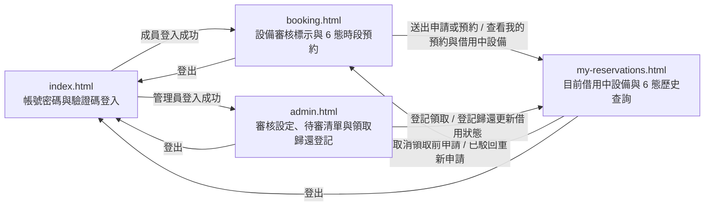

# UI 規劃：設備現場領取與歸還登記及借用狀態檢視 (Equipment Pickup, Return Registration and Loan Status Tracking)

**Spec**: [spec.md](../spec.md) | **Plan**: [plan.md](../plan.md) | **Date**: 2026-11-09

- 負責介面：F1 驗證碼與帳號密碼登入登出介面、F2 設備審核標示與單日固定時段借用狀態預約介面、F3 成員目前借用中設備醒目區塊、6 態狀態查詢與領取前取消介面、F4 管理員設備審核設定、待審核准駁回與現場領取歸還登記介面
- 雛形入口：[index.html](./index.html)

## 1. 畫面範疇

| 介面 | 畫面 | 需求依據 |
| ---- | ---- | -------- |
| F1 驗證碼與帳號密碼登入登出介面 | 帳號密碼與 7 位數驗證碼登入 | FR-009 完整保留並向下相容前兩次迭代已實作的 7 位數區分大小寫英數驗證碼登入與工作階段維持功能；NFR-001 所有新增與既有的使用者介面文字與錯誤提示使用臺灣繁體中文；SC-005 前兩次迭代既有功能回歸測試通過率達 100% |
| F2 設備審核標示與單日固定時段借用狀態預約介面 | 設備審核標示與單日固定時段借用狀態預約 | US3 情境 3 成員與其他成員在設備預約頁面檢視借用中或已歸還時段狀態；FR-007 將處於已核准／有效、借用中及當日已履行完畢之已歸還的紀錄視為已占用該設備時段，在設備預約頁面對借用人本人區分顯示「本人借用中」與「本人已歸還」，對其他成員統一顯示為「已被預約」且不揭露借用人身分；FR-009 完整保留單日 3 個固定時段、當日起算 7 天內預約範圍與需人工審核／免審核申請功能；NFR-001 全介面文字、借用狀態標籤與錯誤提示使用臺灣繁體中文；Edge Cases 當日借用提早歸還後的時段占用保護 |
| F3 成員目前借用中設備醒目區塊、6 態狀態查詢與領取前取消介面 | 我的借用中設備與 6 態狀態查詢及取消 | US3 成員查看借用中設備與借用狀態，並於領取後禁止取消預約；FR-006 在我的預約頁面頂部提供「目前借用中設備」醒目區塊（列出本人所有處於借用中狀態的設備、預約日期、固定時段與領取時間，無借用中設備時顯示清晰的繁體中文空白狀態提示），並在預約清單支援依全部 6 種狀態（待審核、已核准／有效、借用中、已歸還、已駁回、已取消）篩選及檢視領取時間與歸還時間；FR-008 僅允許成員在預約時段開始時間之前取消處於待審核或尚未領取之已核准／有效狀態的本人申請，一旦進入借用中或已歸還狀態即隱藏取消按鈕並拒絕任何取消請求；NFR-001 全介面文字與錯誤提示使用臺灣繁體中文；NFR-002 查詢目前借用中設備與借用歷史清單的操作回應時間低於 2 秒；SC-003 成員可 100% 準確查看本人所有借用中設備與全狀態歷史紀錄，且進入借用中或已歸還狀態後嘗試取消 100% 被攔截拒絕；SC-004 查詢目前借用中設備與借用狀態清單回應時間低於 2 秒；Edge Cases 成員於當日提早領取後，在時段開始前嘗試自行取消預約 |
| F4 管理員設備審核設定、待審核准駁回與現場領取歸還登記介面 | 管理員審核設定、待審清單與現場領取歸還登記 | US1 管理員於現場登記設備領取並轉入借用中狀態；US2 管理員於現場登記設備歸還並留存完整借用稽核紀錄；FR-001 管理員對已核准／有效預約執行登記領取時更新為借用中並記錄領取時間與領取經手管理員，非已核准狀態拒絕領取並顯示繁體中文錯誤提示；FR-002 限制登記領取僅能針對預約日期為當日且當前時間尚未超過該固定時段結束時間的已核准／有效預約執行，拒絕未來日期提前領取與過期未領補登領取；FR-003 嚴格限制登記領取與登記歸還操作僅供管理員角色執行，一般成員嘗試執行時拒絕並提示權限不足；FR-004 管理員對借用中紀錄執行登記歸還時（不論在固定時段結束前或結束後逾時歸還）更新為已歸還、記錄歸還時間與歸還經手管理員並保留歷史紀錄，非借用中狀態拒絕歸還並提示；FR-005 在管理員預約與借用管理頁面支援依全部 6 種狀態篩選紀錄、完整顯示領取時間、領取經手管理員、歸還時間與歸還經手管理員，且僅對當日且時段尚未結束的已核准／有效預約開放「登記領取」操作、僅對借用中紀錄開放「登記歸還」操作（支援單鍵確認完成登記）；FR-009 保留設備人工審核設定切換、待審核准／駁回與衝突重檢功能，並擴充涵蓋 6 種狀態的初始展示資料；NFR-001 全介面文字與錯誤提示使用臺灣繁體中文；NFR-002 登記領取、登記歸還與狀態篩選回應時間低於 2 秒；SC-001 當日未結束已核准預約領取 100% 成功，非已核准、未來日期或過期未領 100% 攔截拒絕；SC-002 借用中紀錄（含逾時）歸還 100% 成功，非借用中 100% 攔截拒絕；SC-004 操作回應時間低於 2 秒；SC-005 一般成員呼叫領取或歸還功能 100% 攔截拒絕；Edge Cases 管理員對非當日預約或過期未領取預約嘗試登記領取、成員超過固定時段結束時間才逾時歸還設備、重複點擊登記領取或登記歸還、當日借用提早歸還後的時段占用保護 |

不在範疇：

- 現場掃碼或輸入取件驗證碼流程：spec 明確排除，現場領取與歸還由管理員在系統管理介面直接核對並點擊「登記領取」或「登記歸還」完成，不採用 QR Code 掃碼或額外取件驗證碼核銷畫面。
- 預約改期、設備送修停用與逾期外部通知：spec 明確排除，預約改期申請、設備送修／停用及逾期未還自動發送 Discord 通知留待後續迭代實作。
- 後端驗證碼挑戰、當日時段時間窗交易檢核與資料庫雙重部分唯一索引鎖定：由 B1–B6 後端介面與 D1–D2 資料庫介面負責，HTML 雛形於前端模擬角色切換、6 態狀態轉移與錯誤攔截回饋。

## 2. 視覺風格

- 氣質：現代專業實驗室／企業管理風（清爽、專業、秩序感強的商務工具風格，支援 Light Mode 淺色模式與 Dark Mode 深色模式雙主題切換）。
- 配色：

  | 用途 | 色碼 |
  | ---- | ---- |
  | 背景（`--bg`，Light Mode 預設 ／ Dark Mode） | `#F8FAFC` 淺灰白 ／ `#0F172A` 深石板藍 |
  | 卡片與表單底色（`--surface`，Light ／ Dark） | `#FFFFFF` 純白 ／ `#1E293B` 深灰藍 |
  | 次要區塊底色（`--surface-muted`，Light ／ Dark） | `#F1F5F9` 淺霧灰 ／ `#162032` 深藍灰底 |
  | 主要文字（`--ink`，Light ／ Dark） | `#0F172A` 深藍灰 ／ `#F8FAFC` 淺灰白 |
  | 次要文字（`--muted`，Light ／ Dark） | `#475569` 藍灰 ／ `#94A3B8` 淺藍灰 |
  | 邊框與分隔線（`--line`，Light ／ Dark） | `#E2E8F0` 淺灰藍 ／ `#334155` 深灰藍邊框 |
  | 主色／本人已預約（`--primary`，Light ／ Dark） | `#2563EB` 靛藍 ／ `#3B82F6` 亮藍 |
  | 主色柔和底（`--primary-soft`，Light ／ Dark） | `#DBEAFE` 淺靛藍 ／ `#1E3A8A` 深靛藍底 |
  | 借用中／登記領取（`--loan`，Light ／ Dark） | `#0284C7` 湖水青藍 ／ `#38BDF8` 亮青藍 |
  | 借用中柔和底（`--loan-soft`，Light ／ Dark） | `#E0F2FE` 淺青藍 ／ `#0C4A6E` 深青藍底 |
  | 已歸還／登記歸還（`--returned`，Light ／ Dark） | `#0D9488` 青松綠 ／ `#2DD4BF` 亮青綠 |
  | 已歸還柔和底（`--returned-soft`，Light ／ Dark） | `#CCFBF1` 淺青綠 ／ `#134E4A` 深青綠底 |
  | 可預約／成功（`--success`，Light ／ Dark） | `#16A34A` 翠綠 ／ `#22C55E` 亮綠 |
  | 可預約／成功柔和底（`--success-soft`，Light ／ Dark） | `#DCFCE7` 淺翠綠 ／ `#14532D` 深綠底 |
  | 已被預約／中性狀態（`--occupied`，Light ／ Dark） | `#64748B` 中性灰 ／ `#94A3B8` 中灰 |
  | 已被預約柔和底（`--occupied-soft`，Light ／ Dark） | `#F1F5F9` 淺中性灰 ／ `#334155` 深中灰底 |
  | 待審核／處理中／提示（`--pending`，Light ／ Dark） | `#D97706` 琥珀橘 ／ `#F59E0B` 亮琥珀 |
  | 待審核／處理中柔和底（`--pending-soft`，Light ／ Dark） | `#FEF3C7` 淺琥珀 ／ `#78350F` 深琥珀底 |
  | 已駁回／已取消／錯誤（`--danger`，Light ／ Dark） | `#DC2626` 珊瑚紅 ／ `#EF4444` 亮紅 |
  | 已駁回／已取消／錯誤柔和底（`--danger-soft`，Light ／ Dark） | `#FEE2E2` 淺珊瑚紅 ／ `#7F1D1D` 深紅底 |

- 字體：介面內文使用系統無襯線字體（`"Noto Sans TC", "PingFang TC", "Microsoft JhengHei", system-ui, sans-serif`）；7 位數驗證碼、設備編號、預約編號與時段時間固定使用等寬字體（`"JetBrains Mono", ui-monospace, SFMono-Regular, Menlo, Consolas, monospace`）。
- 版面：內容最大寬度 1120px，手機寬度 360px 仍可完整操作；卡片圓角 12px；每個 HTML 雛形頁面頂部導覽列統一提供品牌標題、4 個頁面導覽連結、目前登入角色徽章、可即時切換 Light Mode／Dark Mode 的主題按鈕與登出連結。

## 3. 畫面與流程

### 3.1 頁面清單

| 檔案 | 畫面 | 介面 | 進入方式 |
| ---- | ---- | ---- | -------- |
| `index.html` | 帳號密碼與 7 位數驗證碼登入 | F1 | 雛形入口；頁首「登入」或「登出」；未登入嘗試存取受保護頁面時導向 |
| `booking.html` | 設備審核標示與單日固定時段借用狀態預約 | F2 | 成員登入成功的「前往設備預約」；頁首「設備預約」；我的預約頁的「前往設備預約」或「重新申請此時段」 |
| `my-reservations.html` | 我的借用中設備與 6 態狀態查詢及取消 | F3 | 頁首「我的預約」；設備預約送出後橫幅的「查看我的預約」 |
| `admin.html` | 管理員審核設定、待審清單與現場領取歸還登記 | F4 | 管理員登入成功的「前往審核與借用管理」；頁首「審核與借用管理」 |

### 3.2 流程

### 3.3 使用者操作

| 編號 | 畫面 | 操作 | 需求依據 |
| ---- | ---- | ---- | -------- |
| A1 | `index.html` | 點擊「重整驗證碼」更換新的 7 位數區分大小寫英數驗證碼 | FR-009、SC-005 |
| A2 | `index.html` | 輸入預建帳號、密碼與 7 位數區分大小寫英數驗證碼（或點選預建展示帳號快速帶入）並送出登入 | FR-009、NFR-001、SC-005 |
| A3 | `index.html` | 點擊頂部導覽的「深色模式／淺色模式」按鈕即時切換 Light Mode 與 Dark Mode | NFR-001 |
| A4 | `booking.html` | 選擇當日起算 7 天內（`2026-11-09` 至 `2026-11-15`）的預約日期、切換設備分類或審核模式篩選，檢視 4 台預建設備的審核標示與單日固定時段 6 態狀態（可預約、本人待審核、本人已預約、本人借用中、本人已歸還、已被預約） | US3、FR-007、FR-009、NFR-001；Edge Cases 當日借用提早歸還後的時段占用保護 |
| A5 | `booking.html` | 切換檢視成員視角（林雅婷／陳冠廷），驗證「本人借用中」與「本人已歸還」時段對其他成員統一顯示為「已被預約」且不揭露借用人身分，並驗證他人「本人待審核」時段對自己仍顯示為「可預約」 | US3、FR-007、FR-009；Edge Cases 當日借用提早歸還後的時段占用保護 |
| A6 | `booking.html` | 點選「需人工審核」設備（如 `EQ-102`）於所選日期狀態為「可預約」的固定時段，點擊「送出待審核申請」建立「待審核」紀錄且不鎖定時段 | FR-009、NFR-001、SC-005 |
| A7 | `booking.html` | 點選「免審核」設備（如 `EQ-104`）於所選日期狀態為「可預約」的固定時段，點擊「確認送出預約」立即建立「已核准／有效」預約並鎖定占用該時段 | FR-007、FR-009、SC-005 |
| A8 | `my-reservations.html` | 在頁面頂部「目前借用中設備」醒目區塊檢視本人目前所有處於「借用中」狀態的設備、預約編號、設備編號、預約日期、固定時段與領取時間（或切換檢視無借用中設備時的繁體中文空白狀態提示） | US3、FR-006、NFR-001、NFR-002、SC-003、SC-004 |
| A9 | `my-reservations.html` | 在下方預約與借用清單依全部紀錄與 6 種狀態（待審核、已核准／有效、借用中、已歸還、已駁回、已取消）切換篩選，檢視每筆紀錄的領取時間、歸還時間、審核時間與駁回原因 | US3、FR-006、NFR-001、NFR-002、SC-003、SC-004 |
| A10 | `my-reservations.html` | 對尚未到達時段開始時間且尚未領取的本人「待審核」或「已核准／有效」申請點擊「取消待審申請」或「取消預約」並於對話框確認取消；對已進入「借用中」或「已歸還」的紀錄隱藏取消按鈕並禁止取消 | US3、FR-008、FR-009、SC-003；Edge Cases 成員於當日提早領取後，在時段開始前嘗試自行取消預約 |
| A11 | `my-reservations.html` | 對狀態為「已駁回」或「已取消」且時段尚未被占用的紀錄點擊「重新申請此時段」返回設備預約頁重新送出申請 | FR-009、SC-005 |
| A12 | `admin.html` | 於預建設備管理區點擊指定設備的「切換為需人工審核」或「切換為免審核」按鈕，並於待審核申請清單對待審申請執行「核准申請」或選填原因「駁回申請」 | FR-007、FR-009、SC-005 |
| A13 | `admin.html` | 於全體預約與借用管理區塊依全部狀態與 6 種狀態（待審核、已核准／有效（待領取）、借用中、已歸還、已駁回、已取消）或單件設備篩選，檢視領取時間／經手管理員與歸還時間／經手管理員 | US1、US2、FR-005、NFR-001、NFR-002、SC-004 |
| A14 | `admin.html` | 對預約日期為當日（`2026-11-09`）且尚未超過該固定時段結束時間的「已核准／有效」預約（如 `RV-20261108-06`）單鍵點擊「登記領取」，將狀態更新為「借用中」並記錄領取時間與領取經手管理員 | US1、FR-001、FR-002、FR-005、NFR-001、NFR-002、SC-001、SC-004 |
| A15 | `admin.html` | 對處於「借用中」狀態的紀錄（包含時段結束前的一般借用 `RV-20261108-03` 及已超過時段結束時間的逾時借用 `RV-20261107-05`）單鍵點擊「登記歸還」，將狀態更新為「已歸還」並記錄歸還時間與歸還經手管理員 | US2、FR-004、FR-005、NFR-001、NFR-002、SC-002、SC-004；Edge Cases 成員超過固定時段結束時間才逾時歸還設備 |
| A16 | `admin.html` | 一般成員越權開啟管理員頁面或嘗試呼叫登記領取／歸還操作遭攔截時，點擊「返回設備預約」或「切換管理員帳號登入」 | US1、FR-003、SC-005 |

## 4. 狀態

每個雛形頁面右下角的「雛形狀態」面板可切換本節列出的該頁狀態。

| 畫面 | 狀態 | 呈現方式 | 需求依據 |
| ---- | ---- | -------- | -------- |
| `index.html` | 載入驗證碼中 | 驗證碼顯示框顯示旋轉圖示與「正在產生 7 位數驗證碼…」，送出按鈕暫時停用 | FR-009、NFR-001 |
| `index.html` | 待登入 | 顯示帳號、密碼欄位與 7 位數區分大小寫英數驗證碼 `A7k9M2x`（有效期限 5 分鐘），下方提供預建成員（林雅婷、陳冠廷）與管理員（吳承翰）快速帶入按鈕 | FR-009、SC-005 |
| `index.html` | 已重整驗證碼 | 原驗證碼 `A7k9M2x` 立即作廢，驗證碼顯示框更新為 `B4p8Q1z`，並顯示提示「已更換為新的 7 位數驗證碼 B4p8Q1z，原驗證碼 A7k9M2x 已立即失效。」 | FR-009、SC-005 |
| `index.html` | 登入驗證中 | 送出按鈕改為「登入驗證中…」並停用，帳號、密碼與驗證碼輸入欄停用 | FR-009、NFR-002 |
| `index.html` | 成員登入成功 | 表單切換為成功卡片，顯示「登入成功，歡迎林雅婷（一般成員）」與「前往設備預約」按鈕 | FR-009、SC-005 |
| `index.html` | 管理員登入成功 | 表單切換為成功卡片，顯示「登入成功，歡迎吳承翰（管理員）」與「前往審核與借用管理」按鈕 | US1、US2、FR-009 |
| `index.html` | 已登出 | 頁頂顯示「您已安全登出工作階段，請重新輸入帳號、密碼與新的 7 位數驗證碼登入。」，驗證碼更新為 `m3R7v9K` | FR-009、SC-005 |
| `booking.html` | 載入中 | 日期選擇列與 4 張單件設備卡片以灰色骨架顯示，提示「正在載入預建設備審核標示與單日固定時段 6 態借用狀態…」 | FR-007、NFR-001、NFR-002 |
| `booking.html` | 檢視設備與固定時段 6 態狀態（本人視角） | 日期選在當日 `2026-11-09`（目前業務時間 `14:30`）、登入成員為林雅婷：同頁完整呈現固定時段 6 態標示——`EQ-101` 下午為「本人借用中」（`RV-20261108-03`，`13:05` 已領取）、晚間為「本人待審核」（`RV-20261109-08`）；`EQ-102` 上午為「本人已歸還」（`RV-20261108-01`，`11:40` 已歸還結案不重開）、晚間為「可預約」；`EQ-103` 晚間為「本人已預約」（`RV-20261108-06` 已核准待領取）；`EQ-104` 上午為「已被預約」（不揭露陳冠廷身分）、晚間為「可預約」 | US3、FR-007、FR-009、NFR-001；Edge Cases 當日借用提早歸還後的時段占用保護 |
| `booking.html` | 其他成員視角檢視借用中與已歸還時段（顯示已被預約） | 切換為另一位成員陳冠廷（`chen.guanting`）檢視當日 `2026-11-09`：林雅婷處於「借用中」的 `EQ-101` 下午時段與處於「已歸還」的 `EQ-102` 上午時段，對陳冠廷皆統一顯示為「已被預約」且不揭露林雅婷身分，亦禁止重複預約 | US3、FR-007、SC-003；Edge Cases 當日借用提早歸還後的時段占用保護 |
| `booking.html` | 已選取需人工審核設備時段 | 林雅婷點選 `EQ-102 四通道數位示波器 Keysight DSOX3024T`（需人工審核）於 `2026-11-09` 晚間 `18:00–21:00`（可預約時段），右側確認面板顯示審核模式「需人工審核（送出後進入待審核，核准前不鎖定時段）」與「送出待審核申請」按鈕 | FR-009、NFR-001 |
| `booking.html` | 已選取免審核設備時段 | 林雅婷點選 `EQ-104 微量分光光度計 Thermo NanoDrop One`（免審核）於 `2026-11-09` 晚間 `18:00–21:00`（可預約時段），右側確認面板顯示審核模式「免審核（送出後立即成為已核准／有效並占用時段）」與「確認送出預約」按鈕 | FR-007、FR-009 |
| `booking.html` | 送出預約申請中 | 右側送出按鈕改為「送出申請中…」並停用，時段按鈕暫時鎖定 | FR-009、NFR-002 |
| `booking.html` | 需人工審核申請已送出（待審核） | 頁頂顯示琥珀色提示橫幅「待審核申請已送出！預約編號 RV-20261109-11（EQ-102 四通道數位示波器 Keysight DSOX3024T，2026-11-09 晚間 18:00–21:00）目前狀態為『待審核』，核准前不占用時段，請靜候管理員審核。」與「查看我的預約」按鈕 | FR-009、SC-005 |
| `booking.html` | 免審核預約立即成立（已核准／有效） | 頁頂顯示綠色成功橫幅「預約已成立！預約編號 RV-20261109-12（EQ-104 微量分光光度計 Thermo NanoDrop One，2026-11-09 晚間 18:00–21:00）屬於免審核設備，狀態為『已核准／有效』並已立即占用該時段。」與「查看我的預約」按鈕 | FR-007、FR-009、SC-005 |
| `booking.html` | 無符合篩選的設備 | 顯示空白狀態卡片「目前篩選條件下沒有符合的設備」與「顯示全部設備」按鈕 | FR-009、NFR-001 |
| `my-reservations.html` | 載入中 | 頁頂「目前借用中設備」區塊與下方預約清單以灰色骨架顯示，提示「正在載入目前借用中設備與 6 態借還歷史紀錄…」 | FR-006、NFR-001、NFR-002 |
| `my-reservations.html` | 個人借用中醒目區塊與 6 態預約清單 | 頁頂「目前借用中設備」醒目區塊列出林雅婷目前處於「借用中」的 `RV-20261108-03`（`EQ-101 高解析度光學顯微鏡 Olympus BX53`，`2026-11-09` 下午 `13:00–17:00`，領取時間 `2026-11-09 13:05`，並提示已領取設備不可取消、請於使用完畢後交由管理員登記歸還）；下方清單支援全部紀錄與 6 種狀態篩選，完整顯示「借用中」、「已歸還」（`RV-20261108-01`，顯示領取時間 `2026-11-09 09:05` 與歸還時間 `2026-11-09 11:40`）、「已核准／有效」、「待審核」、「已駁回」與「已取消」共 8 筆紀錄，且對「借用中」與「已歸還」紀錄隱藏取消按鈕 | US3、FR-006、FR-008、FR-009、SC-003 |
| `my-reservations.html` | 目前無借用中設備（空白狀態） | 頁頂「目前借用中設備」醒目區塊顯示繁體中文空白狀態提示「目前名下沒有借用中的設備。當您於預約當日到現場由管理員完成『登記領取』後，借用中的設備與領取時間會立即顯示於此區塊。」 | US3、FR-006、NFR-001、SC-003 |
| `my-reservations.html` | 篩選借用中與已歸還紀錄 | 下方狀態篩選切換至「已歸還」（或「借用中」），清楚顯示 `RV-20261108-01` 的領取時間 `2026-11-09 09:05`、歸還時間 `2026-11-09 11:40` 與經手管理員，且操作欄不顯示取消預約按鈕 | US3、FR-006、FR-008、SC-003 |
| `my-reservations.html` | 確認取消待審核申請 | 開啟確認取消對話框，顯示待審核申請 `RV-20261109-08`（`EQ-101 高解析度光學顯微鏡 Olympus BX53`，`2026-11-09` 晚間 `18:00–21:00`）明細，說明取消後將自管理員待審清單移除並保留已取消歷史紀錄 | FR-008、FR-009 |
| `my-reservations.html` | 確認取消已核准／有效預約 | 開啟確認取消對話框，顯示尚未領取且未開始的已核准／有效預約 `RV-20261108-04`（`EQ-101 高解析度光學顯微鏡 Olympus BX53`，`2026-11-10` 上午 `09:00–12:00`）明細，說明取消後將立即釋出該時段並保留已取消歷史紀錄 | FR-008、FR-009 |
| `my-reservations.html` | 取消處理中 | 對話框確認按鈕改為「取消處理中…」並停用 | FR-008、NFR-002 |
| `my-reservations.html` | 已取消待審核申請 | 頁頂顯示綠色橫幅「已取消待審核申請 RV-20261109-08（EQ-101 高解析度光學顯微鏡 Olympus BX53，2026-11-09 晚間 18:00–21:00），已自管理員待審清單移除並保留歷史紀錄。」，該筆狀態更新為「已取消」 | FR-008、FR-009 |
| `my-reservations.html` | 已取消有效預約並釋出時段 | 頁頂顯示綠色橫幅「已取消已核准／有效預約 RV-20261108-04（EQ-101 高解析度光學顯微鏡 Olympus BX53，2026-11-10 上午 09:00–12:00），該時段已立即釋出恢復為可預約狀態。」與「前往設備預約重新預約」連結 | FR-008、FR-009 |
| `my-reservations.html` | 尚無符合篩選的預約紀錄 | 下方清單顯示空白狀態卡片「目前篩選條件下沒有符合的預約與借用紀錄」與「前往設備預約」按鈕 | FR-006、NFR-001 |
| `admin.html` | 載入中 | 設備審核設定卡片、待審核申請清單與全體預約借還管理表格以灰色骨架顯示，提示「正在載入設備審核設定、待審清單與全體 6 態借還管理紀錄…」 | FR-005、FR-009、NFR-001 |
| `admin.html` | 審核設定、待審清單與 6 態借還管理總覽 | 上方列出 4 台預建設備審核設定切換；中段列出 3 筆待審核申請；下方「全體成員預約與借用管理清單」支援全部狀態與 6 種狀態篩選（含「已核准／有效（待領取）」與「借用中」），完整顯示領取時間／經手管理員與歸還時間／經手管理員，並嚴格對齊可操作條件——僅對當日未結束的已核准預約 `RV-20261108-06` 顯示「登記領取」按鈕，僅對借用中紀錄 `RV-20261108-03`（當日借用中）與 `RV-20261107-05`（逾時未還借用中）顯示「登記歸還」按鈕 | US1、US2、FR-001、FR-002、FR-004、FR-005、FR-009 |
| `admin.html` | 篩選已核准／有效（待領取）紀錄 | 狀態篩選切為「已核准／有效（待領取）」，列出 5 筆已核准紀錄：其中當日 `2026-11-09` 晚間 `18:00–21:00` 尚未結束的 `RV-20261108-06` 開放「登記領取」按鈕；明日以後的 `RV-20261108-04`、`RV-20261108-07`、`RV-20261108-05` 標示「非當日預約（限當日領取）」而不開放領取按鈕；當日上午已結束未領的 `RV-20261108-02` 標示「時段已結束未領（逾期不可領取）」而不開放領取按鈕 | US1、US2、FR-001、FR-002、FR-005、SC-001 |
| `admin.html` | 篩選借用中（待歸還）紀錄 | 狀態篩選切為「借用中」，列出 `RV-20261108-03`（林雅婷，當日下午 `13:00–17:00` 借用中，領取時間 `2026-11-09 13:05`、經手人吳承翰）與 `RV-20261107-05`（陳冠廷，前一日 `2026-11-08` 晚間 `18:00–21:00` 逾時未還借用中，領取時間 `2026-11-08 18:02`、經手人吳承翰），兩筆皆開放「登記歸還」單鍵按鈕 | US2、FR-004、FR-005、SC-002；Edge Cases 成員超過固定時段結束時間才逾時歸還設備 |
| `admin.html` | 登記領取處理中 | 目標預約列（`RV-20261108-06`）的「登記領取」按鈕改為「登記領取中…」並停用 | US1、FR-001、NFR-002、SC-004 |
| `admin.html` | 已完成登記領取（轉為借用中） | 對當日晚間已核准預約 `RV-20261108-06`（林雅婷，`EQ-103 高精度工業熱像儀 FLIR E86`，`2026-11-09` 晚間 `18:00–21:00`）完成單鍵「登記領取」，頁頂顯示綠色成功橫幅「已完成登記領取！預約編號 RV-20261108-06（林雅婷，EQ-103 高精度工業熱像儀 FLIR E86，2026-11-09 晚間 18:00–21:00）狀態已更新為『借用中』，記錄領取時間 2026-11-09 14:32 與領取經手管理員吳承翰 (wu.chenghan)。」；該列狀態更新為「借用中」、操作按鈕切換為「登記歸還」 | US1、FR-001、FR-002、FR-005、SC-001、SC-004 |
| `admin.html` | 登記歸還處理中 | 目標借用列（`RV-20261108-03`）的「登記歸還」按鈕改為「登記歸還中…」並停用 | US2、FR-004、NFR-002、SC-004 |
| `admin.html` | 已完成登記歸還（時段內歸還轉為已歸還） | 對當日下午借用中紀錄 `RV-20261108-03`（林雅婷，`EQ-101 高解析度光學顯微鏡 Olympus BX53`，`2026-11-09` 下午 `13:00–17:00`）完成單鍵「登記歸還」，頁頂顯示綠色成功橫幅「已完成登記歸還！預約編號 RV-20261108-03（林雅婷，EQ-101 高解析度光學顯微鏡 Olympus BX53，2026-11-09 下午 13:00–17:00）狀態已更新為『已歸還』，記錄歸還時間 2026-11-09 14:35 與歸還經手管理員吳承翰 (wu.chenghan)，該時段視為已履約結案不重新開放。」；該列完整顯示領取與歸還稽核紀錄並移除操作按鈕 | US2、FR-004、FR-005、FR-007、SC-002；Edge Cases 當日借用提早歸還後的時段占用保護 |
| `admin.html` | 已完成逾時歸還登記（超過時段結束時間補還） | 對已超過固定時段結束時間的逾時借用中紀錄 `RV-20261107-05`（陳冠廷，`EQ-103 高精度工業熱像儀 FLIR E86`，`2026-11-08` 晚間 `18:00–21:00`）完成單鍵「登記歸還」，頁頂顯示綠色成功橫幅「已完成逾時設備登記歸還！預約編號 RV-20261107-05（陳冠廷，EQ-103 高精度工業熱像儀 FLIR E86，2026-11-08 晚間 18:00–21:00）雖已超過原時段結束時間，系統已允許結案並更新為『已歸還』，記錄實際歸還時間 2026-11-09 14:36 與歸還經手管理員吳承翰 (wu.chenghan)。」 | US2、FR-004、FR-005、SC-002；Edge Cases 成員超過固定時段結束時間才逾時歸還設備 |
| `admin.html` | 已切換設備審核設定與核准待審申請 | 切換 `EQ-103` 為需人工審核並核准 `RV-20261109-08`，頁頂顯示綠色成功橫幅說明已更新設備審核設定與核准申請並保留既有借還紀錄效力 | FR-007、FR-009、SC-005 |
| `admin.html` | 填寫駁回原因對話框 | 開啟駁回申請對話框（針對 `RV-20261109-09` 陳冠廷），顯示申請明細與選填駁回原因文字框（上限 200 字，預填「該時段已核准另一位成員的實驗專案申請，請改選其他可用時段。」） | FR-009、NFR-001 |
| `admin.html` | 尚無待審或符合篩選紀錄 | 待審清單或全體預約借還表格顯示空白狀態卡片「目前沒有符合篩選條件的預約與借用紀錄」與「重設篩選條件」按鈕 | FR-005、NFR-001 |

## 5. 驗證與錯誤回饋

錯誤狀態同樣可從「雛形狀態」面板切換；同一畫面的多個欄位驗證錯誤合併為一個狀態「欄位驗證錯誤」。

| 畫面 | 情境 | 觸發條件 | 畫面回饋 | 需求依據 |
| ---- | ---- | -------- | -------- | -------- |
| `index.html` | 帳號空白 | 送出登入時帳號欄位為空字串 | 帳號輸入欄紅框，欄位下方顯示「請輸入登入帳號」 | FR-009、NFR-001 |
| `index.html` | 密碼空白 | 送出登入時密碼欄位為空字串 | 密碼輸入欄紅框，欄位下方顯示「請輸入登入密碼」 | FR-009、NFR-001 |
| `index.html` | 驗證碼未滿 7 位或含非英數字元 | 驗證碼輸入 `A7k9`（僅 4 碼，不足 7 位數） | 驗證碼輸入欄紅框，欄位下方顯示「請輸入完整的 7 位數英數驗證碼（區分英文大小寫）」 | FR-009、NFR-001、SC-005 |
| `index.html` | 驗證碼大小寫不符 | 畫面驗證碼為 `A7k9M2x`，但驗證碼欄位輸入小寫 `a7k9m2x` 並送出 | 頁頂紅色錯誤橫幅顯示「驗證碼輸入錯誤（英文須區分大小寫，例如 a 與 A 不同），原驗證碼已失效，請輸入新驗證碼 B4p8Q1z 後重試。」，驗證碼顯示框自動更新為 `B4p8Q1z` 並清空驗證碼輸入欄 | FR-009、NFR-001、SC-005 |
| `index.html` | 驗證碼已過期或重複使用 | 驗證碼挑戰超過 5 分鐘有效期限，或重送已驗證過的舊驗證碼 `A7k9M2x` | 頁頂紅色錯誤橫幅顯示「此 7 位數驗證碼已超過 5 分鐘有效期限或已失效，系統已換發新驗證碼 T6n2W8c，請重新輸入。」，驗證碼顯示框更新為 `T6n2W8c` | FR-009、NFR-001、SC-005 |
| `index.html` | 帳號或密碼錯誤 | 帳號輸入 `lin.yating`、密碼輸入 `WrongPass123` 且驗證碼輸入 `A7k9M2x` 送出 | 頁頂紅色錯誤橫幅顯示「帳號或密碼不正確，且原驗證碼已單次消耗失效，請確認密碼並輸入新驗證碼 h5L4d9P。」，驗證碼顯示框更新為 `h5L4d9P` | FR-009、NFR-001、SC-005 |
| `index.html` | 未登入存取受保護頁面 | 未登入或已點擊登出後，嘗試開啟設備預約、我的預約或管理員頁面 | 頁頂紅色錯誤橫幅顯示「請先完成帳號密碼與 7 位數驗證碼登入，才能檢視設備清單或執行預約、領取與歸還管理操作。」 | FR-009、NFR-001 |
| `booking.html` | 未選擇可預約時段 | 尚未點選任何「可預約」固定時段即點擊右側送出按鈕 | 右側確認面板下方顯示紅色提示「請先從上方設備卡片點選一個狀態為『可預約』的固定時段。」 | FR-009、NFR-001 |
| `booking.html` | 同成員重複申請同一設備時段 | 林雅婷已對 `EQ-101` 於 `2026-11-09` 下午 `13:00–17:00` 持有「借用中」紀錄 `RV-20261108-03`（或對晚間持有「待審核」申請 `RV-20261109-08`、對 `EQ-103` 晚間持有「已核准／有效」申請 `RV-20261108-06`），再次針對同一設備、同一日期與同一固定時段送出申請 | 頁頂紅色錯誤橫幅顯示「重複申請遭拒：您已對 EQ-101 高解析度光學顯微鏡 Olympus BX53 於 2026-11-09 晚間 18:00–21:00 持有一筆未結束的紀錄（RV-20261109-08），同一成員不得對同一設備時段重複申請。」 | FR-007、FR-009、NFR-001 |
| `booking.html` | 送出時時段已被占用 | 針對已被「已核准／有效」、「借用中」或當日已履約完畢之「已歸還」紀錄（如 `EQ-102` 於 `2026-11-09` 上午 `09:00–12:00` `RV-20261108-01` 已提早歸還結案）占用的時段送出預約申請 | 頁頂紅色錯誤橫幅顯示「申請失敗：EQ-102 四通道數位示波器 Keysight DSOX3024T 於 2026-11-09 上午 09:00–12:00 已完成當日借用並歸還結案（或已被其他有效／借用中紀錄占用），同一固定時段不重新開放重複預約。」 | US3、FR-004、FR-007、NFR-001；Edge Cases 當日借用提早歸還後的時段占用保護 |
| `booking.html` | 選擇已開始或已結束時段 | 日期選在當日 `2026-11-09`（目前時間 `14:30`），嘗試申請已結束的上午 `09:00–12:00` 或已開始的下午 `13:00–17:00` 時段 | 頁頂紅色錯誤橫幅顯示「無法申請：2026-11-09 下午 13:00–17:00 時段已開始或已結束，請選擇尚未開始的固定時段。」 | FR-009、NFR-001 |
| `booking.html` | 選擇超出開放範圍日期 | 日期選擇過去日期 `2026-11-08` 或超過當日起 7 天的 `2026-11-18` 並嘗試申請 | 日期選擇列下方與頁頂紅色錯誤橫幅顯示「僅開放申請當日起算 7 天內（2026-11-09 至 2026-11-15）尚未開始的固定時段，所選日期不在開放範圍內。」，送出按鈕停用 | FR-009、NFR-001 |
| `booking.html` | 設備目前不可用或目標設備不存在 | 送出預約時目標設備（如 `EQ-999`）不存在或目前非可供借用狀態 | 頁頂紅色錯誤橫幅顯示「無法建立預約：指定的設備不存在或目前處於不可借用狀態，請重新整理設備清單後改選其他設備。」 | FR-009、NFR-001 |
| `my-reservations.html` | 取消已領取借用中或已歸還設備遭拒 | 成員林雅婷對已被管理員登記領取進入「借用中」的 `RV-20261108-03`（或當日提早於時段開始前領取的紀錄、已進入「已歸還」的 `RV-20261108-01`）嘗試執行取消請求 | 畫面對「借用中」與「已歸還」紀錄不顯示取消按鈕；當嘗試觸發取消時，頁頂紅色錯誤橫幅顯示「無法取消預約：預約編號 RV-20261108-03 已完成現場登記領取（目前狀態為『借用中』或『已歸還』），一旦領取設備後即禁止取消預約，請於使用完畢後將設備帶回現場由管理員執行『登記歸還』。」 | US3、FR-008、NFR-001、SC-003；Edge Cases 成員於當日提早領取後，在時段開始前嘗試自行取消預約 |
| `my-reservations.html` | 取消已開始或已過期申請 | 嘗試對當日 `2026-11-09` 上午 `09:00–12:00` 已超過時段開始時間的預約 `RV-20261108-02` 送出取消請求 | 頁頂紅色錯誤橫幅顯示「無法取消：預約編號 RV-20261108-02（2026-11-09 上午 09:00–12:00）已到達或超過時段開始時間，僅能在預約時段開始前取消待審核或尚未領取的已核准／有效申請。」 | FR-008、FR-009、NFR-001 |
| `my-reservations.html` | 取消已駁回或已取消申請 | 嘗試對狀態已為「已駁回」的 `RV-20261109-07` 或已為「已取消」的 `RV-20261107-06` 執行取消 | 頁頂紅色錯誤橫幅顯示「無法取消：預約編號 RV-20261109-07 目前狀態為『已駁回』（或已取消），僅處於『待審核』或尚未領取之『已核准／有效』狀態的申請可執行取消。」 | FR-008、NFR-001 |
| `my-reservations.html` | 越權取消他人預約申請 | 一般成員林雅婷嘗試取消屬於陳冠廷的預約申請 `RV-20261109-09` 或 `RV-20261108-07` | 頁頂紅色錯誤橫幅顯示「權限不足：預約編號 RV-20261109-09 不屬於您本人名下，系統拒絕取消他人預約申請。」 | FR-008、FR-009、NFR-001 |
| `my-reservations.html` | 目標預約紀錄不存在 | 嘗試取消或查詢一筆不存在的預約編號 `RV-20261109-99` | 頁頂紅色錯誤橫幅顯示「找不到指定的預約或借用紀錄（RV-20261109-99），請重新整理清單後再試。」 | FR-006、FR-008、NFR-001 |
| `admin.html` | 駁回原因超過 200 字上限 | 於駁回申請對話框輸入 215 字的駁回原因並點擊「確認駁回申請」 | 駁回原因文字框紅框，下方顯示紅色錯誤訊息「駁回原因為選填，但長度不得超過 200 字（目前已輸入 215 字）。」 | FR-009、NFR-001 |
| `admin.html` | 登記領取非已核准狀態紀錄遭拒 | 管理員嘗試對狀態為「待審核」（`RV-20261109-08`）、「借用中」（`RV-20261108-03` 重複點擊領取）、「已歸還」（`RV-20261108-01`）、「已駁回」（`RV-20261109-07`）或「已取消」（`RV-20261107-06`）的紀錄執行「登記領取」 | 頁頂紅色錯誤橫幅顯示「無法登記領取：預約編號 RV-20261108-03 目前狀態為『借用中』（非『已核准／有效』狀態），系統僅允許對『已核准／有效』預約執行單次登記領取，禁止對待審核、借用中、已歸還、已駁回或已取消紀錄重複領取。」 | US1、FR-001、NFR-001、SC-001；Edge Cases 重複點擊登記領取或登記歸還 |
| `admin.html` | 非當日預約提前登記領取遭拒 | 管理員於當日 `2026-11-09` 嘗試對預約日期為明日 `2026-11-10`（或未來日期）的「已核准／有效」預約 `RV-20261108-04` 執行提前「登記領取」 | 頁頂紅色錯誤橫幅顯示「無法登記領取：預約編號 RV-20261108-04 的預約日期為 2026-11-10（非今日 2026-11-09），系統僅開放預約當日且尚未超過該固定時段結束時間的已核准預約辦理現場領取，拒絕未來日期提前領取。」 | US1、FR-002、NFR-001、SC-001；Edge Cases 管理員對非當日預約或過期未領取預約嘗試登記領取 |
| `admin.html` | 時段已結束過期未領取補登遭拒 | 管理員於當日 `2026-11-09 14:30` 嘗試對當日上午 `09:00–12:00` 已超過固定時段結束時間卻未到場領取的「已核准／有效」預約 `RV-20261108-02`（或過去日期未領取預約）執行「登記領取」 | 頁頂紅色錯誤橫幅顯示「無法登記領取：預約編號 RV-20261108-02（2026-11-09 上午 09:00–12:00）的固定時段已經結束（目前台灣時間 14:30 已超過 12:00），已逾期未領取的預約無法補登領取。」 | US1、FR-002、NFR-001、SC-001；Edge Cases 管理員對非當日預約或過期未領取預約嘗試登記領取 |
| `admin.html` | 登記歸還非借用中狀態紀錄遭拒 | 管理員嘗試對尚未領取的「已核准／有效」預約（`RV-20261108-06`）、已經歸還的「已歸還」紀錄（`RV-20261108-01` 重複點擊歸還）、「待審核」、「已駁回」或「已取消」紀錄執行「登記歸還」 | 頁頂紅色錯誤橫幅顯示「無法登記歸還：預約編號 RV-20261108-01 目前狀態為『已歸還』（或尚未領取之『已核准／有效』），系統僅允許對處於『借用中』狀態的紀錄執行登記歸還，禁止未領先還或重複歸還。」 | US2、FR-004、NFR-001、SC-002；Edge Cases 重複點擊登記領取或登記歸還 |
| `admin.html` | 多筆待審申請核准時段衝突 | 管理員已先核准 `RV-20261109-08`（或該時段已被借用中／當日已歸還紀錄占用），接著再對陳冠廷同一設備、同一日期與同一時段的待審申請 `RV-20261109-09` 點擊「核准申請」 | 頁頂紅色錯誤橫幅顯示「無法核准申請：預約編號 RV-20261109-09 所申請的 EQ-101 高解析度光學顯微鏡 Olympus BX53（2026-11-09 晚間 18:00–21:00）已被另一筆占用狀態紀錄（RV-20261109-08）鎖定；RV-20261109-09 仍維持『待審核』狀態，請改為執行駁回。」 | FR-007、FR-009、NFR-001；Edge Cases 當日借用提早歸還後的時段占用保護 |
| `admin.html` | 核准或駁回時申請人已取消或非待審狀態 | 管理員在待審清單對 `RV-20261109-10` 點擊核准或駁回時，該筆申請剛剛已被成員林雅婷自行取消（狀態已變為「已取消」或非「待審核」） | 頁頂紅色錯誤橫幅顯示「無法執行審核：預約編號 RV-20261109-10 剛剛已被申請人林雅婷自行取消（目前狀態為『已取消』），僅處於『待審核』狀態的申請可執行核准或駁回。」 | FR-009、NFR-001 |
| `admin.html` | 核准或駁回時時段已開始或已過期 | 管理員嘗試對預約時段已到達或超過開始時間（如 `2026-11-09` 下午 `13:00–17:00`，目前時間 `14:30`）的待審申請執行核准或駁回 | 頁頂紅色錯誤橫幅顯示「無法執行審核：該筆申請的預約時段（2026-11-09 下午 13:00–17:00）已到達或超過開始時間，管理員僅能審核尚未開始的待審核申請。」 | FR-009、NFR-001 |
| `admin.html` | 目標預約紀錄或設備不存在 | 管理員對不存在的預約編號 `RV-20261109-99` 執行登記領取／登記歸還／審核，或切換不存在的設備 `EQ-999` 設定 | 頁頂紅色錯誤橫幅顯示「操作失敗：找不到指定的預約借用紀錄（RV-20261109-99）或目標設備，請重新整理清單後再試。」 | FR-001、FR-004、FR-005、NFR-001 |
| `admin.html` | 一般成員越權執行領取、歸還或管理操作遭拒 | 以一般成員帳號 `lin.yating`（林雅婷）登入並嘗試開啟 `admin.html`、呼叫「登記領取」、「登記歸還」、查詢管理清單或切換設備人工審核設定 | 隱藏管理員設備設定、待審清單與全體預約借還管理表格，顯示紅色權限攔截卡片「權限不足：『登記領取』、『登記歸還』與『審核及借用管理』僅供管理員（admin）角色執行，您目前的身分為一般成員（林雅婷），系統已攔截拒絕操作。」與「返回設備預約」「切換管理員帳號登入」按鈕 | US1、FR-003、NFR-001、SC-005 |
