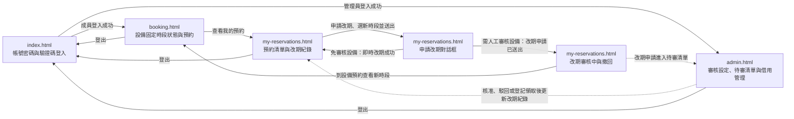

# UI 規劃：成員預約改期申請與改期成功前保留原預約 (Reservation Reschedule Request)

**Spec**: [spec.md](../spec.md) | **Plan**: [plan.md](../plan.md) | **Date**: 2026-11-09

- 負責介面：F1 驗證碼與帳號密碼登入登出介面、F2 設備時段狀態與預約介面（含本人改期審核中標示）、F3 成員預約清單、申請改期、改期紀錄與撤回介面、F4 管理員改期申請審核、待審預約與現場領取歸還介面
- 雛形入口：[index.html](./index.html)

## 1. 畫面範疇

| 介面 | 畫面 | 需求依據 |
| ---- | ---- | -------- |
| F1 驗證碼與帳號密碼登入登出介面 | 帳號密碼與 7 位數驗證碼登入 | FR-015 完整保留並向下相容前三次迭代已實作的驗證碼登入與登出功能；NFR-001 介面文字與錯誤提示使用臺灣繁體中文；SC-006 前三次迭代既有功能回歸測試通過率達 100% |
| F2 設備時段狀態與預約介面（含本人改期審核中標示） | 設備固定時段狀態與預約 | US1 情境 2 即時改期後，其他成員看到原時段為「可預約」並可預約；US2 情境 1 改期審核中的新時段對其他成員顯示「可預約」；US3 情境 8 新時段對申請人標示「本人改期審核中」、對其他成員顯示「可預約」；FR-002 即時改期成功時釋出原時段；FR-014 新預約與改期同時占用同一時段時只有一筆成功，其餘收到時段已被占用的錯誤提示；FR-017 改期審核中申請的新時段對申請成員本人標示「本人改期審核中」，對其他成員顯示「可預約」且不揭露申請；NFR-001 介面文字與錯誤提示使用臺灣繁體中文；Edge Cases 同時搶同一新時段 |
| F3 成員預約清單、申請改期、改期紀錄與撤回介面 | 我的預約、申請改期與改期紀錄 | US1 情境 1、3–5、7 即時改期、新時段被占用、不可改期的預約、新時段不符合條件、升級後既有預約可改期；US3 情境 1–3、6 查看改期紀錄、撤回、撤回非審核中申請、取消有改期審核中申請的預約；FR-001 只對原時段尚未開始的「已核准／有效」預約顯示「申請改期」，只接受同一設備 7 天內、尚未開始、未被占用、不同於原時段且本人沒有其他未結束預約的新時段；FR-002 免審核設備送出時立即改期，失敗時原預約不變；FR-003 需人工審核設備建立「改期審核中」申請，原預約繼續有效、新時段不保留；FR-004 同一預約最多一筆「改期審核中」申請，再送出時提示先撤回；FR-009 顯示改期紀錄的 5 種狀態、原／新日期時段、申請時間、審核時間與駁回原因，並在預約上標示「改期審核中」；FR-010 撤回「改期審核中」申請，非審核中時拒絕並提示；FR-013 取消有改期審核中申請的預約時，申請同時變成「改期已失效」；FR-014 新時段同時被搶時只有一筆成功，改期失敗者原預約不變；NFR-001 繁體中文介面與錯誤提示；NFR-002 送出改期、撤回與查詢改期紀錄回應低於 2 秒；Edge Cases 審核中取消原預約、同時搶同一新時段 |
| F4 管理員改期申請審核、待審預約與現場領取歸還介面 | 審核設定、待審清單與借用管理 | US2 情境 3–8 核准、核准時新時段被占用、駁回、一般成員越權、切換審核設定後申請仍在待審清單、demo seed 有可核准與會被拒的申請；US3 情境 7 審核中登記領取原預約；FR-005 待審清單以「改期申請」標示列出申請成員、設備、原／新日期時段與申請時間，提供核准與選填 200 字內原因的駁回，一般成員操作時拒絕；FR-006 核准時重新檢查申請狀態、原預約狀態、兩個時段尚未開始與新時段未被占用，新時段被占用時拒絕並維持「改期審核中」；FR-007 駁回後申請變成「改期被駁回」，原預約不變；FR-008 切換設備審核設定後，已送出的「改期審核中」申請仍留在待審清單；FR-011 原時段開始時申請自動失效並拒絕核准；FR-012 新時段比原時段早且先開始時申請自動失效並拒絕核准；FR-016 登記領取有改期審核中申請的預約時，申請同時失效並移出待審清單；NFR-001 繁體中文介面與錯誤提示；SC-004 到期、取消或領取後仍在審核的申請 100% 失效、核准成功率 0%；SC-006 一般成員呼叫核准或駁回 100% 被拒絕；Edge Cases 核准時新時段已被他人占用、審核中原時段開始、新時段比原時段早、審核中提前登記領取原預約 |

不在範疇：

- 管理員代成員改期：spec 的 Out of Scope 已排除，管理員只核准或駁回改期申請，`admin.html` 不提供直接改期的操作。
- 改期時更換設備：spec 的 Out of Scope 已排除，申請改期對話框只列出同一台設備的時段；要換設備時，成員取消原預約後重新預約。
- 待審核預約直接改期：spec 的 Out of Scope 已排除，「待審核」預約不顯示「申請改期」，只顯示「取消待審申請」。
- 借用中預約延長借用時間：spec 的 Out of Scope 已排除，「借用中」預約不顯示「申請改期」。
- 改期結果的外部通知（Email、Discord）：spec 的 Out of Scope 已排除，成員在 `my-reservations.html` 的改期紀錄查看結果。
- 設備送修與停用：spec 的 Out of Scope 已排除。
- 時段開始時自動讓改期申請失效、並發占用的判定與改期申請資料保存：由 B2、B3、B4、B5 後端介面與 D2 資料庫介面負責；雛形以「雛形狀態」面板呈現失效與衝突後的畫面。

## 2. 視覺風格

- 氣質：現代專業實驗室／企業管理風（清爽、專業、秩序感強的商務工具風格，支援 Light Mode 淺色模式與 Dark Mode 深色模式雙主題切換），沿用 `specs/003-equipment-loan-booking/ui/plan.md` 的視覺風格。
- 配色：

  | 用途 | 色碼 |
  | ---- | ---- |
  | 背景（`--bg`，Light Mode 預設 ／ Dark Mode） | `#F8FAFC` 淺灰白 ／ `#0F172A` 深石板藍 |
  | 卡片與表單底色（`--surface`，Light ／ Dark） | `#FFFFFF` 純白 ／ `#1E293B` 深灰藍 |
  | 次要區塊底色（`--surface-muted`，Light ／ Dark） | `#F1F5F9` 淺霧灰 ／ `#162032` 深藍灰底 |
  | 主要文字（`--ink`，Light ／ Dark） | `#0F172A` 深藍灰 ／ `#F8FAFC` 淺灰白 |
  | 次要文字（`--muted`，Light ／ Dark） | `#475569` 藍灰 ／ `#94A3B8` 淺藍灰 |
  | 邊框與分隔線（`--line`，Light ／ Dark） | `#E2E8F0` 淺灰藍 ／ `#334155` 深灰藍邊框 |
  | 主色／本人已預約／借用中（`--primary`，Light ／ Dark） | `#2563EB` 靛藍 ／ `#3B82F6` 亮藍 |
  | 主色柔和底（`--primary-soft`，Light ／ Dark） | `#DBEAFE` 淺靛藍 ／ `#1E3A8A` 深靛藍底 |
  | 可預約／可改期／改期成功（`--success`，Light ／ Dark） | `#16A34A` 翠綠 ／ `#22C55E` 亮綠 |
  | 可預約／成功柔和底（`--success-soft`，Light ／ Dark） | `#DCFCE7` 淺翠綠 ／ `#14532D` 深綠底 |
  | 已被預約／改期已撤回／改期已失效（`--occupied`，Light ／ Dark） | `#64748B` 中性灰 ／ `#94A3B8` 中灰 |
  | 已被預約柔和底（`--occupied-soft`，Light ／ Dark） | `#F1F5F9` 淺中性灰 ／ `#334155` 深中灰底 |
  | 待審核／改期審核中／處理中（`--pending`，Light ／ Dark） | `#D97706` 琥珀橘 ／ `#F59E0B` 亮琥珀 |
  | 待審核／改期審核中柔和底（`--pending-soft`，Light ／ Dark） | `#FEF3C7` 淺琥珀 ／ `#78350F` 深琥珀底 |
  | 已駁回／改期被駁回／錯誤（`--danger`，Light ／ Dark） | `#DC2626` 珊瑚紅 ／ `#EF4444` 亮紅 |
  | 已駁回／錯誤柔和底（`--danger-soft`，Light ／ Dark） | `#FEE2E2` 淺珊瑚紅 ／ `#7F1D1D` 深紅底 |

- 字體：介面內文使用 `"Noto Sans TC", "PingFang TC", "Microsoft JhengHei", system-ui, sans-serif`；驗證碼、設備編號、預約編號、改期申請編號與時段時間使用 `"JetBrains Mono", ui-monospace, SFMono-Regular, Menlo, Consolas, monospace`。
- 版面：內容最大寬度 1120px，手機寬度 360px 仍可完整操作；卡片圓角 12px；每頁頂部導覽列提供品牌標題、4 個頁面導覽連結、目前登入角色、Light Mode／Dark Mode 切換按鈕與登出連結。「本人改期審核中」時段與「改期審核中」標籤使用琥珀色虛線框，和實線框的「本人待審核」區分。申請改期對話框為置中彈窗，手機寬度改為全螢幕，7 天 × 3 時段格子可左右捲動。

## 3. 畫面與流程

### 3.1 頁面清單

| 檔案 | 畫面 | 介面 | 進入方式 |
| ---- | ---- | ---- | -------- |
| `index.html` | 帳號密碼與 7 位數驗證碼登入 | F1 | 雛形入口；頁首「登入」與「登出」 |
| `booking.html` | 設備固定時段狀態與預約 | F2 | 成員登入成功的「前往設備預約」；頁首「設備預約」；我的預約頁改期成功橫幅的「到設備預約查看時段」 |
| `my-reservations.html` | 我的預約、申請改期與改期紀錄 | F3 | 頁首「我的預約」；設備預約頁的「查看我的預約」 |
| `admin.html` | 審核設定、待審清單與借用管理 | F4 | 管理員登入成功的「前往審核與借用管理」；頁首「審核與借用管理」 |

### 3.2 流程

### 3.3 使用者操作

| 編號 | 畫面 | 操作 | 需求依據 |
| ---- | ---- | ---- | -------- |
| A1 | `index.html` | 點擊「重整驗證碼」換一組新的 7 位數驗證碼 | FR-015、SC-006 |
| A2 | `index.html` | 輸入帳號、密碼與驗證碼（或點「帶入帳號」）後送出登入 | FR-015、NFR-001、SC-006 |
| A3 | `index.html` | 點擊頁首「深色模式／淺色模式」切換主題 | NFR-001 |
| A4 | `booking.html` | 點選 7 天內的日期，查看 4 台設備 3 個固定時段的狀態（可預約、本人待審核、本人已預約、本人借用中、本人已歸還、本人改期審核中、已被預約、時段已開始） | US3、FR-017、FR-002 |
| A5 | `booking.html` | 切換「登入成員」為林雅婷或陳冠廷，比對同一時段對申請人顯示「本人改期審核中」、對其他成員顯示「可預約」 | US3、FR-017 |
| A6 | `booking.html` | 點選「本人改期審核中」時段，右側面板顯示對應的改期申請編號、原時段與「查看我的預約」 | FR-017 |
| A7 | `booking.html` | 點選「可預約」時段後點擊「送出預約」 | FR-014、FR-015 |
| A8 | `my-reservations.html` | 點擊篩選按鈕（全部、改期審核中、待審核、已核准／有效、借用中、已歸還、已駁回、已取消）篩選預約清單 | FR-009 |
| A9 | `my-reservations.html` | 展開或收合某筆預約的「改期紀錄」，查看每筆改期申請的狀態、原／新日期時段、申請時間、審核時間與說明 | FR-009 |
| A10 | `my-reservations.html` | 對可改期的預約點擊「申請改期」，在同一設備 7 天 × 3 時段格子點選標示「可改期」的新時段 | US1、FR-001 |
| A11 | `my-reservations.html` | 點擊「送出改期申請」：免審核設備立即改期，需人工審核設備建立「改期審核中」申請 | FR-002、FR-003、FR-014、NFR-002 |
| A12 | `my-reservations.html` | 在改期紀錄中對「改期審核中」申請點擊「撤回」並確認 | FR-010、NFR-002 |
| A13 | `my-reservations.html` | 對有「改期審核中」申請的預約點擊「取消預約」並確認 | FR-013 |
| A14 | `admin.html` | 在待審清單切換「改期申請」與「預約申請」分頁 | FR-005 |
| A15 | `admin.html` | 對改期申請點擊「核准改期」 | FR-006、SC-004 |
| A16 | `admin.html` | 對改期申請點擊「駁回」，填寫選填的駁回原因後點擊「確認駁回」 | FR-005、FR-007 |
| A17 | `admin.html` | 在設備審核設定點擊「切換為免審核」或「切換為需人工審核」 | FR-008 |
| A18 | `admin.html` | 對今日且時段尚未結束的「已核准／有效」預約點擊「登記領取」 | FR-016 |
| A19 | `admin.html` | 對「借用中」紀錄點擊「登記歸還」 | FR-015 |
| A20 | `admin.html` | 在「預約申請」分頁點擊「核准申請」或「駁回申請」 | FR-015 |

## 4. 狀態

每個雛形頁面右下角的「雛形狀態」面板可切換本節列出的該頁狀態。

| 畫面 | 狀態 | 呈現方式 | 需求依據 |
| ---- | ---- | -------- | -------- |
| `index.html` | 載入驗證碼中 | 驗證碼框顯示轉圈與「正在產生 7 位數驗證碼…」，「登入系統」停用 | FR-015 |
| `index.html` | 待登入 | 帳號 `lin.yating`、密碼與驗證碼 `A7k9M2x` 已填入，右側列出林雅婷、陳冠廷（一般成員）與吳承翰（管理員）3 個預建帳號 | FR-015、SC-006 |
| `index.html` | 已重整驗證碼 | 驗證碼更新為 `B4p8Q1z`，頁頂提示「已更換為新的 7 位數驗證碼 B4p8Q1z，原驗證碼 A7k9M2x 已失效。」 | FR-015 |
| `index.html` | 登入驗證中 | 按鈕改為「登入驗證中…」並停用，所有欄位停用 | FR-015、NFR-002 |
| `index.html` | 成員登入成功 | 成功卡片「登入成功，歡迎林雅婷（一般成員）」與「前往設備預約」 | FR-015、SC-006 |
| `index.html` | 管理員登入成功 | 成功卡片「登入成功，歡迎吳承翰（管理員）」與「前往審核與借用管理」 | FR-015、SC-006 |
| `index.html` | 已登出 | 頁頂提示「您已登出。請重新輸入帳號、密碼與新的驗證碼 m3R7v9K 登入。」 | FR-015 |
| `booking.html` | 載入中 | 日期列與設備卡片以灰色骨架顯示，提示「正在載入設備與固定時段狀態…」 | NFR-001 |
| `booking.html` | 檢視今日固定時段狀態（本人視角） | 林雅婷檢視 `2026-11-09`（目前 14:30）：`EQ-101` 下午「本人借用中」（`RV-20261108-03`）、晚間「本人待審核」（`RV-20261109-08`）；`EQ-102` 上午「本人已歸還」、晚間「本人已預約」（`RV-20261108-06`）；`EQ-103` 晚間「可預約」；`EQ-104` 晚間「已被預約」；已開始的時段標示「時段已開始」 | FR-017、FR-015 |
| `booking.html` | 本人改期審核中時段（本人視角） | 林雅婷檢視 `2026-11-11`：`EQ-101` 上午「本人已預約」（`RV-20261108-04`），晚間以琥珀虛線框標示「本人改期審核中」與 `RR-20261109-02` | US3、FR-017 |
| `booking.html` | 改期審核中時段（其他成員視角） | 切換為陳冠廷檢視 `2026-11-11`：`EQ-101` 上午「已被預約」，晚間顯示「可預約」，畫面不出現 `RR-20261109-02` 或林雅婷 | US2、US3、FR-017 |
| `booking.html` | 即時改期後原時段釋出（其他成員視角） | 陳冠廷檢視 `2026-11-10`：`EQ-104` 上午因林雅婷的 `RV-20261108-05` 已改到下午而顯示「可預約」，下午「已被預約」，晚間「本人已預約」（`RV-20261109-13`） | US1、FR-002 |
| `booking.html` | 已選取可預約時段 | 林雅婷選取 `EQ-104 微量分光光度計 Thermo NanoDrop One` 於 `2026-11-11` 上午，右側面板顯示「免審核」與「送出後立即成為「已核准／有效」並占用時段。」 | FR-015 |
| `booking.html` | 送出預約中 | 「送出預約」改為「送出預約中…」並停用，時段與日期按鈕停用 | FR-015、NFR-002 |
| `booking.html` | 預約已成立 | 頁頂綠色橫幅「預約已成立：預約編號 RV-20261109-14（EQ-104 微量分光光度計 Thermo NanoDrop One，2026-11-11 上午 09:00–12:00），狀態為「已核准／有效」。」與「查看我的預約」 | FR-015 |
| `booking.html` | 待審核申請已送出 | 頁頂琥珀色橫幅「申請已送出：預約編號 RV-20261109-15（EQ-102 四通道數位示波器 Keysight DSOX3024T，2026-11-11 下午 13:00–17:00）目前為「待審核」，管理員核准前不占用時段。」 | FR-015 |
| `my-reservations.html` | 載入中 | 預約卡片以灰色骨架顯示，提示「正在載入預約與改期紀錄…」 | FR-009、NFR-002 |
| `my-reservations.html` | 預約清單與改期紀錄 | 林雅婷的 12 筆預約由新到舊排列；`RV-20261107-04`、`RV-20261109-12`、`RV-20261108-07`、`RV-20261108-05` 顯示「申請改期」；`RV-20261108-04` 與 `RV-20261108-06` 標示「改期審核中」並在改期紀錄提供「撤回」；改期紀錄涵蓋「改期審核中」、「改期成功」、「改期被駁回」（原因「11/13 下午顯微鏡已排定年度校正，請改選其他時段。」）、「改期已撤回」與「改期已失效」；待審核、借用中、已歸還、已駁回、已取消與原時段已開始的 `RV-20261107-03` 不顯示「申請改期」 | US1、US3、FR-001、FR-009 |
| `my-reservations.html` | 申請改期（免審核設備） | `RV-20261108-05`（`EQ-104`，原時段 `2026-11-10` 上午）的對話框：綠色說明「這台設備免審核：送出時新時段仍未被占用，就立即改期…」，格子標示「原時段」、「已開始」、「已被預約」、「可改期」與 `11/16`「未開放」，已選取 `2026-11-10` 下午 | US1、FR-001、FR-002 |
| `my-reservations.html` | 申請改期（需人工審核設備） | `RV-20261107-04`（`EQ-101`，原時段 `2026-11-13` 上午）的對話框：琥珀色說明「這台設備需人工審核：送出後建立「改期審核中」的申請…新時段不會替您保留。」，`2026-11-11` 上午標示「本人已有預約」，已選取 `2026-11-14` 下午 | US2、FR-001、FR-003 |
| `my-reservations.html` | 送出改期中 | 對話框按鈕改為「送出改期中…」並停用，格子停用 | FR-002、NFR-002 |
| `my-reservations.html` | 即時改期成功 | 頁頂綠色橫幅「改期成功：預約 RV-20261108-05（EQ-104 微量分光光度計 Thermo NanoDrop One）已改到 2026-11-10 下午 13:00–17:00，預約編號與「已核准／有效」狀態不變；原時段 2026-11-10 上午 09:00–12:00 已釋出。」與「到設備預約查看時段」；改期紀錄新增 `RR-20261109-05`「改期成功」 | US1、FR-002、FR-009 |
| `my-reservations.html` | 改期申請已送出 | 頁頂琥珀色橫幅「改期申請 RR-20261109-06 已送出，目前為「改期審核中」。管理員核准前，預約 RV-20261107-04 仍為 2026-11-13 上午 09:00–12:00 的「已核准／有效」…」；該預約標示「改期審核中」並隱藏「申請改期」 | US2、FR-003、FR-004、FR-009 |
| `my-reservations.html` | 確認撤回改期申請 | 對話框顯示 `RR-20261109-02`（`RV-20261108-04`，原 `2026-11-11` 上午 → 新 `2026-11-11` 晚間），說明撤回後移出管理員待審清單、預約維持原時段 | US3、FR-010 |
| `my-reservations.html` | 撤回處理中 | 對話框按鈕改為「撤回處理中…」並停用 | FR-010、NFR-002 |
| `my-reservations.html` | 改期申請已撤回 | 頁頂綠色橫幅「已撤回改期申請 RR-20261109-02。預約 RV-20261108-04 仍為 2026-11-11 上午 09:00–12:00 的「已核准／有效」。」；該筆紀錄變成「改期已撤回」 | US3、FR-010 |
| `my-reservations.html` | 確認取消預約（含改期審核中申請） | `RV-20261108-06` 的取消對話框以琥珀色提示「這筆預約有一筆改期審核中的申請 RR-20261109-04（改到 2026-11-10 晚間 18:00–21:00）。取消預約後，這筆申請會同時變成「改期已失效」…」 | US3、FR-013 |
| `my-reservations.html` | 取消處理中 | 對話框按鈕改為「取消處理中…」並停用 | FR-013、NFR-002 |
| `my-reservations.html` | 已取消預約且改期申請失效 | 頁頂綠色橫幅「已取消預約 RV-20261108-06（…，2026-11-09 晚間 18:00–21:00），時段已釋出。改期申請 RR-20261109-04 已同時變成「改期已失效」。」；紀錄說明「失效原因：原預約已取消」 | US3、FR-013 |
| `my-reservations.html` | 尚無符合篩選的預約 | 篩選「改期審核中」時，兩筆申請已撤回或已失效，顯示「目前沒有符合篩選條件的預約」與「顯示全部預約」、「前往設備預約」 | FR-009 |
| `admin.html` | 載入中 | 設備設定、待審清單與借用管理以灰色骨架顯示，提示「正在載入設備審核設定、待審清單與借用管理紀錄…」 | FR-005 |
| `admin.html` | 審核設定、待審清單與借用管理總覽 | 「改期申請（3）」分頁依新日期與時段排序列出 `RR-20261109-04`（林雅婷，原 `2026-11-09` 晚間 → 新 `2026-11-10` 晚間）、`RR-20261109-02`（林雅婷，原 `2026-11-11` 上午 → 新 `2026-11-11` 晚間）、`RR-20261109-03`（陳冠廷，原 `2026-11-13` 上午 → 新 `2026-11-12` 下午），每筆標示「改期申請」並有「核准改期」與「駁回」；借用管理表格對 `RV-20261108-06` 標示「改期審核中 RR-20261109-04」並提供「登記領取」 | US2、FR-005、FR-016 |
| `admin.html` | 待審預約申請分頁 | 「預約申請（2）」分頁列出 `RV-20261109-08`（林雅婷）與 `RV-20261109-09`（陳冠廷），提供「核准申請」與「駁回申請」 | FR-005、FR-015 |
| `admin.html` | 核准改期處理中 | `RR-20261109-02` 的按鈕改為「核准中…」並停用 | FR-006 |
| `admin.html` | 改期核准成功 | 頁頂綠色橫幅「已核准改期申請 RR-20261109-02：林雅婷的預約 RV-20261108-04（EQ-101 高解析度光學顯微鏡 Olympus BX53）已改到 2026-11-11 晚間 18:00–21:00，狀態仍為「已核准／有效」；原時段 2026-11-11 上午 09:00–12:00 已釋出。審核管理員吳承翰，審核時間 2026-11-09 14:32。」；申請移出待審清單 | US2、FR-006 |
| `admin.html` | 填寫改期駁回原因 | `RR-20261109-03` 的駁回對話框，原因預填「新時段 2026-11-12 下午已被其他成員預約，請改選其他時段後重新申請。」，字數「39 / 200」 | FR-005、FR-007 |
| `admin.html` | 駁回改期處理中 | 對話框按鈕改為「駁回中…」並停用 | FR-007 |
| `admin.html` | 改期已駁回 | 頁頂綠色橫幅「已駁回改期申請 RR-20261109-03，狀態變成「改期被駁回」。陳冠廷的預約 RV-20261108-11 維持 2026-11-13 上午 09:00–12:00，不會變動…」 | US2、FR-007 |
| `admin.html` | 已切換設備審核設定 | `EQ-102` 切換為「免審核」，頁頂提示「…切換前送出的 2 筆改期審核中申請（RR-20261109-04、RR-20261109-03）仍留在待審清單，請繼續核准或駁回；之後新送出的改期依新設定處理。」 | US2、FR-008 |
| `admin.html` | 登記領取處理中 | `RV-20261108-06` 的按鈕改為「登記領取中…」並停用 | FR-016 |
| `admin.html` | 登記領取完成（改期申請已失效） | 頁頂綠色橫幅「已完成登記領取：預約 RV-20261108-06（林雅婷，EQ-102 四通道數位示波器 Keysight DSOX3024T，2026-11-09 晚間 18:00–21:00）已變成「借用中」…這筆預約的改期申請 RR-20261109-04 已同時變成「改期已失效」，並已移出待審清單。」 | US3、FR-016 |
| `admin.html` | 登記歸還完成 | 頁頂綠色橫幅「已完成登記歸還：預約 RV-20261107-05（陳冠廷，EQ-103 高精度工業熱像儀 FLIR E86，2026-11-08 晚間 18:00–21:00）已變成「已歸還」…」 | FR-015 |
| `admin.html` | 待審清單沒有改期申請 | 「改期申請（0）」分頁顯示「目前沒有待審的改期申請」 | FR-005 |

## 5. 驗證與錯誤回饋

錯誤狀態同樣可從「雛形狀態」面板切換；同一畫面的多個欄位驗證錯誤合併為一個狀態「欄位驗證錯誤」。

| 畫面 | 情境 | 觸發條件 | 畫面回饋 | 需求依據 |
| ---- | ---- | -------- | -------- | -------- |
| `index.html` | 帳號空白 | 送出時帳號欄為空 | 帳號欄紅框，下方「請輸入登入帳號」 | FR-015、NFR-001 |
| `index.html` | 密碼空白 | 送出時密碼欄為空 | 密碼欄紅框，下方「請輸入登入密碼」 | FR-015、NFR-001 |
| `index.html` | 驗證碼不足 7 位 | 驗證碼輸入 `A7k9`（4 碼） | 驗證碼欄紅框，下方「請輸入完整的 7 位數英數驗證碼（區分英文大小寫）」 | FR-015、NFR-001 |
| `index.html` | 驗證碼大小寫不符 | 畫面驗證碼 `A7k9M2x`，輸入 `a7k9m2x` 送出 | 頁頂紅色橫幅「驗證碼錯誤：英文要區分大小寫（例如 a 與 A 不同）。原驗證碼已失效，請輸入新驗證碼 B4p8Q1z。」 | FR-015、NFR-001 |
| `index.html` | 帳號或密碼錯誤 | 帳號 `lin.yating`、密碼 `WrongPass123` 送出 | 頁頂紅色橫幅「帳號或密碼不正確。原驗證碼已失效，請輸入新驗證碼 h5L4d9P 後重試。」 | FR-015、NFR-001 |
| `index.html` | 未登入存取受保護頁面 | 未登入時開啟設備預約、我的預約或審核與借用管理 | 頁頂紅色橫幅「請先登入，才能查看設備預約、我的預約或審核與借用管理。」 | FR-015、NFR-001 |
| `booking.html` | 未選擇時段 | 沒有選取「可預約」時段就點擊「送出預約」 | 右側面板下方紅字「請先在左側點選一個標示「可預約」的固定時段。」 | FR-015、NFR-001 |
| `booking.html` | 時段已被占用 | 陳冠廷送出 `EQ-104` 於 `2026-11-10` 下午的預約時，林雅婷的 `RV-20261108-05` 剛即時改期到同一時段 | 頁頂紅色橫幅「預約失敗：EQ-104 微量分光光度計 Thermo NanoDrop One 2026-11-10 下午 13:00–17:00 剛被其他預約占用，請改選其他時段。」，該時段改為「已被預約」 | FR-014、NFR-001；Edge Cases 同時搶同一新時段 |
| `booking.html` | 點選本人改期審核中時段 | 林雅婷點選 `2026-11-11` 晚間 `EQ-101`（`RR-20261109-02` 的新時段） | 右側面板琥珀色說明「2026-11-11 晚間 18:00–21:00 是您改期申請 RR-20261109-02 的新時段（預約 RV-20261108-04 原為 2026-11-11 上午 09:00–12:00）。管理員核准前，這個時段不會替您保留，原預約照常有效。」與「查看我的預約」，「送出預約」不送出任何預約 | FR-003、FR-017 |
| `booking.html` | 點選已被預約或已開始的時段 | 林雅婷點選 `2026-11-09` 晚間 `EQ-104`（已被預約）或 `2026-11-09` 下午 `EQ-102`（已開始） | 右側面板下方紅字「2026-11-09 晚間 18:00–21:00 已被預約，請選擇標示「可預約」的時段。」或「2026-11-09 下午 13:00–17:00 已開始，請選擇尚未開始的時段。」 | FR-015、NFR-001 |
| `my-reservations.html` | 未選擇新時段 | 開啟申請改期對話框後，沒有選取新時段就點擊「送出改期申請」 | 對話框紅色提示「請先選擇一個標示「可改期」的新時段。」 | FR-001、NFR-001 |
| `my-reservations.html` | 新時段與原時段相同 | 在 `RV-20261108-05` 的對話框點選 `2026-11-10` 上午（原時段） | 對話框紅色提示「新時段不能與原時段相同（2026-11-10 上午 09:00–12:00），請選擇其他時段。」 | US1、FR-001 |
| `my-reservations.html` | 新時段已開始 | 點選 `2026-11-09` 下午（目前 14:30 已開始） | 對話框紅色提示「2026-11-09 下午 13:00–17:00 已開始，請選擇尚未開始的時段。」 | US1、FR-001 |
| `my-reservations.html` | 新時段超出 7 天 | 點選 `11/16（一）` 欄的任一時段 | 對話框紅色提示「只能改到 2026-11-09 至 2026-11-15（當日起算 7 天）內的時段。」 | US1、FR-001 |
| `my-reservations.html` | 新時段已被預約 | 在 `RV-20261108-05` 的對話框點選 `2026-11-10` 晚間（陳冠廷 `RV-20261109-13` 已占用） | 對話框紅色提示「2026-11-10 晚間 18:00–21:00 已被預約，請選擇標示「可改期」的時段。」，原預約不變 | US1、FR-001 |
| `my-reservations.html` | 本人在新時段已有預約 | 在 `RV-20261107-04` 的對話框點選 `2026-11-11` 上午（本人 `RV-20261108-04`） | 對話框紅色提示「您在 2026-11-11 上午 09:00–12:00 已有這台設備的預約 RV-20261108-04，不能改到同一時段。」 | FR-001 |
| `my-reservations.html` | 新時段已被占用 | 送出 `RV-20261108-05` 改到 `2026-11-11` 上午時，陳冠廷剛完成同一時段的預約 `RV-20261109-16` | 對話框紅色提示「改期失敗：2026-11-11 上午 09:00–12:00 剛被其他預約占用。您的預約 RV-20261108-05 仍為 2026-11-10 上午 09:00–12:00，沒有任何變更。」，該格改為「已被預約」 | US1、FR-002、FR-014；Edge Cases 同時搶同一新時段 |
| `my-reservations.html` | 預約已不可改期 | 對原時段 `2026-11-09` 下午已開始的 `RV-20261107-03`（或待審核、借用中、已歸還、已駁回、已取消的預約）送出改期 | 畫面不顯示「申請改期」；送出時頁頂紅色橫幅「無法改期：預約 RV-20261107-03 的原時段 2026-11-09 下午 13:00–17:00 已開始。只有原時段尚未開始的「已核准／有效」預約可以改期。」 | US1、FR-001、NFR-001 |
| `my-reservations.html` | 已有改期審核中申請 | 對已有 `RR-20261109-02` 的 `RV-20261108-04` 再送出改期（例如從另一個分頁） | 畫面隱藏「申請改期」；送出時頁頂紅色橫幅「無法送出：預約 RV-20261108-04 已有一筆改期審核中的申請 RR-20261109-02，請先撤回這筆申請，再重新申請改期。」 | US2、FR-004、NFR-001 |
| `my-reservations.html` | 撤回失敗 | 點擊 `RR-20261109-02` 的「撤回」時，管理員已在 `2026-11-09 14:28` 駁回 | 頁頂紅色橫幅「無法撤回：改期申請 RR-20261109-02 已在 2026-11-09 14:28 被管理員駁回，目前為「改期被駁回」。只有「改期審核中」的申請可以撤回。」，紀錄更新為「改期被駁回」 | US3、FR-010、NFR-001 |
| `my-reservations.html` | 取消有改期審核中申請的預約 | 確認取消 `RV-20261108-06`（有 `RR-20261109-04`） | 取消對話框先提示申請會一併失效；完成後頁頂綠色橫幅說明 `RR-20261109-04` 已變成「改期已失效」 | FR-013；Edge Cases 審核中取消原預約 |
| `admin.html` | 核准時新時段已被占用 | 核准 `RR-20261109-03`，新時段 `2026-11-12` 下午已被林雅婷的 `RV-20261109-12` 占用 | 該列紅框並標示「新時段已被預約 RV-20261109-12 占用」，頁頂紅色橫幅「無法核准改期申請 RR-20261109-03：新時段 2026-11-12 下午 13:00–17:00 已被預約 RV-20261109-12 占用。這筆申請維持「改期審核中」，陳冠廷的預約 RV-20261108-11 仍為 2026-11-13 上午 09:00–12:00。您可以改為駁回。」 | US2、FR-006、NFR-001；Edge Cases 核准時新時段已被他人占用 |
| `admin.html` | 核准時原時段已開始 | 目前 `2026-11-09 18:02`，核准原時段 `2026-11-09` 晚間的 `RR-20261109-04` | 頁頂紅色橫幅「無法核准：改期申請 RR-20261109-04 的原時段 2026-11-09 晚間 18:00–21:00 已開始，申請已自動變成「改期已失效」並移出待審清單。林雅婷的預約 RV-20261108-06 維持原時段，可以照常登記領取。」 | US3、FR-011、SC-004；Edge Cases 審核中原時段開始 |
| `admin.html` | 核准時新時段已開始 | 目前 `2026-11-12 13:05`，核准新時段 `2026-11-12` 下午（早於原時段 `2026-11-13` 上午）的 `RR-20261109-03` | 頁頂紅色橫幅「無法核准：改期申請 RR-20261109-03 的新時段 2026-11-12 下午 13:00–17:00 已開始（早於原時段 2026-11-13 上午 09:00–12:00），申請已自動變成「改期已失效」並移出待審清單。陳冠廷的預約 RV-20261108-11 維持原時段。」 | US3、FR-012、SC-004；Edge Cases 新時段比原時段早 |
| `admin.html` | 審核時申請已撤回 | 核准或駁回 `RR-20261109-02` 時，林雅婷已在 `2026-11-09 14:31` 撤回 | 頁頂紅色橫幅「無法審核：改期申請 RR-20261109-02 已在 2026-11-09 14:31 被林雅婷撤回，目前為「改期已撤回」。只有「改期審核中」的申請可以核准或駁回。」，該列移出待審清單 | FR-010、FR-006、NFR-001 |
| `admin.html` | 駁回原因超過 200 字 | 在駁回對話框輸入 209 字的原因後點擊「確認駁回」 | 原因欄紅框，下方「駁回原因最多 200 字，目前 209 字。」，對話框不關閉 | FR-005、NFR-001 |
| `admin.html` | 一般成員越權操作 | 以一般成員 `lin.yating` 開啟 `admin.html` 或呼叫核准、駁回改期申請 | 隱藏所有管理區塊，顯示紅框卡片「權限不足」與「核准或駁回改期申請、審核預約與登記領取歸還，只限管理員操作。您目前登入的身分是一般成員（林雅婷）。」，提供「返回設備預約」與「切換管理員帳號登入」 | US2、FR-005、SC-006 |
| `admin.html` | 登記領取有改期審核中申請的預約 | 目前 `2026-11-09 14:32`，對 `RV-20261108-06`（今日晚間，有 `RR-20261109-04`）點擊「登記領取」 | 登記領取成功，頁頂綠色橫幅說明預約變成「借用中」，且 `RR-20261109-04` 已同時變成「改期已失效」並移出待審清單 | US3、FR-016、SC-004；Edge Cases 審核中提前登記領取原預約 |
