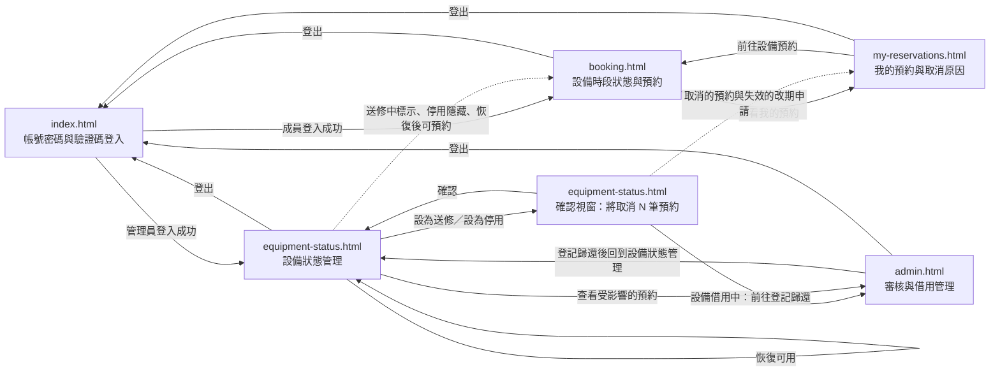

# UI 規劃：設備送修與停用、恢復可用及受影響未來預約的處理 (Equipment Maintenance and Retirement)

**Spec**: [spec.md](../spec.md) | **Plan**: [plan.md](../plan.md) | **Date**: 2026-11-10

- 負責介面：F1 驗證碼與帳號密碼登入登出介面、F2 成員設備預約頁的送修中標示與停用隱藏介面、F3 成員「我的預約」取消原因與停用設備歷史紀錄介面、F4 管理員設備清單狀態操作與確認視窗介面、F5 管理員全體預約管理的取消原因、待審清單與現場領取歸還介面
- 雛形入口：[index.html](./index.html)

## 1. 畫面範疇

| 介面 | 畫面 | 需求依據 |
| ---- | ---- | -------- |
| F1 驗證碼與帳號密碼登入登出介面 | 帳號密碼與 7 位數驗證碼登入 | FR-018 完整保留並向下相容前四次迭代已實作的驗證碼登入與登出功能；SC-005 前四次迭代既有功能回歸測試通過率達 100%；NFR-001 介面文字與錯誤提示使用臺灣繁體中文 |
| F2 成員設備預約頁的送修中標示與停用隱藏介面 | 設備固定時段狀態與預約（送修中標示、停用隱藏） | US3 情境 1–2 送修中設備標示「送修中」且所有時段沒有「預約」按鈕，停用設備不在清單中；US1 情境 9 從尚未重新整理的頁面預約送修中設備時拒絕並顯示「設備送修中，無法預約」；US2 情境 1–2、4 恢復可用後可以預約未來時段、停用設備重新出現，需人工審核設備的新預約進入「待審核」；FR-014 送修中標示且不提供預約操作，停用設備不出現在成員清單；FR-006 非可用設備的新預約被拒絕並顯示說明設備狀態的錯誤提示；FR-011 恢復可用後成員可以預約未來時段；FR-012 被取消的時段恢復後不保留給原成員；FR-013 恢復後依人工審核設定直接成立或進入「待審核」；NFR-001 設備狀態標籤與錯誤提示使用臺灣繁體中文；Edge Cases 恢復後原時段仍空著 |
| F3 成員「我的預約」取消原因與停用設備歷史紀錄介面 | 我的預約（取消原因、改期紀錄與歷史紀錄） | US3 情境 3–5 因設備送修被取消的預約顯示「已取消」與取消原因「設備送修」，停用設備上的「已歸還」紀錄照常顯示，成員自行取消的預約不顯示設備原因；US2 情境 3 恢復可用後被取消的預約仍為「已取消」；FR-015 因設備送修或停用被取消的預約顯示取消原因，成員自行取消的不顯示這兩種原因；FR-016 照常顯示送修中或停用設備上的歷史紀錄、設備名稱與紀錄狀態；FR-012 恢復可用後被取消的預約維持「已取消」、失效的改期申請維持「改期已失效」；FR-004 被取消預約的改期申請變成「改期已失效」，失效原因為「原預約已取消」；NFR-001 取消原因與錯誤提示使用臺灣繁體中文；Edge Cases 停用設備的歷史紀錄 |
| F4 管理員設備清單狀態操作與確認視窗介面 | 設備狀態管理與確認視窗 | US1 情境 1、3、4、8、10、11、15 設為送修後狀態變成「送修中」、確認視窗顯示將取消的預約數與將失效的改期申請數、按「取消」不變、借用中時拒絕、顯示最近變更、送修中直接改為停用、確認時數量不同時拒絕；US2 情境 1–2、5 恢復可用、一般成員越權被拒絕；FR-001 對可用設備設為送修或停用；FR-005 借用中時顯示「設備借用中，請先登記歸還」；FR-007 先顯示確認視窗列出將取消的預約數與將失效的改期申請數，取消時不變；FR-008 每列顯示最近一次狀態變更的管理員名稱與時間；FR-010 送修中與停用之間直接切換；FR-011 恢復可用；FR-013 恢復後保留人工審核設定；FR-017 只允許管理員設定送修、停用與恢復可用；FR-019 確認時資料不同顯示「設備狀態已被變更，請重新確認」；NFR-001 確認視窗與錯誤提示使用臺灣繁體中文；NFR-002 操作回應低於 2 秒；Edge Cases 設備有逾期未還的借用、確認視窗開啟後資料改變 |
| F5 管理員全體預約管理的取消原因、待審清單與現場領取歸還介面 | 審核與借用管理（待審清單、全體預約與取消原因、現場領取歸還） | US1 情境 17 全體預約管理頁顯示「已取消」與取消原因「設備送修」；FR-020 為因設備送修或停用被取消的預約顯示取消原因；FR-004 失效的改期申請之後管理員不能核准；FR-003 時段已開始但尚未領取的預約被取消後不能再登記領取；FR-009 核准待審預約與設定送修同時發生時，設備不留下尚未結束的預約；FR-018 保留審核、改期審核與領取歸還功能；NFR-001 介面文字與錯誤提示使用臺灣繁體中文；Edge Cases 待審核的預約、改期申請審核中、時段進行中但尚未領取 |

不在範疇：

- 刪除設備、新增設備與編輯設備基本資料：spec 的 Out of Scope 已排除；`equipment-status.html` 只提供送修、停用、恢復可用與審核設定切換。
- 預計恢復日期、自動恢復與送修原因備註：spec 的 Out of Scope 已排除；確認視窗沒有日期或備註欄位，只能由管理員按「恢復可用」手動恢復。
- 確認視窗列出受影響預約明細：spec 的 Out of Scope 已排除；確認視窗只顯示數量，管理員在 `admin.html` 的全體預約篩選「已取消」查看取消原因與受影響成員。
- 設備狀態變更歷程畫面：spec 的 Out of Scope 已排除；`equipment-status.html` 每列只顯示最近一次變更的管理員與時間。
- 通知受影響成員（Email、Discord、站內提示）：spec 的 Out of Scope 已排除；成員只在 `my-reservations.html` 看到取消原因。
- 受影響預約自動改期或改到其他設備：spec 的 Out of Scope 已排除；成員自行到 `booking.html` 重新預約。
- 申請改期、撤回改期與切換登入成員比對「本人改期審核中」：`specs/006-reservation-reschedule/ui/my-reservations.html` 與 `booking.html` 已規劃，本次行為不變；007 雛形只顯示改期紀錄、「改期審核中」標示與「本人改期審核中」時段，不重畫申請改期與撤回對話框。
- 同一交易內批次取消預約與改期失效、確認時重新計算數量、與預約或核准並發時的序列化、狀態變更紀錄保存與資料遷移：由 B2、B4、B5、B6 後端介面與 D2、D3 資料庫介面負責；雛形以「雛形狀態」面板呈現拒絕與完成後的畫面。

## 2. 視覺風格

- 氣質：現代專業實驗室／企業管理風（清爽、專業、秩序感強的商務工具風格，支援 Light Mode 淺色模式與 Dark Mode 深色模式雙主題切換），沿用 `specs/003-equipment-loan-booking/ui/plan.md` 的視覺風格。
- 配色：

  | 用途 | 色碼 |
  | ---- | ---- |
  | 背景（`--bg`，Light Mode 預設 ／ Dark Mode） | `#F8FAFC` 淺灰白 ／ `#0F172A` 深石板藍 |
  | 卡片與表單底色（`--surface`，Light ／ Dark） | `#FFFFFF` 純白 ／ `#1E293B` 深灰藍 |
  | 次要區塊底色（`--surface-muted`，Light ／ Dark） | `#F1F5F9` 淺霧灰 ／ `#162032` 深藍灰底 |
  | 主要文字（`--ink`，Light ／ Dark） | `#0F172A` 深藍灰 ／ `#F8FAFC` 淺灰白 |
  | 次要文字（`--muted`，Light ／ Dark） | `#475569` 藍灰 ／ `#94A3B8` 淺藍灰 |
  | 邊框與分隔線（`--line`，Light ／ Dark） | `#E2E8F0` 淺灰藍 ／ `#334155` 深灰藍邊框 |
  | 主色／本人已預約／借用中（`--primary`，Light ／ Dark） | `#2563EB` 靛藍 ／ `#3B82F6` 亮藍 |
  | 主色柔和底（`--primary-soft`，Light ／ Dark） | `#DBEAFE` 淺靛藍 ／ `#1E3A8A` 深靛藍底 |
  | 可用／可預約／成功（`--success`，Light ／ Dark） | `#16A34A` 翠綠 ／ `#22C55E` 亮綠 |
  | 可用／成功柔和底（`--success-soft`，Light ／ Dark） | `#DCFCE7` 淺翠綠 ／ `#14532D` 深綠底 |
  | 已被預約／停用／已取消／改期已失效（`--occupied`，Light ／ Dark） | `#64748B` 中性灰 ／ `#94A3B8` 中灰 |
  | 已被預約／停用柔和底（`--occupied-soft`，Light ／ Dark） | `#F1F5F9` 淺中性灰 ／ `#334155` 深中灰底 |
  | 送修中／待審核／改期審核中／處理中（`--pending`，Light ／ Dark） | `#D97706` 琥珀橘 ／ `#F59E0B` 亮琥珀 |
  | 送修中／待審核柔和底（`--pending-soft`，Light ／ Dark） | `#FEF3C7` 淺琥珀 ／ `#78350F` 深琥珀底 |
  | 已駁回／錯誤／借用中拒絕（`--danger`，Light ／ Dark） | `#DC2626` 珊瑚紅 ／ `#EF4444` 亮紅 |
  | 已駁回／錯誤柔和底（`--danger-soft`，Light ／ Dark） | `#FEE2E2` 淺珊瑚紅 ／ `#7F1D1D` 深紅底 |

- 字體：介面內文使用 `"Noto Sans TC", "PingFang TC", "Microsoft JhengHei", system-ui, sans-serif`；驗證碼、設備編號、預約編號、改期申請編號、時段時間與狀態變更時間使用 `"JetBrains Mono", ui-monospace, SFMono-Regular, Menlo, Consolas, monospace`。
- 版面：內容最大寬度 1120px，手機寬度 360px 仍可完整操作；卡片圓角 12px；每頁頂部導覽列提供品牌標題、5 個頁面導覽連結、目前登入角色徽章、Light Mode／Dark Mode 切換按鈕與登出連結。「送修中」以琥珀色實心徽章標示（暫時性），「停用」以中性灰徽章標示（長期）；「設備送修」「設備停用」取消原因以帶左側色條的說明列顯示在預約卡片內。設定送修或停用的確認視窗為置中彈窗，數量以大字呈現，手機寬度改為全螢幕；設備清單在 720px 以下改為一台設備一張卡片。

## 3. 畫面與流程

### 3.1 頁面清單

| 檔案 | 畫面 | 介面 | 進入方式 |
| ---- | ---- | ---- | -------- |
| `index.html` | 帳號密碼與 7 位數驗證碼登入 | F1 | 雛形入口；頁首「登入」與「登出」 |
| `booking.html` | 設備固定時段狀態與預約（送修中標示、停用隱藏） | F2 | 成員登入成功的「前往設備預約」；頁首「設備預約」；我的預約頁的「前往設備預約」 |
| `my-reservations.html` | 我的預約（取消原因、改期紀錄與歷史紀錄） | F3 | 頁首「我的預約」；設備預約頁預約成立橫幅的「查看我的預約」 |
| `equipment-status.html` | 設備狀態管理與確認視窗 | F4 | 管理員登入成功的「前往設備狀態管理」；頁首「設備狀態管理」；審核與借用管理頁登記歸還橫幅的「前往設備狀態管理」 |
| `admin.html` | 審核與借用管理（待審清單、全體預約與取消原因、現場領取歸還） | F5 | 頁首「審核與借用管理」；設備狀態管理頁送修完成橫幅的「查看受影響的預約」；設備借用中提示的「前往登記歸還」 |

### 3.2 流程

### 3.3 使用者操作

| 編號 | 畫面 | 操作 | 需求依據 |
| ---- | ---- | ---- | -------- |
| A1 | `index.html` | 點擊「重整驗證碼」換一組新的 7 位數驗證碼 | FR-018、SC-005 |
| A2 | `index.html` | 輸入帳號、密碼與驗證碼（或點「帶入帳號」）後送出登入 | FR-018、NFR-001、SC-005 |
| A3 | `index.html` | 點擊頁首「深色模式／淺色模式」切換主題（每頁相同） | NFR-001 |
| A4 | `booking.html` | 點選 7 天內的日期，查看設備清單（停用設備不出現）與 3 個固定時段狀態；送修中設備標示「送修中」，時段沒有預約操作 | US3、FR-014 |
| A5 | `booking.html` | 點選「可預約」時段，在右側面板確認設備、日期時段與審核方式 | FR-011、FR-013 |
| A6 | `booking.html` | 點擊「送出預約」：免審核設備立即成立，需人工審核設備進入「待審核」 | FR-006、FR-013、NFR-001 |
| A7 | `my-reservations.html` | 點擊篩選按鈕（全部、待審核、已核准／有效、借用中、已歸還、已駁回、已取消、改期審核中）篩選預約清單 | FR-015、FR-016 |
| A8 | `my-reservations.html` | 展開或收合某筆預約的「改期紀錄」，查看改期申請狀態與失效原因 | FR-004、FR-012 |
| A9 | `my-reservations.html` | 對本人「已核准／有效」或「待審核」且時段尚未開始的預約點擊「取消預約」或「取消待審申請」並確認 | US3、FR-015 |
| A10 | `equipment-status.html` | 對設備點擊「設為送修」或「設為停用」，開啟確認視窗並等待計算將取消的預約數與將失效的改期申請數 | FR-001、FR-007、FR-010、NFR-002 |
| A11 | `equipment-status.html` | 在確認視窗點擊「確認設為送修」或「確認設為停用」 | FR-001、FR-007、FR-019 |
| A12 | `equipment-status.html` | 在確認視窗點擊「取消」關閉視窗 | US1、FR-007 |
| A13 | `equipment-status.html` | 對「送修中」或「停用」設備點擊「恢復可用」 | US2、FR-011、FR-013 |
| A14 | `equipment-status.html` | 點擊「切換為免審核」或「切換為需人工審核」 | FR-013、FR-018 |
| A15 | `admin.html` | 在待審清單切換「預約申請」與「改期申請」分頁 | FR-018 |
| A16 | `admin.html` | 對待審預約點擊「核准申請」，或對改期申請點擊「核准改期」 | FR-004、FR-009、FR-018 |
| A17 | `admin.html` | 對待審預約或改期申請點擊「駁回」，填寫選填的駁回原因（200 字內）後點擊「確認駁回」 | FR-018 |
| A18 | `admin.html` | 在全體預約點擊篩選按鈕（全部、待審核、已核准／有效、借用中、已歸還、已駁回、已取消），查看取消原因 | US1、FR-020 |
| A19 | `admin.html` | 對今日且時段尚未結束的「已核准／有效」預約點擊「登記領取」 | FR-003、FR-018 |
| A20 | `admin.html` | 對「借用中」紀錄點擊「登記歸還」 | FR-005、FR-018 |

## 4. 狀態

每個雛形頁面右下角的「雛形狀態」面板可切換本節列出的該頁狀態。目前時間固定為 `2026-11-10`（二）14:30；吳承翰在 14:32 把 `EQ-101` 設為送修，在 14:40 把 `EQ-105` 恢復可用。

| 畫面 | 狀態 | 呈現方式 | 需求依據 |
| ---- | ---- | -------- | -------- |
| `index.html` | 載入驗證碼中 | 驗證碼框顯示轉圈與「正在產生 7 位數驗證碼…」，「登入系統」停用 | FR-018 |
| `index.html` | 待登入 | 帳號 `lin.yating`、密碼與驗證碼 `K3m8P2q` 已填入，右側列出林雅婷、陳冠廷（一般成員）與吳承翰、黃詩涵（管理員）4 個預建帳號 | FR-018、SC-005 |
| `index.html` | 已重整驗證碼 | 驗證碼更新為 `R7d4N9w`，頁頂提示「已更換為新的 7 位數驗證碼 R7d4N9w，原驗證碼 K3m8P2q 已失效。」 | FR-018 |
| `index.html` | 登入驗證中 | 按鈕改為「登入驗證中…」並停用，所有欄位停用 | FR-018 |
| `index.html` | 成員登入成功 | 成功卡片「登入成功，歡迎林雅婷（一般成員）」與「前往設備預約」 | FR-018、SC-005 |
| `index.html` | 管理員登入成功 | 成功卡片「登入成功，歡迎吳承翰（管理員）」與「前往設備狀態管理」 | FR-018、SC-005 |
| `index.html` | 已登出 | 頁頂提示「您已登出。請重新輸入帳號、密碼與新的驗證碼 b6T2x8L 登入。」 | FR-018 |
| `booking.html` | 載入中 | 日期列與設備卡片以灰色骨架顯示，提示「正在載入設備與固定時段狀態…」 | NFR-001 |
| `booking.html` | 檢視固定時段狀態 | 林雅婷檢視 `2026-11-10`，清單「共 5 台設備」：`EQ-101` 晚間「本人待審核」、`EQ-103` 下午「本人借用中」、`EQ-104` 晚間「已被預約」；`EQ-105 桌上型冷凍離心機 Eppendorf 5430R` 標示琥珀色「送修中」徽章與「設備送修中，暫停預約」，3 個時段都顯示「送修中」且不能點選；停用的 `EQ-106` 不出現 | US3、FR-014 |
| `booking.html` | 已選取可預約時段 | 林雅婷選取 `EQ-104 微量分光光度計 Thermo NanoDrop One` 於 `2026-11-13` 上午，右側面板顯示「免審核」與「送出後立即成為「已核准／有效」並占用時段。」 | FR-013 |
| `booking.html` | 送出預約中 | 「送出預約」改為「送出預約中…」並停用，時段與日期按鈕停用 | FR-006、NFR-002 |
| `booking.html` | 預約已成立 | 頁頂綠色橫幅「預約已成立：預約編號 RV-20261110-11（EQ-104 微量分光光度計 Thermo NanoDrop One，2026-11-13 上午 09:00–12:00），狀態為「已核准／有效」。」與「查看我的預約」 | FR-018 |
| `booking.html` | 設備恢復可用後 | 管理員恢復 `EQ-105` 與 `EQ-106` 後，林雅婷檢視 `2026-11-14`：清單「共 6 台設備」，`EQ-105` 不再標示「送修中」並顯示「需人工審核」，`EQ-106` 重新出現並顯示「免審核」，兩台的時段都顯示「可預約」；已選取 `EQ-105` 上午 | US2、FR-011、FR-013 |
| `booking.html` | 待審核申請已送出 | 頁頂琥珀色橫幅「申請已送出：預約編號 RV-20261110-12（EQ-105 桌上型冷凍離心機 Eppendorf 5430R，2026-11-14 上午 09:00–12:00）目前為「待審核」，管理員核准前不占用時段。」 | US2、FR-013 |
| `my-reservations.html` | 載入中 | 預約卡片以灰色骨架顯示，提示「正在載入預約與改期紀錄…」 | FR-015 |
| `my-reservations.html` | 預約清單 | 林雅婷的 9 筆預約由新到舊排列；`RV-20261108-14`（`EQ-105`，`2026-11-11` 下午）顯示「已取消」與琥珀色條說明「取消原因：設備送修｜取消時間 2026-11-09 16:20」；本人取消的 `RV-20261107-06` 只顯示「已取消」與取消時間；停用設備 `EQ-106` 上的 `RV-20261027-02` 顯示設備名稱與「已歸還」；`RV-20261109-21` 標示「改期審核中」 | US3、FR-015、FR-016 |
| `my-reservations.html` | 設備送修後的預約清單 | 14:32 後重新載入：`RV-20261109-21`（`EQ-101`，`2026-11-11` 上午）與 `RV-20261110-06`（`EQ-101`，`2026-11-10` 晚間）變成「已取消」並顯示「取消原因：設備送修｜取消時間 2026-11-10 14:32」；`RV-20261109-21` 的改期紀錄展開，`RR-20261110-01` 為「改期已失效」，說明「失效原因：原預約已取消」 | US1、US3、FR-004、FR-015 |
| `my-reservations.html` | 篩選已取消的預約 | 篩選「已取消」顯示 4 筆：`RV-20261110-06`、`RV-20261109-21`（設備送修）、`RV-20261108-14`（設備送修）、`RV-20261107-06`（不顯示設備原因） | FR-015 |
| `my-reservations.html` | 確認取消預約 | 對話框顯示 `RV-20261109-18`（`EQ-104 微量分光光度計 Thermo NanoDrop One`，`2026-11-12` 上午 09:00–12:00），說明「取消後時段會釋出，這筆預約無法復原。」 | US3、FR-015 |
| `my-reservations.html` | 取消處理中 | 對話框按鈕改為「取消處理中…」並停用 | FR-015、NFR-002 |
| `my-reservations.html` | 已取消預約 | 頁頂綠色橫幅「已取消預約 RV-20261109-18（EQ-104 微量分光光度計 Thermo NanoDrop One，2026-11-12 上午 09:00–12:00），時段已釋出。」；卡片變成「已取消」，只顯示取消時間 `2026-11-10 14:31`，不顯示「設備送修」或「設備停用」 | US3、FR-015 |
| `my-reservations.html` | 設備恢復可用後的預約清單 | 14:40 `EQ-105` 恢復可用後：`RV-20261108-14` 仍為「已取消」與「取消原因：設備送修」；新預約 `RV-20261110-12`（`EQ-105`，`2026-11-14` 上午）為「待審核」 | US2、FR-012、FR-013 |
| `my-reservations.html` | 尚無符合篩選的預約 | 設備送修後篩選「改期審核中」，`RR-20261110-01` 已失效，顯示「目前沒有符合篩選條件的預約」與「顯示全部預約」、「前往設備預約」 | FR-012 |
| `equipment-status.html` | 載入中 | 設備清單以灰色骨架顯示，提示「正在載入設備狀態…」 | FR-008 |
| `equipment-status.html` | 設備清單 | 摘要「可用 4｜送修中 1｜停用 1」；6 台設備依編號排列，每列顯示狀態徽章、審核設定、最近變更（`EQ-105` 吳承翰 `2026-11-09 16:20`、`EQ-106` 黃詩涵 `2026-11-03 10:05`、`EQ-104` 黃詩涵 `2026-10-30 09:12`，其餘「尚無狀態變更」）；「可用」列提供「設為送修」「設為停用」，「送修中」列提供「設為停用」「恢復可用」，「停用」列提供「設為送修」「恢復可用」 | US1、FR-001、FR-008、FR-010 |
| `equipment-status.html` | 計算受影響預約中 | `EQ-101` 的確認視窗開啟，顯示轉圈與「正在計算將取消的預約與將失效的改期申請…」，「確認設為送修」停用 | FR-007、NFR-002 |
| `equipment-status.html` | 設為送修確認視窗 | 標題「設為送修：EQ-101 高解析度光學顯微鏡 Olympus BX53」，狀態「可用 → 送修中」，大字「將取消 4 筆預約、1 筆改期申請將失效」，下方說明取消範圍、已結束紀錄不變與恢復後不會自動復原，按鈕「取消」與「確認設為送修」 | US1、FR-007 |
| `equipment-status.html` | 狀態變更處理中 | 確認視窗按鈕改為「設定中…」並停用，「取消」也停用 | FR-007、NFR-002 |
| `equipment-status.html` | 已設為送修 | 視窗關閉；頁頂綠色橫幅「已將 EQ-101 高解析度光學顯微鏡 Olympus BX53 設為「送修中」，取消 4 筆預約，1 筆改期申請已失效。」與「查看受影響的預約」；`EQ-101` 列顯示「送修中」、最近變更「吳承翰 2026-11-10 14:32」，操作改為「設為停用」「恢復可用」 | US1、FR-001、FR-008 |
| `equipment-status.html` | 改為停用確認視窗 | `EQ-105` 的確認視窗：狀態「送修中 → 停用」，大字「將取消 0 筆預約、0 筆改期申請將失效」，說明「停用後，這台設備會從成員的設備清單隱藏。」 | US1、FR-010 |
| `equipment-status.html` | 已改為停用 | 頁頂綠色橫幅「已將 EQ-105 桌上型冷凍離心機 Eppendorf 5430R 從「送修中」改為「停用」，沒有需要取消的預約。」；`EQ-105` 列顯示「停用」與「吳承翰 2026-11-10 14:35」 | US1、FR-010 |
| `equipment-status.html` | 恢復可用處理中 | `EQ-105` 列的「恢復可用」改為「恢復中…」並停用 | FR-011、NFR-002 |
| `equipment-status.html` | 已恢復可用 | 頁頂綠色橫幅「已將 EQ-105 桌上型冷凍離心機 Eppendorf 5430R 恢復為「可用」，審核設定維持「需人工審核」。送修時取消的預約不會自動復原。」；`EQ-105` 列顯示「可用」與「吳承翰 2026-11-10 14:40」 | US2、FR-011、FR-012、FR-013 |
| `equipment-status.html` | 已切換審核設定 | `EQ-103` 切換為「需人工審核」，頁頂提示「已將 EQ-103 高精度工業熱像儀 FLIR E86 切換為「需人工審核」，之後的新預約會進入待審核。」 | FR-013、FR-018 |
| `admin.html` | 載入中 | 待審清單與全體預約以灰色骨架顯示，提示「正在載入待審清單與全體預約…」 | FR-018 |
| `admin.html` | 審核與借用管理總覽 | 14:30 的資料：「預約申請（3）」列出 `RV-20261110-06`（林雅婷，`EQ-101`）、`RV-20261110-05`（陳冠廷，`EQ-101`）、`RV-20261109-20`（陳冠廷，`EQ-102`）；「改期申請（2）」有 `RR-20261110-01` 與 `RR-20261109-07`；全體預約 17 筆，`RV-20261108-14`、`RV-20261108-15` 顯示取消原因「設備送修」，`RV-20261102-04` 顯示「設備停用」，`RV-20261107-06` 顯示「成員取消」 | US1、FR-018、FR-020 |
| `admin.html` | 設備送修後的總覽 | 14:32 後重新載入：「預約申請（1）」只剩 `RV-20261109-20`，「改期申請（1）」只剩 `RR-20261109-07`；全體預約中 `EQ-101` 的 `RV-20261110-03`、`RV-20261110-06`、`RV-20261109-21`、`RV-20261110-05` 顯示「已取消」與「設備送修」 | US1、FR-004、FR-020 |
| `admin.html` | 篩選已取消的預約 | 設備送修後篩選「已取消」顯示 8 筆，取消原因欄顯示「設備送修」「設備停用」或「成員取消」與取消時間 | US1、FR-020 |
| `admin.html` | 核准處理中 | `RV-20261109-20` 的「核准申請」改為「核准中…」並停用 | FR-018 |
| `admin.html` | 預約已核准 | 頁頂綠色橫幅「已核准預約 RV-20261109-20：陳冠廷的 EQ-102 四通道數位示波器 Keysight DSOX3024T，2026-11-14 上午 09:00–12:00，狀態變成「已核准／有效」。」；申請移出待審清單 | FR-018 |
| `admin.html` | 改期已核准 | 頁頂綠色橫幅「已核准改期申請 RR-20261109-07：陳冠廷的預約 RV-20261109-17 已改到 2026-11-15 上午 09:00–12:00，原時段 2026-11-13 下午 13:00–17:00 已釋出。」 | FR-018 |
| `admin.html` | 填寫駁回原因 | `RV-20261109-20` 的駁回對話框，原因預填「11/14 上午示波器已排定年度校正，請改選其他時段。」，字數「27 / 200」 | FR-018 |
| `admin.html` | 預約已駁回 | 頁頂綠色橫幅「已駁回預約 RV-20261109-20，狀態變成「已駁回」。」；申請移出待審清單 | FR-018 |
| `admin.html` | 登記領取完成 | 頁頂綠色橫幅「已完成登記領取：預約 RV-20261109-16（陳冠廷，EQ-104 微量分光光度計 Thermo NanoDrop One，2026-11-10 晚間 18:00–21:00）已變成「借用中」。」 | FR-018 |
| `admin.html` | 登記歸還完成 | 頁頂綠色橫幅「已完成登記歸還：預約 RV-20261109-10（陳冠廷，EQ-102 四通道數位示波器 Keysight DSOX3024T，2026-11-09 晚間 18:00–21:00）已變成「已歸還」。EQ-102 已沒有借用中的預約。」與「前往設備狀態管理」 | FR-005、FR-018 |
| `admin.html` | 待審清單沒有預約申請 | 設備送修後核准 `RV-20261109-20`，「預約申請（0）」分頁顯示「目前沒有待審的預約申請」 | FR-018；Edge Cases 待審核的預約 |

## 5. 驗證與錯誤回饋

錯誤狀態同樣可從「雛形狀態」面板切換；同一畫面的多個欄位驗證錯誤合併為一個狀態「欄位驗證錯誤」。

| 畫面 | 情境 | 觸發條件 | 畫面回饋 | 需求依據 |
| ---- | ---- | -------- | -------- | -------- |
| `index.html` | 帳號空白 | 送出時帳號欄為空 | 帳號欄紅框，下方「請輸入登入帳號」 | FR-018、NFR-001 |
| `index.html` | 密碼空白 | 送出時密碼欄為空 | 密碼欄紅框，下方「請輸入登入密碼」 | FR-018、NFR-001 |
| `index.html` | 驗證碼不足 7 位 | 驗證碼輸入 `K3m8`（4 碼） | 驗證碼欄紅框，下方「請輸入完整的 7 位數英數驗證碼（區分英文大小寫）」 | FR-018、NFR-001 |
| `index.html` | 驗證碼大小寫不符 | 畫面驗證碼 `K3m8P2q`，輸入 `k3m8p2q` 送出 | 頁頂紅色橫幅「驗證碼錯誤：英文要區分大小寫（例如 a 與 A 不同）。原驗證碼已失效，請輸入新驗證碼 R7d4N9w。」 | FR-018、NFR-001 |
| `index.html` | 帳號或密碼錯誤 | 帳號 `lin.yating`、密碼 `WrongPass123` 送出 | 頁頂紅色橫幅「帳號或密碼不正確。原驗證碼已失效，請輸入新驗證碼 y4H9c2V 後重試。」 | FR-018、NFR-001 |
| `index.html` | 未登入存取受保護頁面 | 未登入時開啟設備預約、我的預約、設備狀態管理或審核與借用管理 | 頁頂紅色橫幅「請先登入，才能查看設備預約、我的預約、設備狀態管理或審核與借用管理。」 | FR-018、NFR-001 |
| `booking.html` | 未選擇時段 | 沒有選取「可預約」時段就點擊「送出預約」 | 右側面板下方紅字「請先在左側點選一個標示「可預約」的固定時段。」 | FR-018、NFR-001 |
| `booking.html` | 送修中設備的時段 | `EQ-105` 為「送修中」，點選它的任一時段 | 卡片標示「送修中」與「設備送修中，暫停預約」；3 個時段顯示「送修中」且為不能點選的灰色格子，右側面板不變 | US3、FR-014 |
| `booking.html` | 停用設備不顯示 | `EQ-106` 為「停用」 | 設備清單只有 5 台，不出現 `EQ-106` 的卡片或時段 | US3、FR-014 |
| `booking.html` | 預約時設備已送修 | 林雅婷在 14:30 載入的頁面選取 `EQ-101` 於 `2026-11-13` 下午，14:33 送出（管理員已在 14:32 設為送修） | 頁頂紅色橫幅「設備送修中，無法預約：EQ-101 高解析度光學顯微鏡 Olympus BX53 目前送修中，這筆預約沒有建立，請改選其他設備。」；`EQ-101` 卡片改為「送修中」，所有時段不能點選，右側選取清除 | US1、FR-006、NFR-001；Edge Cases 同時預約與送修 |
| `booking.html` | 預約時設備已停用 | 同上，但管理員已把 `EQ-101` 設為停用 | 頁頂紅色橫幅「設備已停用，無法預約：EQ-101 高解析度光學顯微鏡 Olympus BX53 已停用，這筆預約沒有建立，設備已從清單移除。」；`EQ-101` 卡片消失，清單變成「共 4 台設備」 | FR-006、FR-014、NFR-001 |
| `booking.html` | 點選已被預約或已開始的時段 | 林雅婷點選 `2026-11-10` 晚間 `EQ-104`（已被預約）或 `2026-11-10` 上午 `EQ-102`（已開始） | 右側面板下方紅字「2026-11-10 晚間 18:00–21:00 已被預約，請選擇標示「可預約」的時段。」或「2026-11-10 上午 09:00–12:00 已開始，請選擇尚未開始的時段。」 | FR-018、NFR-001 |
| `booking.html` | 恢復後原時段仍空著 | `EQ-105` 恢復可用後，林雅婷點選日期 `2026-11-11`，原本 `RV-20261108-14` 的下午時段 | 該時段顯示「可預約」，可以選取並送出，不標示原預約或優先權 | US2、FR-012；Edge Cases 恢復後原時段仍空著 |
| `my-reservations.html` | 因設備送修或停用取消的預約 | `RV-20261108-14` 的取消原因為設備送修 | 卡片顯示「已取消」徽章，下方琥珀色條「取消原因：設備送修｜取消時間 2026-11-09 16:20」 | US3、FR-015 |
| `my-reservations.html` | 成員自行取消的預約 | `RV-20261107-06` 由林雅婷在 `2026-11-08 21:10` 取消 | 卡片只顯示「已取消」與「取消時間 2026-11-08 21:10」，不顯示「設備送修」或「設備停用」 | US3、FR-015 |
| `my-reservations.html` | 停用設備的歷史紀錄 | `EQ-106` 已停用，林雅婷有 `RV-20261027-02`（`2026-10-28` 下午）已歸還 | 卡片照常顯示「EQ-106 紫外光可見光分光光譜儀 Hitachi U-2900」、「已歸還」、領取 `2026-10-28 13:06` 與歸還 `2026-10-28 16:48` | US3、FR-016；Edge Cases 停用設備的歷史紀錄 |
| `my-reservations.html` | 改期申請因原預約取消而失效 | `EQ-101` 送修後，`RV-20261109-21` 的 `RR-20261110-01` | 改期紀錄顯示灰色「改期已失效」與「失效原因：原預約已取消」，預約卡片不再標示「改期審核中」 | FR-004、FR-012 |
| `my-reservations.html` | 取消時預約已因設備送修取消 | 林雅婷在 14:30 載入的頁面，14:33 對 `RV-20261109-21` 點擊「取消預約」並確認 | 頁頂紅色橫幅「無法取消：預約 RV-20261109-21 已在 2026-11-10 14:32 因設備送修取消，取消原因為「設備送修」。」；清單重新載入為設備送修後的內容 | FR-015、NFR-001 |
| `equipment-status.html` | 設備借用中 | 對 `EQ-102` 點擊「設為送修」，它有 `RV-20261109-10`（陳冠廷，`2026-11-09` 晚間）逾期未還 | 確認視窗不顯示數量，改為紅框提示「設備借用中，請先登記歸還」與「預約 RV-20261109-10（陳冠廷，2026-11-09 晚間 18:00–21:00）已超過歸還時間，仍在借用中。」，「確認設為送修」停用，提供「前往登記歸還」；`EQ-102` 仍為「可用」 | US1、FR-005、NFR-001；Edge Cases 設備有逾期未還的借用 |
| `equipment-status.html` | 設備狀態已被變更 | 確認視窗顯示「將取消 4 筆預約」時，陳冠廷送出 `RV-20261110-09`（`EQ-101`，`2026-11-13` 上午），管理員才按「確認設為送修」 | 視窗關閉，頁頂紅色橫幅「設備狀態已被變更，請重新確認。EQ-101 高解析度光學顯微鏡 Olympus BX53 與所有預約都沒有變更。」；`EQ-101` 仍為「可用」；再點「設為送修」顯示「將取消 5 筆預約、1 筆改期申請將失效」 | US1、FR-019；Edge Cases 確認視窗開啟後資料改變 |
| `equipment-status.html` | 取消確認視窗 | 在 `EQ-101` 的確認視窗點擊「取消」 | 視窗關閉，`EQ-101` 仍為「可用」，最近變更仍為「尚無狀態變更」，不顯示任何橫幅 | US1、FR-007 |
| `equipment-status.html` | 權限不足 | 以一般成員 `lin.yating` 開啟設備狀態管理，或呼叫設為送修、停用、恢復可用 | 隱藏設備清單，顯示紅框卡片「權限不足」與「設定送修、停用與恢復可用只限管理員操作。您目前登入的身分是一般成員（林雅婷）。」，提供「返回設備預約」與「切換管理員帳號登入」 | US2、FR-017、NFR-001 |
| `admin.html` | 核准時預約已取消 | 14:30 載入的待審清單，14:33 對 `RV-20261110-05`（`EQ-101`）點擊「核准申請」 | 頁頂紅色橫幅「無法核准：預約 RV-20261110-05 已在 2026-11-10 14:32 因設備送修取消，已移出待審清單。」；清單重新載入，「預約申請」只剩 `RV-20261109-20` | FR-009、FR-002；Edge Cases 待審核的預約 |
| `admin.html` | 核准改期時申請已失效 | 14:30 載入的待審清單，14:33 對 `RR-20261110-01` 點擊「核准改期」 | 頁頂紅色橫幅「無法核准：改期申請 RR-20261110-01 已變成「改期已失效」（失效原因：原預約已取消），已移出待審清單。」；「改期申請」只剩 `RR-20261109-07` | FR-004；Edge Cases 改期申請審核中 |
| `admin.html` | 登記領取時預約已取消 | 14:30 載入的全體預約，14:33 對 `RV-20261110-03`（陳冠廷，`EQ-101`，`2026-11-10` 下午，時段進行中）點擊「登記領取」 | 頁頂紅色橫幅「無法登記領取：預約 RV-20261110-03 已在 2026-11-10 14:32 因設備送修取消，不能領取這台設備。」；該列變成「已取消」與「設備送修」，「登記領取」消失 | FR-003；Edge Cases 時段進行中但尚未領取 |
| `admin.html` | 因設備送修或停用取消的預約 | 全體預約中取消原因為設備送修或設備停用的預約 | 取消原因欄顯示琥珀色「設備送修」或灰色「設備停用」與取消時間，成員本人取消的顯示「成員取消」 | US1、FR-020 |
| `admin.html` | 權限不足 | 以一般成員 `lin.yating` 開啟審核與借用管理，或呼叫核准、駁回、登記領取與歸還 | 隱藏所有管理區塊，顯示紅框卡片「權限不足」與「審核預約、改期申請與登記領取歸還只限管理員操作。您目前登入的身分是一般成員（林雅婷）。」，提供「返回設備預約」與「切換管理員帳號登入」 | FR-017、FR-018、NFR-001 |
