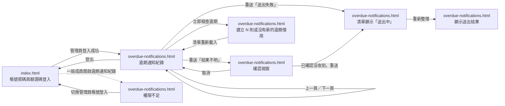

# UI 規劃：逾期借用的 Discord 通知、送出結果查看與重送、手動逾期檢查 (Overdue Discord Notification)

**Spec**: [spec.md](../spec.md) | **Plan**: [plan.md](../plan.md) | **Date**: 2026-11-11

- 負責介面：F1 管理員「逾期通知紀錄」頁籤的通知清單與狀態篩選介面、F2 通知重送操作與「結果不明」確認視窗介面、F3 「立即檢查逾期」操作與建立數量提示介面、F4 前五版成員與管理員既有畫面（登入、設備預約、我的預約、管理員總覽）
- 雛形入口：[index.html](./index.html)

## 1. 畫面範疇

| 介面 | 畫面 | 需求依據 |
| ---- | ---- | -------- |
| F1 管理員「逾期通知紀錄」頁籤的通知清單與狀態篩選介面 | 逾期通知紀錄（通知清單與狀態篩選） | US2 情境 1–3、9–12、15、16 管理員查看通知清單、失敗原因、送出時間、依狀態篩選，送出中、送出成功與借用已歸還的通知沒有「重送」，一般成員被拒絕，demo seed 後看到三種狀態；FR-003 依建立時間由新到舊列出設備編號與名稱、借用成員姓名、預約日期與時段、通知狀態、嘗試次數、最後嘗試時間，送出成功顯示送出時間，送出失敗顯示失敗原因；FR-004 依通知狀態篩選；FR-008 顯示借用是否已歸還，已歸還時不提供重送；FR-019 只允許管理員查看通知紀錄，一般成員顯示權限不足的繁體中文錯誤提示；NFR-002 狀態標籤（送出中、送出成功、送出失敗、結果不明）與失敗原因使用臺灣繁體中文並明確說明原因；NFR-003 Webhook 位址不得出現在畫面與失敗原因；Edge Cases 逾期好幾天仍未歸還、Discord 要求等待很久、Webhook 沒有設定或已失效 |
| F2 通知重送操作與「結果不明」確認視窗介面 | 逾期通知紀錄（重送與「結果不明」確認視窗） | US2 情境 4–8、13 重送「送出失敗」後立即顯示「送出中」、重新整理後同一則通知變成「送出成功」且嘗試次數增加、「結果不明」先顯示確認視窗、取消時不變、確認後顯示「送出中」、從未重新整理的頁面重送已歸還借用時被拒絕；FR-005 點擊重送後不等結果，立即顯示「送出中」，送出結束後重新整理清單看到結果，不建立新的通知；FR-006 重送「結果不明」前顯示確認視窗，提醒先到 Discord 頻道確認沒有收到、重送可能造成重複通知，取消時通知不變；FR-007 只對送出失敗與結果不明提供重送，對送出中或送出成功的通知送出重送時顯示說明目前狀態的錯誤提示；FR-008 借用已歸還時顯示「借用已歸還，不需要重送」；FR-018 多位管理員同時重送同一則通知時只送出一次；NFR-002 確認視窗與錯誤提示使用臺灣繁體中文；Edge Cases 結果不明但 Discord 其實已收到、通知送出中或結果不明時借用被歸還 |
| F3 「立即檢查逾期」操作與建立數量提示介面 | 逾期通知紀錄（立即檢查逾期與建立數量提示） | US3 情境 1–3、6 管理員點擊「立即檢查逾期」後顯示這次建立的通知數、沒有新的逾期借用時顯示「沒有新的逾期借用」、已有「送出失敗」通知的逾期借用不再建立通知、demo seed 後至少建立 1 則；FR-009 手動執行一次和自動檢查相同的逾期檢查；FR-010 立即顯示新建立的通知數，不等待送出結果，沒有時顯示「沒有新的逾期借用」；FR-012 已經有通知的逾期借用不再建立通知；NFR-001 逾期借用 100 筆以內時從點擊到顯示建立數量低於 2 秒；SC-005 手動檢查顯示建立數量低於 2 秒 |
| F4 前五版成員與管理員既有畫面（登入、設備預約、我的預約、管理員總覽） | 帳號密碼與 7 位數驗證碼登入（前五版既有畫面的入口） | US1 情境 10 升級到本版後既有資料與前幾次的功能照常運作；FR-020 完整保留並向下相容前五次迭代已實作的功能；FR-019 管理員是唯一可以查看通知紀錄、重送與手動檢查的角色；SC-007 前五次迭代既有功能回歸測試通過率 100% |

不在範疇：

- F4 中的設備預約、我的預約與管理員總覽（設備狀態操作、待審清單、全體預約與領取歸還）：本次行為不變，FR-020 只要求完整保留；這些畫面的規劃與雛形沿用 `specs/007-equipment-maintenance-retire/ui/`，本次不重畫。雛形的 `index.html` 只保留登入與登出；管理員登入成功卡片的「前往逾期通知紀錄」只是雛形的入口。產品中管理員登入後仍進入 007 的「設備狀態管理」，本次只在頁首新增「逾期通知紀錄」頁籤；這個頁籤對一般成員也顯示，點開後看到第 5 節的「權限不足」卡片。
- Discord 頻道中的通知內容（設備、成員姓名、預約日期與時段、逾期多久）：由 N1 Discord Webhook 逾期通知送出負責，畫面不顯示通知文字預覽。
- 自動逾期檢查的排程、送出與自動重試、系統恢復運作時的處理：由 S1、S2、S3 排程介面負責；畫面只呈現它們寫入的通知狀態，「送出中」不區分等待自動重試或等待 Discord 回應。
- 在畫面上設定 Discord Webhook 位址與自動檢查間隔：spec 的 Out of Scope「在畫面上設定通知」已排除，Webhook 位址也不得出現在畫面上（NFR-003）。
- 一次重送多則通知（全部重送、勾選多則重送）：spec 的 Out of Scope 已排除，每則通知各自有「重送」按鈕。
- 刪除或封存通知紀錄：spec 的 Out of Scope 已排除。
- 清單自動更新或即時推播通知狀態：spec 沒有涵蓋，Clarifications 決定由管理員按「重新整理」看到送出結果。
- 成員端的逾期提醒：spec 的 Out of Scope「通知借用成員本人」已排除，成員畫面不顯示逾期提醒。

## 2. 視覺風格

- 氣質：現代專業實驗室／企業管理風（清爽、專業、秩序感強的商務工具風格，支援 Light Mode 淺色模式與 Dark Mode 深色模式雙主題切換），沿用 `specs/003-equipment-loan-booking/ui/plan.md` 的視覺風格。
- 配色：

  | 用途 | 色碼 |
  | ---- | ---- |
  | 背景（`--bg`，Light Mode 預設 ／ Dark Mode） | `#F8FAFC` 淺灰白 ／ `#0F172A` 深石板藍 |
  | 卡片與表單底色（`--surface`，Light ／ Dark） | `#FFFFFF` 純白 ／ `#1E293B` 深灰藍 |
  | 次要區塊底色（`--surface-muted`，Light ／ Dark） | `#F1F5F9` 淺霧灰 ／ `#162032` 深藍灰底 |
  | 主要文字（`--ink`，Light ／ Dark） | `#0F172A` 深藍灰 ／ `#F8FAFC` 淺灰白 |
  | 次要文字（`--muted`，Light ／ Dark） | `#475569` 藍灰 ／ `#94A3B8` 淺藍灰 |
  | 邊框與分隔線（`--line`，Light ／ Dark） | `#E2E8F0` 淺灰藍 ／ `#334155` 深灰藍邊框 |
  | 主色／送出中／借用中（`--primary`，Light ／ Dark） | `#2563EB` 靛藍 ／ `#3B82F6` 亮藍 |
  | 主色柔和底（`--primary-soft`，Light ／ Dark） | `#DBEAFE` 淺靛藍 ／ `#1E3A8A` 深靛藍底 |
  | 送出成功（`--success`，Light ／ Dark） | `#16A34A` 翠綠 ／ `#22C55E` 亮綠 |
  | 送出成功柔和底（`--success-soft`，Light ／ Dark） | `#DCFCE7` 淺翠綠 ／ `#14532D` 深綠底 |
  | 已歸還／中性狀態（`--occupied`，Light ／ Dark） | `#64748B` 中性灰 ／ `#94A3B8` 中灰 |
  | 已歸還柔和底（`--occupied-soft`，Light ／ Dark） | `#F1F5F9` 淺中性灰 ／ `#334155` 深中灰底 |
  | 結果不明／提醒確認（`--pending`，Light ／ Dark） | `#D97706` 琥珀橘 ／ `#F59E0B` 亮琥珀 |
  | 結果不明柔和底（`--pending-soft`，Light ／ Dark） | `#FEF3C7` 淺琥珀 ／ `#78350F` 深琥珀底 |
  | 送出失敗／錯誤（`--danger`，Light ／ Dark） | `#DC2626` 珊瑚紅 ／ `#EF4444` 亮紅 |
  | 送出失敗／錯誤柔和底（`--danger-soft`，Light ／ Dark） | `#FEE2E2` 淺珊瑚紅 ／ `#7F1D1D` 深紅底 |

- 字體：介面內文使用 `"Noto Sans TC", "PingFang TC", "Microsoft JhengHei", system-ui, sans-serif`；驗證碼、設備編號、預約編號、時段時間與通知的嘗試及送出時間使用 `"JetBrains Mono", ui-monospace, SFMono-Regular, Menlo, Consolas, monospace`。
- 版面：內容最大寬度 1120px，手機寬度 360px 仍可完整操作；卡片圓角 12px；每頁頂部導覽列提供品牌標題、2 個頁面導覽連結、目前登入角色徽章、Light Mode／Dark Mode 切換按鈕與登出連結。通知狀態以徽章標示：「送出中」為靛藍底加轉圈、「送出成功」為綠色、「送出失敗」為紅色、「結果不明」為琥珀色；失敗原因以帶左側紅色條的說明列顯示在狀態下方。「立即檢查逾期」與「重新整理」放在清單標題列右側，狀態篩選下拉選單在清單上方。重送「結果不明」的確認視窗為置中彈窗，手機寬度改為全螢幕；通知清單在 720px 以下改為一則通知一張卡片。

## 3. 畫面與流程

### 3.1 頁面清單

| 檔案 | 畫面 | 介面 | 進入方式 |
| ---- | ---- | ---- | -------- |
| `index.html` | 帳號密碼與 7 位數驗證碼登入 | F4 | 雛形入口；頁首「登入」與「登出」；逾期通知紀錄頁權限不足卡片的「切換管理員帳號登入」 |
| `overdue-notifications.html` | 逾期通知紀錄（通知清單、狀態篩選、重送與確認視窗、立即檢查逾期） | F1、F2、F3 | 管理員登入成功的「前往逾期通知紀錄」；頁首「逾期通知紀錄」 |

### 3.2 流程

### 3.3 使用者操作

| 編號 | 畫面 | 操作 | 需求依據 |
| ---- | ---- | ---- | -------- |
| A1 | `index.html` | 點擊「重整驗證碼」換一組新的 7 位數驗證碼 | FR-020、SC-007 |
| A2 | `index.html` | 輸入帳號、密碼與驗證碼（或點「帶入帳號」）後送出登入 | FR-020、SC-007 |
| A3 | `index.html` | 點擊頁首「深色模式／淺色模式」切換主題（每頁相同） | FR-020 |
| A4 | `index.html` | 登入成功後點擊「切換其他帳號」回到登入表單 | FR-020 |
| A5 | `index.html` | 管理員登入成功後點擊「前往逾期通知紀錄」 | FR-003、FR-019 |
| A6 | `overdue-notifications.html` | 從「通知狀態」下拉選單選擇全部、送出中、送出成功、送出失敗或結果不明，篩選通知清單；切換篩選後清單回到第 1 頁 | FR-004 |
| A7 | `overdue-notifications.html` | 查看每則通知的設備、借用成員、預約日期與時段、通知狀態、嘗試次數、最後嘗試時間、送出時間或失敗原因，以及借用中或已歸還 | FR-003、FR-008、NFR-002 |
| A8 | `overdue-notifications.html` | 對「送出失敗」且仍在借用中的通知點擊「重送」 | FR-005、FR-007 |
| A9 | `overdue-notifications.html` | 對「結果不明」且仍在借用中的通知點擊「重送」，在確認視窗點擊「已確認沒收到，重送」 | FR-005、FR-006 |
| A10 | `overdue-notifications.html` | 在重送確認視窗點擊「取消」關閉視窗 | FR-006 |
| A11 | `overdue-notifications.html` | 點擊「重新整理」重新載入清單，查看重送與自動送出的結果 | FR-005 |
| A12 | `overdue-notifications.html` | 點擊「立即檢查逾期」，查看這次建立的逾期通知數 | FR-009、FR-010、NFR-001 |
| A13 | `overdue-notifications.html` | 一般成員在權限不足卡片點擊「切換管理員帳號登入」 | FR-019 |
| A14 | `overdue-notifications.html` | 清單超過一頁（每頁 20 則）時，點擊清單下方換頁列的「上一頁」或「下一頁」換頁；點擊「重新整理」、重送成功與重送被拒後清單重新載入時都停在目前頁碼，「立即檢查逾期」後回到第 1 頁；停在目前頁碼重新載入時，目前頁碼超過重新載入後的總頁數就改載最後一頁，不顯示空清單（第 4 節「目前頁碼超過總頁數」） | FR-003、FR-005 |

## 4. 狀態

每個雛形頁面右下角的「雛形狀態」面板可切換本節列出的該頁狀態。目前時間固定為 `2026-11-11`（三）17:01，今天下午時段 `13:00–17:00` 剛結束；登入的管理員為吳承翰。

| 畫面 | 狀態 | 呈現方式 | 需求依據 |
| ---- | ---- | -------- | -------- |
| `index.html` | 載入驗證碼中 | 驗證碼框顯示轉圈與「正在產生 7 位數驗證碼…」，「登入系統」停用 | FR-020 |
| `index.html` | 待登入 | 帳號 `wu.chenghan`、密碼與驗證碼 `T4n7Q2k` 已填入，右側列出林雅婷、陳冠廷（一般成員）與吳承翰、黃詩涵（管理員）4 個預建帳號 | FR-020、SC-007 |
| `index.html` | 已重整驗證碼 | 驗證碼更新為 `H8v3M6r`，頁頂提示「已更換為新的 7 位數驗證碼 H8v3M6r，原驗證碼 T4n7Q2k 已失效。」 | FR-020 |
| `index.html` | 登入驗證中 | 按鈕改為「登入驗證中…」並停用，所有欄位停用 | FR-020 |
| `index.html` | 成員登入成功 | 成功卡片「登入成功，歡迎林雅婷（一般成員）」，列出帳號、單位與角色，提供「切換其他帳號」 | FR-020、SC-007 |
| `index.html` | 管理員登入成功 | 成功卡片「登入成功，歡迎吳承翰（管理員）」與「前往逾期通知紀錄」 | FR-019、FR-020 |
| `index.html` | 已登出 | 頁頂提示「您已登出。請重新輸入帳號、密碼與新的驗證碼 c5W9p3D 登入。」 | FR-020 |
| `overdue-notifications.html` | 載入中 | 篩選列與清單以灰色骨架顯示，提示「正在載入逾期通知紀錄…」 | FR-003 |
| `overdue-notifications.html` | 通知清單 | 「共 8 則通知」依建立時間由新到舊：`RV-20261110-13`（林雅婷，`EQ-103`，`2026-11-10` 晚間）「送出中」嘗試 5 次；`RV-20261110-12`（陳冠廷，`EQ-102`，`2026-11-10` 晚間）「送出失敗」與「失敗原因：Discord 伺服器錯誤」、借用中、有「重送」；`RV-20261110-09`（林雅婷，`EQ-104`，`2026-11-10` 下午）「結果不明」、借用中、有「重送」；`RV-20261110-05`（陳冠廷，`EQ-106`）「送出失敗」與「Discord 請求太頻繁」、已歸還；`RV-20261110-02`（林雅婷，`EQ-101`）「送出成功」與「送出時間 2026-11-10 12:01」；`RV-20261109-10`（陳冠廷，`EQ-105`，`2026-11-09` 晚間）「送出成功」、仍借用中；`RV-20261109-04`（林雅婷，`EQ-104`）「結果不明」、已歸還；`RV-20261108-07`（陳冠廷，`EQ-106`）「送出失敗」與「通知設定有誤：Webhook 已失效」、已歸還 | US2、FR-003、FR-008、FR-020 |
| `overdue-notifications.html` | 通知超過一頁 | 清單共 45 則：上列 8 則，加上 37 則 `2026-10-26`～`2026-11-07` 已「送出成功」且已歸還的通知；每頁 20 則，清單上方「共 45 則通知」，清單下方換頁列「第 1／3 頁，第 1–20 則」，「上一頁」停用、「下一頁」可用；清單只有一頁時不顯示換頁列 | FR-003 |
| `overdue-notifications.html` | 換頁中 | 在第 1 頁點擊「下一頁」後，「上一頁」「下一頁」「重新整理」「立即檢查逾期」與「通知狀態」下拉選單停用，清單變淡並顯示「正在載入第 2 頁…」；以上呈現在載入超過 0.3 秒時才出現，0.3 秒內完成時畫面不變淡、不顯示提示 | FR-003 |
| `overdue-notifications.html` | 中間頁 | 第 2 頁列出第 21–40 則，換頁列「第 2／3 頁，第 21–40 則」，「上一頁」與「下一頁」都可用 | FR-003 |
| `overdue-notifications.html` | 最後一頁 | 第 3 頁列出第 41–45 則（`2026-10-26`～`2026-10-28` 的通知），換頁列「第 3／3 頁，第 41–45 則」，「下一頁」停用、「上一頁」可用 | FR-003 |
| `overdue-notifications.html` | 送出失敗最後一頁 | 下拉選單為「送出失敗」，清單上方「共 41 則通知」：「篩選送出失敗」的 3 則，加上 38 則 `2026-10-26`～`2026-11-07` Webhook 失效期間「送出失敗」與「失敗原因：通知設定有誤：Webhook 已失效」的通知（其中 37 則已歸還）；停在第 3 頁，只列出第 41 則 `RV-20261026-05`（陳冠廷，`EQ-107 恆溫培養箱 Memmert IN110`，`2026-10-26`（一）下午 `13:00–17:00`），借用中、有「重送」；換頁列「第 3／3 頁，第 41–41 則」，「下一頁」停用 | FR-003、FR-004 |
| `overdue-notifications.html` | 目前頁碼超過總頁數 | 在「送出失敗最後一頁」對 `RV-20261026-05` 點擊「重送」：該則變成「送出中」並離開篩選結果，「送出失敗」剩 40 則，總頁數由 3 頁變成 2 頁；清單停在第 3 頁重新載入時沒有任何一則，畫面不顯示空清單，改載最後一頁：清單上方「共 40 則通知」，換頁列「第 2／2 頁，第 21–40 則」，「下一頁」停用；頁頂藍色橫幅「已重新送出 RV-20261026-05 的通知，目前為「送出中」。請稍後按「重新整理」查看送出結果。」。重送被拒或點擊「重新整理」後目前頁碼超過總頁數時，同樣改載最後一頁；篩選結果變成 0 則時改顯示「沒有符合篩選的通知」 | FR-003、FR-004、FR-005 |
| `overdue-notifications.html` | 篩選送出失敗 | 下拉選單為「送出失敗」，清單「共 3 則通知」：`RV-20261110-12`、`RV-20261110-05`、`RV-20261108-07`，各自顯示失敗原因 | FR-004 |
| `overdue-notifications.html` | 其他失敗原因 | 同「篩選送出失敗」的 3 則，失敗原因改為另外 3 種：`RV-20261110-12`「失敗原因：無法連線」、`RV-20261110-05`「失敗原因：通知設定有誤：沒有設定」、`RV-20261108-07`「失敗原因：Discord 拒絕訊息內容」 | FR-003、FR-015、NFR-002 |
| `overdue-notifications.html` | 沒有符合篩選的通知 | 重新整理後選擇「送出中」，清單區顯示「目前沒有「送出中」的通知」與「顯示全部通知」 | FR-004 |
| `overdue-notifications.html` | 沒有逾期通知 | 系統還沒有任何逾期通知，清單區顯示「目前沒有逾期通知」與「借用中的設備超過時段結束時間還沒歸還時，系統會發 Discord 通知並列在這裡。」，「立即檢查逾期」照常可用 | FR-003 |
| `overdue-notifications.html` | 重送處理中 | `RV-20261110-12` 的「重送」改為「重送中…」並停用 | FR-005 |
| `overdue-notifications.html` | 已重送，送出中 | 頁頂藍色橫幅「已重新送出 RV-20261110-12 的通知，目前為「送出中」。請稍後按「重新整理」查看送出結果。」；該列變成「送出中」、嘗試次數仍為 4、不顯示失敗原因、「重送」消失；清單仍為 8 則 | US2、FR-005 |
| `overdue-notifications.html` | 重送結果不明確認視窗 | 對 `RV-20261110-09` 點擊「重送」後的置中視窗：標題「重送「結果不明」的通知？」，列出 `EQ-104 微量分光光度計 Thermo NanoDrop One`、林雅婷、`2026-11-10`（二）下午 `13:00–17:00`、最後嘗試 `2026-11-10 17:01`；琥珀色提醒「系統上次送出這則通知後沒有收到 Discord 回應，Discord 頻道可能已經收到。請先到 Discord 通知頻道確認沒有收到這則通知再重送，重送可能造成頻道出現兩則相同的通知。」；按鈕「取消」與「已確認沒收到，重送」 | US2、FR-006 |
| `overdue-notifications.html` | 重新整理中 | 點擊後「重新整理」立即改為「重新整理中…」並停用，至少維持 0.5 秒，按鈕寬度固定；載入超過 0.3 秒時清單才變淡並在「共 N 則通知」右側顯示轉圈與「正在重新整理…」，0.3 秒內完成時清單不變淡，避免閃爍；完成後「共 N 則通知」右側顯示「已更新 HH:MM:SS」；「共 N 則通知」與表格位置不變；載入中不接受重複的重新整理與換頁 | FR-005 |
| `overdue-notifications.html` | 重新整理後 | 17:02 重新載入：`RV-20261110-13` 變成「送出成功」、嘗試 6 次、送出時間 `2026-11-11 17:02`；已重送的 `RV-20261110-12` 變成「送出成功」、嘗試次數由 4 增加為 5、送出時間 `2026-11-11 17:02`；清單仍為 8 則 | US2、FR-005、FR-017 |
| `overdue-notifications.html` | 檢查逾期中 | 「立即檢查逾期」改為「檢查中…」並停用，「重新整理」也停用 | FR-009、NFR-001 |
| `overdue-notifications.html` | 已建立逾期通知 | 頁頂綠色橫幅「這次建立 1 則逾期通知」；清單重新載入為 9 則，最上方新增 `RV-20261111-05`（陳冠廷，`EQ-101 高解析度光學顯微鏡 Olympus BX53`，`2026-11-11`（三）下午 `13:00–17:00`）「送出中」、嘗試 0 次、最後嘗試「—」；已有通知的 `RV-20261110-12` 仍只有一列「送出失敗」 | US3、FR-009、FR-010、FR-012、SC-005 |
| `overdue-notifications.html` | 沒有新的逾期借用 | 再點一次「立即檢查逾期」，頁頂藍色橫幅「沒有新的逾期借用」，清單仍為 9 則 | US3、FR-010、FR-012 |

## 5. 驗證與錯誤回饋

錯誤狀態同樣可從「雛形狀態」面板切換；同一畫面的多個欄位驗證錯誤合併為一個狀態「欄位驗證錯誤」。

| 畫面 | 情境 | 觸發條件 | 畫面回饋 | 需求依據 |
| ---- | ---- | -------- | -------- | -------- |
| `index.html` | 帳號空白 | 送出時帳號欄為空 | 帳號欄紅框，下方「請輸入登入帳號」 | FR-020 |
| `index.html` | 密碼空白 | 送出時密碼欄為空 | 密碼欄紅框，下方「請輸入登入密碼」 | FR-020 |
| `index.html` | 驗證碼不足 7 位 | 驗證碼輸入 `T4n7`（4 碼） | 驗證碼欄紅框，下方「請輸入完整的 7 位數英數驗證碼（區分英文大小寫）」 | FR-020 |
| `index.html` | 驗證碼大小寫不符 | 畫面驗證碼 `T4n7Q2k`，輸入 `t4n7q2k` 送出 | 頁頂紅色橫幅「驗證碼錯誤：英文要區分大小寫（例如 a 與 A 不同）。原驗證碼已失效，請輸入新驗證碼 H8v3M6r。」 | FR-020 |
| `index.html` | 帳號或密碼錯誤 | 帳號 `wu.chenghan`、密碼 `WrongPass123` 送出 | 頁頂紅色橫幅「帳號或密碼不正確。原驗證碼已失效，請輸入新驗證碼 z2K6f9B 後重試。」 | FR-020 |
| `index.html` | 未登入存取受保護頁面 | 未登入時開啟設備預約、我的預約、管理員總覽或逾期通知紀錄 | 頁頂紅色橫幅「請先登入，才能使用設備預約、我的預約、管理員總覽與逾期通知紀錄。」 | FR-019、FR-020 |
| `overdue-notifications.html` | 送出失敗的通知顯示失敗原因 | `RV-20261110-12` 自動重試 3 次後仍收到 Discord 伺服器錯誤 | 狀態欄紅色徽章「送出失敗」，下方紅色條「失敗原因：Discord 伺服器錯誤」 | US2、FR-003、NFR-002 |
| `overdue-notifications.html` | Discord 要求等待超過 1 分鐘 | `RV-20261110-05` 送出時 Discord 要求等待 2 分鐘 | 狀態欄「送出失敗」，下方「失敗原因：Discord 請求太頻繁」 | FR-003、NFR-002；Edge Cases Discord 要求等待很久 |
| `overdue-notifications.html` | Webhook 已失效 | `RV-20261108-07` 送出時 Discord 回應找不到 Webhook | 狀態欄「送出失敗」，下方「失敗原因：通知設定有誤：Webhook 已失效」，畫面任何位置都不顯示 Webhook 位址 | NFR-002、NFR-003；Edge Cases Webhook 沒有設定或已失效 |
| `overdue-notifications.html` | 連線在訊息送出前就失敗 | `RV-20261110-12` 自動重試 3 次時都在連線建立前失敗（例如找不到 Discord 主機） | 雛形狀態「其他失敗原因」：狀態欄「送出失敗」，下方「失敗原因：無法連線」 | FR-014、NFR-002；Edge Cases 連線在訊息送出前就失敗 |
| `overdue-notifications.html` | Webhook 沒有設定 | `RV-20261110-05` 送出時系統沒有設定 Webhook 位址，沒有送出請求 | 雛形狀態「其他失敗原因」：狀態欄「送出失敗」，下方「失敗原因：通知設定有誤：沒有設定」，畫面任何位置都不顯示 Webhook 位址 | FR-015、NFR-002、NFR-003；Edge Cases Webhook 沒有設定或已失效 |
| `overdue-notifications.html` | Discord 拒絕訊息內容 | `RV-20261108-07` 送出時 Discord 拒絕這則訊息的內容 | 雛形狀態「其他失敗原因」：狀態欄「送出失敗」，下方「失敗原因：Discord 拒絕訊息內容」 | FR-015、NFR-002 |
| `overdue-notifications.html` | 失敗原因的畫面文字 | 通知為「送出失敗」時，依記錄的失敗原因顯示 | 狀態欄下方紅色條「失敗原因：」加上下列其中一種文字：「Discord 請求太頻繁」、「Discord 伺服器錯誤」、「無法連線」、「通知設定有誤：Webhook 已失效」、「通知設定有誤：沒有設定」、「Discord 拒絕訊息內容」；文字與資料模型、合約的失敗原因說明相同 | FR-003、NFR-002 |
| `overdue-notifications.html` | 送出成功的通知 | `RV-20261110-02` 已送出成功 | 綠色徽章「送出成功」與「送出時間 2026-11-10 12:01」，操作欄沒有「重送」 | US2、FR-003、FR-007 |
| `overdue-notifications.html` | 送出中的通知 | `RV-20261110-13` 正在等待 Discord 要求的時間後自動重試 | 靛藍徽章「送出中」加轉圈，操作欄沒有「重送」 | US2、FR-007 |
| `overdue-notifications.html` | 借用已歸還的通知 | `RV-20261110-05`（送出失敗）在 `2026-11-10 18:12` 登記歸還；`RV-20261109-04`（結果不明）在 `2026-11-10 09:20` 登記歸還 | 借用欄灰色徽章「已歸還」與歸還時間，操作欄顯示「借用已歸還」灰字，沒有「重送」；通知狀態維持原值 | US2、FR-008；Edge Cases 通知送出中或結果不明時借用被歸還 |
| `overdue-notifications.html` | 逾期好幾天仍未歸還 | `RV-20261109-10` 從 `2026-11-09` 晚間逾期到今天仍為借用中 | 清單只有一列它的通知「送出成功」，借用欄「借用中」，不會每天新增一列 | FR-012；Edge Cases 逾期好幾天仍未歸還 |
| `overdue-notifications.html` | 取消重送結果不明的通知 | 在 `RV-20261110-09` 的確認視窗點擊「取消」 | 視窗關閉，`RV-20261110-09` 仍為「結果不明」、嘗試 1 次，仍有「重送」，不顯示任何橫幅 | US2、FR-006 |
| `overdue-notifications.html` | 結果不明但 Discord 其實已收到 | 對「結果不明」的 `RV-20261110-09` 點擊「重送」 | 先開啟確認視窗，琥珀色提醒「請先到 Discord 通知頻道確認沒有收到這則通知再重送，重送可能造成頻道出現兩則相同的通知。」；管理員點擊確認前不送出 | FR-006；Edge Cases 結果不明但 Discord 其實已收到 |
| `overdue-notifications.html` | 重送時借用已歸還 | 吳承翰在 17:01 載入的頁面，17:03 對 `RV-20261110-12` 點擊「重送」；陳冠廷的 `EQ-102` 已在 17:02 登記歸還 | 頁頂紅色橫幅「借用已歸還，不需要重送：RV-20261110-12（陳冠廷，EQ-102 四通道數位示波器 Keysight DSOX3024T）已在 2026-11-11 17:02 登記歸還。」；清單重新載入，該列維持「送出失敗」、借用欄變成「已歸還」，「重送」消失 | US2、FR-008 |
| `overdue-notifications.html` | 重送時通知已在送出中 | 吳承翰在 17:01 載入的頁面，17:02 對 `RV-20261110-12` 點擊「重送」；黃詩涵已在 17:02 先重送 | 頁頂紅色橫幅「無法重送：RV-20261110-12 的通知目前為「送出中」，系統正在送出，請稍後按「重新整理」查看結果。」；清單重新載入，該列顯示「送出中」，「重送」消失 | US2、FR-007、FR-018 |
| `overdue-notifications.html` | 重送時通知已送出成功 | 吳承翰在 17:01 載入的頁面，17:03 對 `RV-20261110-09` 確認重送；黃詩涵重送的同一則通知已在 17:02 送出成功 | 視窗關閉，頁頂紅色橫幅「無法重送：RV-20261110-09 的通知已「送出成功」（送出時間 2026-11-11 17:02），Discord 頻道已收到這則通知。」；清單重新載入，該列顯示「送出成功」，「重送」消失 | FR-007、FR-018 |
| `overdue-notifications.html` | 手動檢查遇到已有通知的逾期借用 | 點擊「立即檢查逾期」時，`RV-20261110-12` 已有「送出失敗」的通知 | 建立數量只算新的 `RV-20261111-05`，橫幅「這次建立 1 則逾期通知」；`RV-20261110-12` 仍只有一列且維持「送出失敗」 | US3、FR-012 |
| `overdue-notifications.html` | 權限不足 | 以一般成員 `lin.yating` 開啟逾期通知紀錄，或呼叫重送與立即檢查逾期 | 隱藏篩選列與清單，顯示紅框卡片「權限不足」與「逾期通知紀錄、重送通知與立即檢查逾期只限管理員操作。您目前登入的身分是一般成員（林雅婷）。」，提供「切換管理員帳號登入」 | US2、US3、FR-019、NFR-002 |
