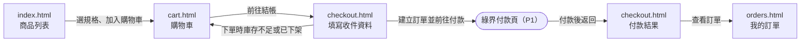

# UI 規劃：購物車與結帳

**Spec**: [spec.md](../spec.md) | **Plan**: [plan.md](../plan.md) | **Date**: 2026-10-27

- 負責介面：F1 商品加入購物車介面、F2 購物車檢視與數量調整介面、F3 結帳與付款結果介面、F4 訂單查詢介面
- 雛形入口：[index.html](./index.html)

## 1. 畫面範疇

| 介面 | 畫面 | 需求依據 |
| ---- | ---- | -------- |
| F1 商品加入購物車介面 | 商品列表與規格選擇 | US1；FR-001 加入商品並選擇規格；FR-003 庫存不足時拒絕並提示；SC-001 加入購物車 1 秒內完成；Edge Cases 商品已下架、數量超過庫存 |
| F2 購物車檢視與數量調整介面 | 購物車 | US1；FR-002 調整數量與移除；FR-003 庫存不足時拒絕並提示；Edge Cases 商品已下架、數量超過庫存 |
| F3 結帳與付款結果介面 | 結帳與付款結果 | US2；FR-004 填寫收件資料並建立訂單；FR-005 導向綠界付款；FR-006 接收綠界付款結果並更新訂單；FR-007 付款完成後結帳頁即時顯示結果；Edge Cases 付款逾時 |
| F4 訂單查詢介面 | 我的訂單 | US3；FR-008 查看訂單明細與付款狀態 |

不在範疇：

- 會員登入與註冊：spec 沒有涵蓋，雛形假設顧客「林佳穎」已登入。
- 商品搜尋、分類篩選與獨立的商品詳情頁：FR-001 只要求加入商品並選擇規格，規格在商品列表的選擇面板中完成。
- 綠界付款頁：由綠界（P1）提供，雛形以「正在前往綠界付款頁」過場代替。
- 運費、優惠券與退貨：spec 沒有涵蓋，訂單金額只計商品小計。

## 2. 視覺風格

依 clarify 確認的結果：

- 氣質：明亮簡潔的生活選物店，留白多、資訊直接，像小型獨立品牌的網店。
- 配色：

  | 用途 | 色碼 |
  | ---- | ---- |
  | 背景 | `#F7F4EE` 米白 |
  | 卡片 | `#FFFFFF` |
  | 主色（主要按鈕、目前頁面、品牌字） | `#2F5D50` 墨綠 |
  | 文字 | `#23302B` |
  | 次要文字 | `#6B7570` |
  | 錯誤 | `#B4442F` |
  | 等待中 | `#9A6A14` |
  | 成功 | `#2F7D4F` |

- 字體：系統中文字體（PingFang TC、Noto Sans TC、微軟正黑體），金額使用等寬數字。
- 版面：內容最大寬度 1080px，手機寬度 360px 仍可完整操作；卡片圓角 12px；主要按鈕為墨綠實心膠囊形；商品圖以線條圖示加淺色底塊表示。

## 3. 畫面與流程

### 3.1 頁面清單

| 檔案 | 畫面 | 介面 | 進入方式 |
| ---- | ---- | ---- | -------- |
| `index.html` | 商品列表與規格選擇 | F1 | 雛形入口；頁首「商品」 |
| `cart.html` | 購物車 | F2 | 頁首「購物車」；加入成功提示的「查看購物車」 |
| `checkout.html` | 結帳與付款結果 | F3 | 購物車的「前往結帳」 |
| `orders.html` | 我的訂單 | F4 | 頁首「我的訂單」；付款結果的「查看訂單」 |

### 3.2 流程

### 3.3 使用者操作

| 編號 | 畫面 | 操作 | 需求依據 |
| ---- | ---- | ---- | -------- |
| A1 | `index.html` | 開啟商品的規格選擇面板，選擇規格與數量 | FR-001 |
| A2 | `index.html` | 加入購物車，成功後頁首購物車數量立即更新 | FR-001、FR-003、SC-001 |
| A3 | `cart.html` | 以「−」「＋」調整項目數量，數量最小為 1 | FR-002、FR-003 |
| A4 | `cart.html` | 移除項目 | FR-002 |
| A5 | `checkout.html` | 填寫收件人姓名、手機號碼與收件地址 | FR-004 |
| A6 | `checkout.html` | 建立訂單並前往綠界付款 | FR-004、FR-005 |
| A7 | `checkout.html` | 停留在付款結果畫面，等待付款結果自動更新 | FR-006、FR-007 |
| A8 | `orders.html` | 查看訂單列表，展開單筆訂單的明細與付款紀錄 | FR-008 |

## 4. 狀態

每個雛形頁面右下角的「雛形狀態」面板可切換本節列出的該頁狀態。

| 畫面 | 狀態 | 呈現方式 | 需求依據 |
| ---- | ---- | -------- | -------- |
| `index.html` | 載入中 | 4 張商品卡以灰色骨架顯示 | SC-001 |
| `index.html` | 商品列表 | 4 件商品；「手沖咖啡濾杯組」已下架，卡片轉灰並標示「已下架」 | FR-001；Edge Cases 商品已下架 |
| `index.html` | 選擇規格中 | 規格選擇面板開啟，已選「亞麻短袖襯衫（黑色 / M）」，顯示「庫存剩 2 件」 | FR-001 |
| `index.html` | 加入中 | 「加入購物車」按鈕改為「加入中…」並停用 | SC-001 |
| `index.html` | 加入成功 | 面板關閉，底部提示「已加入購物車」與「查看購物車」，頁首購物車數量加 1 | FR-001 |
| `cart.html` | 載入中 | 購物車項目以灰色骨架顯示 | FR-002 |
| `cart.html` | 有商品 | 3 個項目、共 4 件、合計 NT$3,010 | FR-002 |
| `cart.html` | 更新中 | 調整數量的那一列停用「−」「＋」，數量改為轉圈 | FR-002 |
| `cart.html` | 購物車是空的 | 顯示「購物車是空的」與「去逛逛」，不顯示結帳區 | FR-002 |
| `checkout.html` | 填寫收件資料 | 左側收件資料表單，右側訂單摘要（3 個項目、合計 NT$3,010） | FR-004 |
| `checkout.html` | 建立訂單中 | 送出按鈕改為「建立訂單中…」並停用，表單欄位停用 | FR-004 |
| `checkout.html` | 前往綠界付款頁 | 全頁過場「正在前往綠界付款頁…」 | FR-005 |
| `checkout.html` | 等待付款結果 | 結果卡顯示轉圈與「付款結果確認中」，提示結果會自動更新、請勿關閉此頁 | FR-006、FR-007 |
| `checkout.html` | 付款成功 | 結果卡顯示「付款成功」、訂單編號 SC20261027A0042、付款金額與付款方式 | FR-006、FR-007 |
| `orders.html` | 載入中 | 訂單卡以灰色骨架顯示 | FR-008 |
| `orders.html` | 有訂單 | 4 筆訂單由新到舊排列，各自標示「已付款」「待付款」「付款失敗」「已逾時」 | FR-008 |
| `orders.html` | 沒有訂單 | 顯示「還沒有訂單」與「去逛逛」 | FR-008 |

## 5. 驗證與錯誤回饋

錯誤狀態同樣可從「雛形狀態」面板切換；同一畫面的多個欄位驗證錯誤合併為一個狀態「欄位驗證錯誤」。

| 畫面 | 情境 | 觸發條件 | 畫面回饋 | 需求依據 |
| ---- | ---- | -------- | -------- | -------- |
| `index.html` | 未選規格 | 開啟規格選擇面板後尚未選規格 | 「加入購物車」停用，按鈕上方顯示「請先選擇規格」 | FR-001 |
| `index.html` | 規格已售完 | 規格庫存為 0 | 規格選項停用並標示「已售完」 | FR-003 |
| `index.html` | 數量超過庫存 | 選擇的數量大於該規格庫存，例如「黑色 / M」選 3 件 | 數量欄下方顯示「黑色 / M 只剩 2 件」，「加入購物車」停用 | FR-003；Edge Cases 數量超過庫存 |
| `index.html` | 商品已下架 | 列表中的商品已下架 | 卡片轉灰、標示「已下架」，按鈕停用 | Edge Cases 商品已下架 |
| `index.html` | 加入時商品剛下架 | 開啟面板後商品被下架，按下加入時被拒絕 | 面板內顯示錯誤「這件商品剛剛下架了，無法加入購物車」，商品卡改為已下架 | FR-003；Edge Cases 商品已下架 |
| `cart.html` | 數量超過庫存 | 按「＋」後數量大於庫存，例如「亞麻短袖襯衫（黑色 / M）」調到 3 件 | 數量維持原值，該列下方顯示「庫存只剩 2 件」 | FR-003；Edge Cases 數量超過庫存 |
| `cart.html` | 購物車中有已下架商品 | 加入後商品被下架，例如「帆布托特包（墨綠 / 單一尺寸）」 | 該列轉灰並標示「已下架」，頁頂提示「請先移除已下架的商品」，「前往結帳」停用；移除後恢復 | Edge Cases 商品已下架 |
| `checkout.html` | 收件人姓名空白 | 送出時姓名為空 | 欄位紅框與「請填寫收件人姓名」，焦點移到第一個錯誤欄位 | FR-004 |
| `checkout.html` | 手機號碼格式錯誤 | 去掉「-」與空白後不是 09 開頭的 10 碼數字 | 欄位紅框與「請輸入 09 開頭的 10 碼手機號碼」 | FR-004 |
| `checkout.html` | 收件地址空白 | 送出時地址為空 | 欄位紅框與「請填寫收件地址」 | FR-004 |
| `checkout.html` | 下單時庫存不足 | 建立訂單時「陶瓷馬克杯 350ml（灰藍）」只剩 1 件 | 頁頂錯誤提示「庫存只剩 1 件，訂單沒有建立」與「回購物車」 | FR-003；Edge Cases 數量超過庫存 |
| `checkout.html` | 下單時商品已下架 | 建立訂單時「帆布托特包（墨綠 / 單一尺寸）」已下架 | 頁頂錯誤提示「已下架，訂單沒有建立」與「回購物車」 | Edge Cases 商品已下架 |
| `checkout.html` | 購物車為空 | 直接開啟結帳頁但購物車沒有商品 | 不顯示表單，改顯示「購物車是空的，無法結帳」與「去逛逛」 | FR-004 |
| `checkout.html` | 付款失敗 | 綠界回傳付款失敗 | 結果卡顯示「付款未完成」與綠界回傳原因「信用卡授權失敗」，說明未扣款 | FR-006、FR-007 |
| `checkout.html` | 付款逾時 | 超過付款期限仍未付款 | 結果卡顯示「已超過付款期限」，說明訂單已取消、不會扣款 | FR-007；Edge Cases 付款逾時 |
